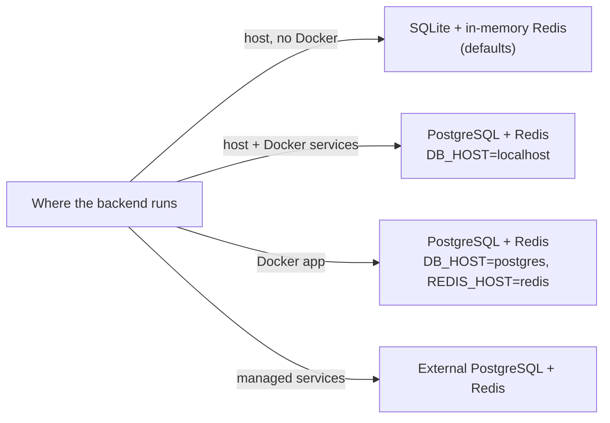

# Database & Redis

The backend runs on SQLite with an in-memory Redis for local development, and on PostgreSQL with real Redis in Docker or production. Both are selected by environment variables.

## Choosing a database



| Runtime                             | `DB_DRIVER`          | `DB_NAME`                                 | `DB_HOST`   |
| ----------------------------------- | -------------------- | ----------------------------------------- | ----------- |
| Local SQLite (development default)  | `sqlite+aiosqlite`   | `template.db` (file)                      | Ignored     |
| Host backend with Docker PostgreSQL | `postgresql+asyncpg` | `template` (database)                     | `localhost` |
| Docker app with Docker PostgreSQL   | `postgresql+asyncpg` | `template` (database)                     | `postgres`  |
| Docker app with SQLite              | `sqlite+aiosqlite`   | `/var/lib/b4fastapi/database/template.db` | Ignored     |

:::warning[Switching engines]

Change `DB_DRIVER` and `DB_NAME` together. `env-sync` keeps existing values, so a leftover `template.db` produces `database "template.db" does not exist` on PostgreSQL.

:::

- The local PostgreSQL container creates its user, password, and database from `DB_USER`, `DB_PASSWORD`, and `DB_NAME` only when its volume is new. Changing `.env` later does not change an existing password; change it in the database instead of deleting the volume.
- Set a real `DB_PASSWORD` for deployments. Enter raw passwords; the backend URL-encodes them. Production preflight rejects an empty, `postgres`, or `CHANGE_ME` password.
- Docker SQLite lives in the `sqlite_data` volume, shared by the app and the mail worker, so it survives container recreation. Deploy commands reject a relative path or one outside `/var/lib/b4fastapi/database`. To move an existing SQLite file into the volume, stop writes, back it up with SQLite's backup facility, import it, and verify the Alembic revision before reopening traffic.

## Migrations

The app runs `alembic upgrade head` on startup and logs `Database schema migration check complete (target=head).` To inspect or apply migrations without starting the server:

```bash
make db-current   # show the configured database's revision
make db-migrate   # apply all pending migrations
```

When you change models:

```bash
cd src/backend
uv run alembic revision --autogenerate -m "describe-schema-change"
# review the generated script
uv run alembic upgrade head
uv run alembic downgrade -1   # confirm the downgrade path
```

| Rule                           | Detail                                                                  |
| ------------------------------ | ----------------------------------------------------------------------- |
| Revision IDs                   | `NNNN_snake_case`, at most 32 characters                                |
| Data migrations                | Idempotent                                                              |
| Shared and production failures | Roll forward, do not downgrade (`src/backend/MIGRATION_ROLLFORWARD.md`) |

## Backup and restore

PostgreSQL in Docker (run from the repository root):

```bash
mkdir -p docker/artifacts/db-backups
docker compose -f docker/docker-compose.yml --env-file docker/.env exec -T postgres \
  sh -c 'pg_dump -U "$POSTGRES_USER" -d "$POSTGRES_DB" -Fc' > docker/artifacts/db-backups/template-$(date +%Y%m%d-%H%M%S).dump

docker compose -f docker/docker-compose.yml --env-file docker/.env exec -T postgres \
  sh -c 'pg_restore -U "$POSTGRES_USER" -d "$POSTGRES_DB" --clean --if-exists --no-owner --no-privileges' < docker/artifacts/db-backups/<file>.dump
```

`-T` disables TTY allocation so the binary dump is not corrupted, and Compose service names replace fixed container names. SQLite: use SQLite's backup facility on `src/backend/template.db`, or on the file in the `sqlite_data` volume for Docker. An image archive is not a data backup.

After a restore, run `uv run alembic upgrade head` and the smoke tests (`uv run pytest tests/test_smoke.py`). Keep production backups encrypted, and test restores regularly. See `src/backend/DB_BACKUP_RESTORE.md` for external PostgreSQL.

## Redis

Redis backs login lockout, deletion and verification codes, realtime pub/sub, and the Celery broker. The API sends a `PING` with a five-second timeout at startup; an unreachable Redis aborts startup.

| Mode            | Settings                                                                   | Use                                                     |
| --------------- | -------------------------------------------------------------------------- | ------------------------------------------------------- |
| In-memory       | `REDIS_IN_MEMORY=true`                                                     | Local development without a server; single process only |
| Local container | `REDIS_IN_MEMORY=false`, `REDIS_HOST=redis` (Docker) or `localhost` (host) | Docker Compose                                          |
| External        | `REDIS_IN_MEMORY=false`, `REDIS_HOST=<host>`                               | Managed Redis                                           |

- A non-empty `REDIS_PASSWORD` enables authentication on the local container, the app, and its healthcheck. Set one for deployments.
- Celery always needs a real Redis, even when the API runs in-memory. See [Background jobs](/docs/features/background-jobs).

## Health checks

| Endpoint            | Checks                                                                |
| ------------------- | --------------------------------------------------------------------- |
| `GET /health/live`  | The process is running                                                |
| `GET /health/ready` | Database and Redis are reachable (used by Docker and the desktop app) |
