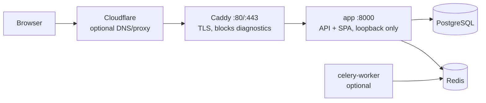
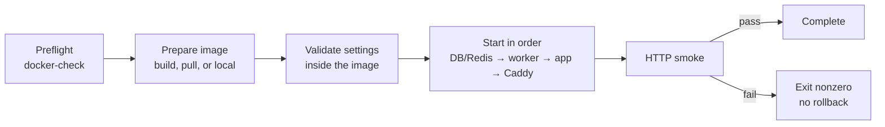

# Server deployment

B4FastAPI deploys as a monolith: one app container serves `/api/v1`, `/config`, and the packaged B4React SPA. There is no separate frontend server. PostgreSQL, Redis, and optional workers run privately beside it, or the app connects to existing external services.

|                  |                                                                                      |
| ---------------- | ------------------------------------------------------------------------------------ |
| **Host**         | Linux with Docker Engine and the Compose plugin, Python 3, Git, and Make             |
| **Environment**  | `docker/.env`, or another file selected with `DOCKER_ENV_FILE`                       |
| **Commands**     | `make docker-init`, `docker-check`, `docker-deploy`, `docker-status`, `docker-smoke` |
| **Public entry** | Caddy HTTPS overlay at the root, or an operator-owned Nginx under a basePath         |

Node, uv, and the Python dependencies are installed inside the Docker build. Compose must support `up --wait --wait-timeout` and `run --pull never`.

## Topology



- Open only TCP 80 and 443 to the Internet. Keep the app port 8000, PostgreSQL 5432, Redis 6379, and the observability ports private.
- Build or pull an image for the server's CPU architecture (for example arm64 or amd64 on AWS EC2).
- With Cloudflare, start in DNS-only mode until the origin certificate is issued, then optionally enable the proxy with **Full (strict)**. Do not cache `/api/*`, `/config`, `/health/*`, authenticated pages, or SSE.

## Initialize

```bash
git clone --recurse-submodules https://github.com/Blueprint4Agent/B4FastAPI.git
cd B4FastAPI
make docker-init PUBLIC_DOMAIN=app.example.com
```

`docker-init` creates a **new** `docker/.env` with mode `0600` and random signing, database, and Redis credentials. It never prints credentials and refuses to overwrite an existing file. With `PUBLIC_DOMAIN`, it also aligns `APP_BASE_URL`, `CORS_ORIGINS`, and the public sharing origin to `https://<domain>` and persists `COMPOSE_FILE=docker-compose.yml:docker-compose.https.yml`.

Review the file before the first deployment:

- Keep `APP_MODE=production` and `LOGIN_ENABLED=true`.
- Set a stable `COMPOSE_PROJECT_NAME` **before creating data**. It selects networks and volumes, so never change it to perform an update.
- Set `APP_IMAGE` to an explicit release tag or registry digest, and keep the previous reference for recovery.
- Email, OAuth, Stripe, and remote object storage stay off until their provider settings are configured.

For an existing installation, do not regenerate keys; edit the required values explicitly. To use another environment file, pass `DOCKER_ENV_FILE=/absolute/path/production.env` to every Docker command. Shell variables override Compose interpolation, so clear stale `COMPOSE_FILE`, `PUBLIC_DOMAIN`, or `APP_IMAGE` exports when switching deployments.

## Check and deploy \{#check-and-deploy\}

```bash
make docker-check
make docker-deploy
make docker-status
```



**Preflight** (`docker-check`) resolves the Compose configuration without printing it and confirms Docker daemon access. It does not contact external providers or prove DNS and certificate issuance. In production it rejects:

| Check         | Requirement                                                                                                             |
| ------------- | ----------------------------------------------------------------------------------------------------------------------- |
| Login         | `LOGIN_ENABLED=true`                                                                                                    |
| Signing key   | See [Production signing key](/docs/environment/runtime-modes#production-signing-key)                                    |
| PostgreSQL    | `DB_PASSWORD` is not empty, `postgres`, or `CHANGE_ME`                                                                  |
| Local Redis   | `REDIS_PASSWORD` is set                                                                                                 |
| SQLite        | `DB_NAME` is an absolute path inside `/var/lib/b4fastapi/database`                                                      |
| HTTPS overlay | `PUBLIC_DOMAIN` is a bare hostname; `APP_BASE_URL`, `CORS_ORIGINS`, and `VITE_PUBLIC_SITE_URL` match `https://<domain>` |
| basePath      | `APP_BASE_URL` ends with `APP_BASE_PATH`, and the Caddy overlay is not selected                                         |

**Deploy** then prepares the image, validates the application settings inside it, and starts each selected stage with `--wait`: local PostgreSQL and Redis (never recreated), the mail worker when login and email are enabled, the API, and Caddy when selected. The app, worker, and proxy are recreated, so this single-instance topology can briefly drop traffic. Do not run two deployments of the same project at once.

**Smoke** checks run against the public HTTPS origin with normal certificate verification, or against the loopback app port without the overlay:

- `/health/ready` and the expected `app_mode` in `/config`
- The SPA HTML and one built JavaScript asset
- With Caddy: `/metrics`, `/docs`, and the OpenAPI schema return 404

Each stage and the HTTP retry window wait 120 seconds by default (`HEALTH_TIMEOUT_SECONDS`). A failure exits nonzero, never reports success, and never rolls back migrations. No image archive is written.

### Image source

| `DEPLOY_SOURCE`   | Image                                               |
| ----------------- | --------------------------------------------------- |
| `build` (default) | Built from this checkout and its pinned frontend    |
| `pull`            | `APP_IMAGE` pulled from the registry (log in first) |
| `local`           | An image already built or loaded on this host       |

A pulled or local image keeps the public frontend build values it was built with. `make docker-build` builds and validates without a rollout, `make docker-up` starts services without forced recreation or the HTTP smoke, and `make docker-export` writes an archive only for deliberate offline transfer.

## HTTPS with Caddy \{#https\}

`docker/docker-compose.https.yml` adds a `caddy` service on ports 80 and 443 with persistent `caddy_data` and `caddy_config` volumes.

- Caddy obtains and renews the TLS certificate for `PUBLIC_DOMAIN`.
- `/metrics`, `/docs`, `/redoc`, and `/openapi.json` return 404 publicly. Prometheus can still scrape `app:8000` on the private network.
- Responses stream without buffering, so SSE works through the proxy.
- The app trusts forwarded headers from the private Compose network, so OAuth redirects keep HTTPS. Attach only trusted services to that network.

Update enabled OAuth callbacks and Stripe return and webhook URLs to the HTTPS origin, and set `SWAGGER_ENABLED=false` when API docs are not needed.

## basePath under Nginx \{#base-path\}

The same image can be mounted under a URL prefix, so several independent apps share one hostname behind an operator-owned Nginx.

```dotenv
APP_BASE_PATH=/my-app
APP_BASE_URL=https://example.com/my-app
CORS_ORIGINS=https://example.com
VITE_PUBLIC_SITE_URL=https://example.com
APP_HOST_PORT=8001
COMPOSE_PROJECT_NAME=my-app
COMPOSE_FILE=docker-compose.yml
```

- `APP_BASE_PATH` is runtime-only. FastAPI writes the base path into the served HTML before JavaScript runs and relocates generated sharing and discovery URLs, so one built image runs at any prefix. Changing the prefix means editing the environment and the Nginx fragment, then `DEPLOY_SOURCE=local make docker-deploy`. `docker restart` does not reload Compose environment files.
- Paths use ASCII letters, digits, `_`, `-`, and single `/` separators; nested paths work and a trailing slash is removed. Empty or `/` is the root. `CORS_ORIGINS` and `VITE_PUBLIC_SITE_URL` stay origins without paths.
- Render `docker/nginx/app-location.conf.template` once per app with `envsubst '${APP_BASE_PATH} ${APP_UPSTREAM}'` and include it in the existing HTTPS `server` block. Its `proxy_pass` strips the prefix, so `/my-app/api/v1/...` reaches the app as `/api/v1/...`; do not also set Uvicorn `--root-path`. The fragment streams SSE and keeps docs and metrics private.
- Set `FORWARDED_ALLOW_IPS` to the actual private proxy IP or CIDR (default `127.0.0.1`), never `*` on a reachable upstream.
- Refresh cookies are scoped to `<basePath>/`, and browser storage keys include the path. Changing the prefix requires signing in again. Paths on one origin are not a security boundary, so give each app its own secrets and data stores.
- Register OAuth callbacks and Stripe URLs with the prefix, for example `https://example.com/my-app/api/v1/auth/oauth/google/callback`. Email links follow `APP_BASE_URL`.
- `/robots.txt` and IndexNow are origin-wide; the gateway owner aggregates them at the domain root.

`make base-path-deployment-test` builds one disposable image, runs it at two prefixes behind a real Nginx, and checks routing, reloads, assets, SSE, and session isolation. It requires Docker, the frontend dependencies, and Playwright Chromium, and never touches existing stacks.

## Public build values \{#public-build-values\}

Some values are compiled into the frontend. They are public, not secrets, and changing them requires a rebuild (`make docker-deploy` with the default `build` source, or new inputs to the manual Build workflow).

| Variable                | Effect                                                                                                   |
| ----------------------- | -------------------------------------------------------------------------------------------------------- |
| `VITE_PUBLIC_SITE_URL`  | HTTP(S) origin for Open Graph and Twitter tags; empty omits URL and image tags                           |
| `VITE_SITE_DESCRIPTION` | Description in the static HTML                                                                           |
| `VITE_PUBLIC_DISCOVERY` | Publishes the static B4A introductions at `/about/` and `/about/ko/` with `robots.txt` and `sitemap.xml` |
| `VITE_INDEXNOW_KEY`     | Public IndexNow ownership proof served at `/<key>.txt`                                                   |

With discovery on, app pages are `noindex`, only the introduction URLs enter the sitemap, and `robots.txt` allows search crawlers while blocking GPTBot and ClaudeBot. Discovery requires the default B4A identity and a public origin; custom projects publish their own content instead. Missing `/about/` pages and static files return 404 rather than the SPA.

With `INDEXNOW_ENABLED=true`, a successful `make docker-deploy` compares the deployed discovery manifest with `docker/.indexnow/accepted.json` and submits only added, changed, or deleted public URLs. A submission failure fails the command but does not roll back healthy containers. `python3 scripts/indexnow.py --origin <origin> --key <key>` shows a dry run.

## Update and recover

```bash
make docker-status
make docker-smoke
make docker-logs DOCKER_SERVICE=app
make docker-logs DOCKER_SERVICE=caddy
```

1. Record the deployed image identity with `docker-status`, and back up the database and private object data. An image archive is not a data backup.
2. Update the checkout and run `git submodule update --init --recursive`. Review migrations.
3. Deploy the new explicit image tag with the same environment and project, run `docker-smoke`, then check login, refresh, configured provider callbacks, and SSE in a browser.

If a rollout fails, data and infrastructure are kept, but the previous API may already be replaced. Redeploy a known previous `APP_IMAGE` with `DEPLOY_SOURCE=pull` or `local` after confirming schema compatibility; for an incompatible migration, restore from backup with writes stopped. `make docker-down` keeps named volumes. Never use `down -v`, volume pruning, or a project rename as an update step.

Celery Beat and the observability stack stay opt-in; update them explicitly with the same release when you run them.

See `notes/monolithic-deployment.md` and `notes/base-path-deployment.md` in B4FastAPI for the full runbooks, and [Docker](/docs/environment/docker) for services and volumes.
