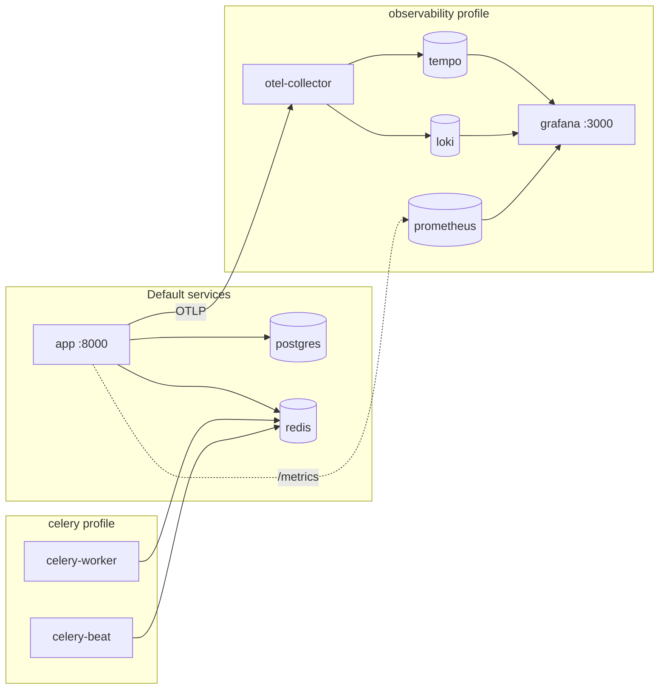
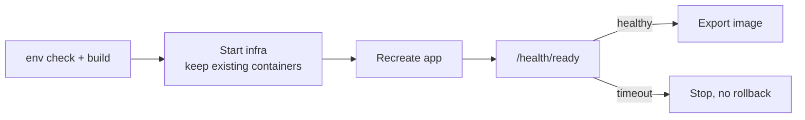

# Docker

One app image serves the API and the packaged B4React frontend. Docker Compose adds PostgreSQL, Redis, optional Celery processes, and the observability stack.

## Services



| Service          | Image                                           | Starts with                                                       | Purpose                                               |
| ---------------- | ----------------------------------------------- | ----------------------------------------------------------------- | ----------------------------------------------------- |
| `app`            | `APP_IMAGE` (default `blueprint4fastapi:local`) | `make docker-up`                                                  | FastAPI API and SPA                                   |
| `postgres`       | `postgres:16-alpine`                            | `docker-up` when `DB_HOST=postgres`                               | Database                                              |
| `redis`          | `redis:7-alpine`                                | `docker-up` when `REDIS_HOST=redis`                               | Cache, pub/sub, Celery broker                         |
| `celery-worker`  | App image                                       | `celery` profile, or `docker-up` when login and email are enabled | Background tasks (prefork, 2 processes)               |
| `celery-beat`    | App image                                       | `make docker-celery-up`                                           | Scheduler (exactly one)                               |
| `otel-collector` | `otel/opentelemetry-collector-contrib:0.114.0`  | `observability` profile                                           | Receives OTLP traces and logs                         |
| `tempo`          | `grafana/tempo:2.6.1`                           | `observability` profile                                           | Trace storage                                         |
| `loki`           | `grafana/loki:3.6.0`                            | `observability` profile                                           | Log storage (7-day retention)                         |
| `loki-init`      | `busybox:1.37.0`                                | `observability` profile                                           | One-shot volume ownership fix; `Exited (0)` is normal |
| `prometheus`     | `prom/prometheus:v2.55.1`                       | `observability` profile                                           | Metrics                                               |
| `grafana`        | `grafana/grafana:11.3.1`                        | `observability` profile                                           | Dashboards and Explore                                |

## Deployment modes

Choose a mode in `docker/.env`:

| Mode                 | Database            | Redis          | Key settings                                                                |
| -------------------- | ------------------- | -------------- | --------------------------------------------------------------------------- |
| A. Local containers  | Local PostgreSQL    | Local Redis    | `DB_HOST=postgres`, `REDIS_IN_MEMORY=false`, `REDIS_HOST=redis`             |
| B. External services | External PostgreSQL | External Redis | `DB_HOST=<host>`, `DB_NAME=<existing db>`, `REDIS_HOST=<host>`              |
| C. Single container  | SQLite              | In-memory      | `DB_DRIVER=sqlite+aiosqlite`, `DB_NAME=template.db`, `REDIS_IN_MEMORY=true` |

`make docker-up` reads the resolved app environment and starts only the infrastructure the mode needs.

## Deploy



```bash
make init                 # once: creates docker/.env
make docker-build         # build the app image
make docker-up            # start infrastructure, then the app; waits for /health/ready
make docker-logs DOCKER_SERVICE=app
make docker-down
```

For updates, use the one-shot deploy:

```bash
make docker-deploy
```

It checks `docker/.env` keys, builds the image, recreates only the app, waits for readiness, and exports the image to `docker/artifacts/`. A readiness failure stops the deploy before export; there is no automatic rollback.

- Existing PostgreSQL and Redis containers are preserved (`--no-recreate`). Recreate one explicitly after changing its configuration:

    ```bash
    docker compose -f docker/docker-compose.yml --env-file docker/.env up -d --no-deps --force-recreate postgres
    ```

- Each startup stage waits up to 120 seconds; override with `HEALTH_TIMEOUT_SECONDS`.
- Requires `uv` and a Docker Compose version that supports `up --wait --wait-timeout`.

After deploying, check `http://localhost:8000/health/ready` and look for `Database schema migration check complete (target=head).` in the app logs.

## Host ports and multiple stacks

| Setting                                       | Default     | Bound to       |
| --------------------------------------------- | ----------- | -------------- |
| `APP_HOST_PORT`                               | 8000        | All interfaces |
| `POSTGRES_HOST_PORT`                          | 5432        | `127.0.0.1`    |
| `REDIS_HOST_PORT`                             | 6379        | `127.0.0.1`    |
| `GRAFANA_HOST_PORT`                           | 3000        | `127.0.0.1`    |
| `PROMETHEUS_HOST_PORT`                        | 9090        | `127.0.0.1`    |
| `OTEL_GRPC_HOST_PORT` / `OTEL_HTTP_HOST_PORT` | 4317 / 4318 | `127.0.0.1`    |

To run a second stack on the same host, set a unique `COMPOSE_PROJECT_NAME`, unused host ports, and a distinct `APP_IMAGE` tag. A new project name creates new volumes; it does not migrate data. Keep `docker` for the original installation.

## Image pipeline

`.github/workflows/build.yml` runs backend and frontend checks, and builds the image from `docker/Dockerfile` only when publishing:

| Trigger                     | Checks | Publishes to `ghcr.io/<owner>/<repo>` |
| --------------------------- | ------ | ------------------------------------- |
| Pull request to `main`      | Yes    | No                                    |
| Nightly (00:00 KST)         | Yes    | `nightly-main`                        |
| Manual dispatch             | Yes    | Only with `publish_image=true`        |
| Release published, `v*` tag | Yes    | Yes                                   |

Merges to `main` do not build an image automatically.
