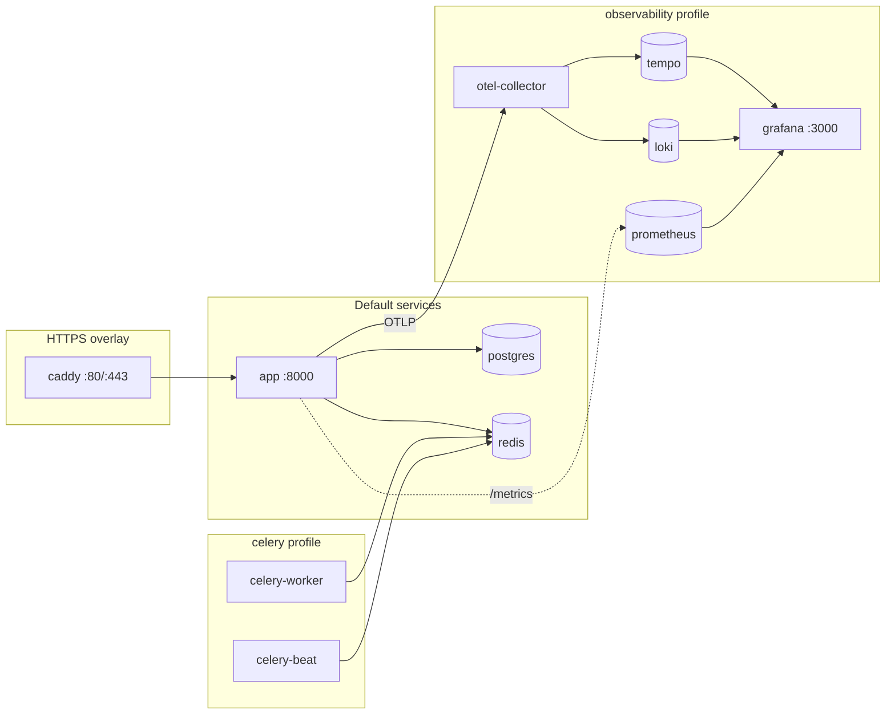

# Docker

One app image serves the API and the packaged B4React frontend. Docker Compose adds PostgreSQL, Redis, optional Celery processes, an optional Caddy HTTPS proxy, and the observability stack. For the production rollout, see [Server deployment](/docs/environment/deployment).

## Services



| Service          | Image                                           | Starts with                                                       | Purpose                                               |
| ---------------- | ----------------------------------------------- | ----------------------------------------------------------------- | ----------------------------------------------------- |
| `app`            | `APP_IMAGE` (default `blueprint4fastapi:local`) | `make docker-up`                                                  | FastAPI API and SPA                                   |
| `postgres`       | `postgres:16-alpine`                            | `docker-up` when `DB_HOST=postgres`                               | Database                                              |
| `redis`          | `redis:7-alpine`                                | `docker-up` when `REDIS_HOST=redis`                               | Cache, pub/sub, Celery broker                         |
| `celery-worker`  | App image                                       | `celery` profile, or `docker-up` when login and email are enabled | Background tasks (prefork, 2 processes)               |
| `celery-beat`    | App image                                       | `make docker-celery-up`                                           | Outbox and billing schedules (exactly one)            |
| `caddy`          | `caddy:2.11.7-alpine` (pinned digest)           | `docker-compose.https.yml` in `COMPOSE_FILE`                      | Public HTTPS, TLS certificates, diagnostics blocked   |
| `otel-collector` | `otel/opentelemetry-collector-contrib:0.114.0`  | `observability` profile                                           | Receives OTLP traces and logs                         |
| `tempo`          | `grafana/tempo:2.6.1`                           | `observability` profile                                           | Trace storage                                         |
| `loki`           | `grafana/loki:3.6.0`                            | `observability` profile                                           | Log storage (7-day retention)                         |
| `loki-init`      | `busybox:1.37.0`                                | `observability` profile                                           | One-shot volume ownership fix; `Exited (0)` is normal |
| `prometheus`     | `prom/prometheus:v2.55.1`                       | `observability` profile                                           | Metrics                                               |
| `grafana`        | `grafana/grafana:11.3.1`                        | `observability` profile                                           | Dashboards and Explore                                |

## Container security

- The app, worker, and Beat run as UID/GID `10001:10001` with all Linux capabilities dropped and `no-new-privileges`.
- New named volumes inherit the image's writable directory ownership. Existing root-owned object storage, SQLite, and Beat volumes must be backed up and migrated to UID/GID 10001 before upgrading; ownership is never changed automatically.
- The app port is published on `127.0.0.1` only. Public traffic goes through the [Caddy overlay](/docs/environment/deployment#https) or an operator-owned proxy.

## Deployment modes

Choose a mode in `docker/.env`:

| Mode                 | Database            | Redis          | Key settings                                                                                            |
| -------------------- | ------------------- | -------------- | ------------------------------------------------------------------------------------------------------- |
| A. Local containers  | Local PostgreSQL    | Local Redis    | `DB_HOST=postgres`, `REDIS_IN_MEMORY=false`, `REDIS_HOST=redis`                                         |
| B. External services | External PostgreSQL | External Redis | `DB_HOST=<host>`, `DB_NAME=<existing db>`, `REDIS_HOST=<host>`                                          |
| C. Single container  | SQLite              | In-memory      | `DB_DRIVER=sqlite+aiosqlite`, `DB_NAME=/var/lib/b4fastapi/database/template.db`, `REDIS_IN_MEMORY=true` |

Docker commands read the resolved app environment and start only the infrastructure the mode needs. In mode C the SQLite file lives in the `sqlite_data` volume, and preflight rejects relative paths, paths outside `/var/lib/b4fastapi/database`, and `..` segments. In-memory Redis is not durable and is not shared between API processes.

## Commands

| Command              | What it does                                                                                       |
| -------------------- | -------------------------------------------------------------------------------------------------- |
| `make init`          | Creates `docker/.env` from the example for local use                                               |
| `make docker-init`   | Creates a new private production `docker/.env` with random credentials; `PUBLIC_DOMAIN` adds HTTPS |
| `make docker-check`  | Preflight of the resolved settings, without printing secrets                                       |
| `make docker-build`  | Preflight, build, and validate the image without a rollout                                         |
| `make docker-up`     | Start the selected services from the existing image and wait for readiness                         |
| `make docker-deploy` | Preflight, prepare the image (`DEPLOY_SOURCE`), recreate services, and run the HTTP smoke          |
| `make docker-status` | Show containers and image identities                                                               |
| `make docker-smoke`  | Check readiness, runtime config, the SPA, and public proxy boundaries                              |
| `make docker-logs`   | Follow the last 100 lines of `DOCKER_SERVICE` (default `app`)                                      |
| `make docker-down`   | Stop the project and keep named volumes                                                            |
| `make docker-export` | Write an image archive to `docker/artifacts/` for offline transfer                                 |

Every command uses the same environment file (`DOCKER_ENV_FILE`, default `docker/.env`) and the overlay list in its `COMPOSE_FILE`. They run through a Python standard-library entrypoint, so the host needs no uv. See [Check and deploy](/docs/environment/deployment#check-and-deploy) for the stages and smoke checks.

- Existing PostgreSQL and Redis containers are never recreated by a deploy. Recreate one explicitly after changing its configuration:

    ```bash
    docker compose -f docker/docker-compose.yml --env-file docker/.env up -d --no-deps --force-recreate postgres
    ```

- Each startup stage waits up to 120 seconds; override with `HEALTH_TIMEOUT_SECONDS`.

After deploying, check `/health/live`, `/health/ready`, and `/config`, and look for `Database schema migration check complete (target=head).` in the app logs.

## Host ports and multiple stacks

| Setting                                       | Default     | Bound to    |
| --------------------------------------------- | ----------- | ----------- |
| `APP_HOST_PORT`                               | 8000        | `127.0.0.1` |
| `POSTGRES_HOST_PORT`                          | 5432        | `127.0.0.1` |
| `REDIS_HOST_PORT`                             | 6379        | `127.0.0.1` |
| `GRAFANA_HOST_PORT`                           | 3000        | `127.0.0.1` |
| `PROMETHEUS_HOST_PORT`                        | 9090        | `127.0.0.1` |
| `OTEL_GRPC_HOST_PORT` / `OTEL_HTTP_HOST_PORT` | 4317 / 4318 | `127.0.0.1` |

To run a second stack on the same host, set a unique `COMPOSE_PROJECT_NAME`, unused host ports, and a distinct `APP_IMAGE` tag. A new project name creates new volumes; it does not migrate data. Keep `docker` for the original installation.

## Volumes

| Volume                       | Mounted in             | Holds                                                                                |
| ---------------------------- | ---------------------- | ------------------------------------------------------------------------------------ |
| `postgres_data`              | `postgres`             | Database                                                                             |
| `redis_data`                 | `redis`                | Redis data                                                                           |
| `object_storage_data`        | `app`, `celery-worker` | [Local object storage](/docs/features/object-storage) at `OBJECT_STORAGE_LOCAL_ROOT` |
| `sqlite_data`                | `app`, `celery-worker` | SQLite database at `/var/lib/b4fastapi/database`                                     |
| `celery_beat_data`           | `celery-beat`          | Beat schedule state                                                                  |
| `caddy_data`, `caddy_config` | `caddy`                | TLS certificates and proxy state                                                     |

The observability services keep their own volumes. Recreating containers keeps volumes; `docker compose down -v` deletes them. Back up the database and object storage together.

## Production settings

`docker/.env.example` selects `APP_MODE=production`, so login must stay enabled, developer UI is hidden, and the [signing key](/docs/environment/runtime-modes#production-signing-key) must be a unique random value. When billing or lifecycle email is enabled, also run `make docker-celery-up` so the worker and Beat process webhooks, the mail outbox, and reconciliation.

## Image pipeline

`.github/workflows/build.yml` runs only on manual dispatch (Actions → Run workflow, or `gh workflow run`). It runs backend and frontend checks for the selected ref, and builds and publishes the image from `docker/Dockerfile` only when requested:

| Input           | Effect                                                               |
| --------------- | -------------------------------------------------------------------- |
| `ref`           | Branch, tag, or SHA to build (defaults to `main` when publishing)    |
| `pr_number`     | Validate a pull request; takes priority over `ref`, does not publish |
| `publish_image` | Build and push the image to `ghcr.io/<owner>/<repo>`                 |

Public frontend inputs (`public_site_url`, `public_discovery`, `indexnow_key`, `coffee_enabled`, `coffee_url`) are passed to the frontend build as [public build values](/docs/environment/deployment#public-build-values).

Published tags are `manual-<ref>` (for example `manual-main`), `manual-pr-<number>` for a pull request, and the short commit SHA. No workflow runs automatically on pull requests, pushes, schedules, tags, or releases, and there are no nightly or release images.
