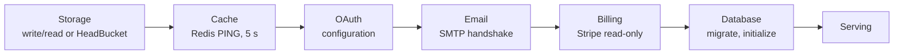

# Startup & console logs

The API prints a B4A banner and a live service panel while it starts, a cleanup panel when it stops, and compact, aligned request and application logs. Only the console presentation changes: file and OTLP handlers keep the original records.

|               |                                                     |
| ------------- | --------------------------------------------------- |
| **Setting**   | `STARTUP_DISPLAY=auto\|plain\|off` (default `auto`) |
| **Colors**    | Follow the terminal; `NO_COLOR=1` disables them     |
| **Hidden at** | `LOG_LEVEL=WARNING` or higher                       |

## Startup panel

The header shows **Mode** (Development or Production, from `APP_MODE`) and **Login** (Enabled, or Disabled with a bootstrap session). Each service row then updates in place:

```text
SERVICE     STACK             ENABLED  CHECK
Storage     Local             Yes      ✓ Verified
Cache       Redis             Yes      ✓ Verified
OAuth       Google · GitHub   Yes      ✓ Configured
Email       Gmail SMTP        Yes      ✓ Verified
Billing     Stripe · Test     No       — Not checked
Database    PostgreSQL        Yes      ✓ Ready
```



| Result          | Meaning                                                                                                    |
| --------------- | ---------------------------------------------------------------------------------------------------------- |
| Verified, Ready | The check connected successfully                                                                           |
| Configured      | Configuration is valid; no connection was attempted (OAuth, or SMTP with `SMTP_VALIDATE_ON_STARTUP=false`) |
| Not checked     | The integration is disabled                                                                                |
| Failed          | Startup aborts, acquired clients are closed, and later services show **Not run**                           |

Storage, cache, and database are required. Stack names come from settings (Local, Amazon S3, Cloudflare R2, Supabase; Gmail SMTP or SMTP; Stripe Test or Live; PostgreSQL or SQLite). The panel shows exception types only and never connection strings or provider responses. The same startup results appear on the admin [server status](/docs/features/admin-and-roles#server-status) page.

## Shutdown panel

On a normal stop, Database, Cache, and Storage change from Pending to Closing… to Closed, then `B4A · Bye!!` appears. This describes the API process closing its own clients, not stopping the database, Redis, or Celery. A startup failure, a failed cleanup, or a forced kill never prints the farewell.

## Display modes

| Value   | Behavior                                                                                                                        |
| ------- | ------------------------------------------------------------------------------------------------------------------------------- |
| `auto`  | Animated panels in interactive terminals at least 76 columns wide; static banner and final panels in Docker and redirected logs |
| `plain` | Line-oriented lifecycle records, for log ingestion                                                                              |
| `off`   | The original service and Uvicorn lifecycle logs                                                                                 |

Dumb or narrow terminals, and more than one Uvicorn worker (`--workers`, `WEB_CONCURRENCY`, `UVICORN_WORKERS`), use plain output automatically.

## Console log format

```text
19:22:15  GET     /api/v1/admin/status                                 200 OK
19:22:16  OPTIONS /api/v1/admin/status                                 400 Bad Request
```

- Local `HH:MM:SS` time, aligned method, path, and status columns. The client port, repeated `INFO` prefix, and HTTP version are omitted; full paths and query strings are kept.
- Successful `2xx` `OPTIONS` preflights are hidden on the console only. Failed preflights and every real request stay visible. `/metrics` scrapes are excluded from access logs.
- Application messages use the same time and an aligned level column. DEBUG and error lines add a `[source]` tag; `LOG_LEVEL=DEBUG` adds it everywhere. Request, trace, and task IDs and full tracebacks are preserved.
- Colors (256-color terminals): methods GET green, POST cyan, PUT yellow, PATCH magenta, DELETE red, HEAD blue, OPTIONS gray; gray timestamps and blue paths. Severity labels use a separate palette (INFO violet, WARNING orange, ERROR rose, CRITICAL white on burgundy) with softer message tints.
- Docker and file output contain no ANSI codes unless a terminal or color environment enables them.

See `notes/startup-display.md` in B4FastAPI for the full specification, and [Observability](/docs/environment/observability) for exported logs.
