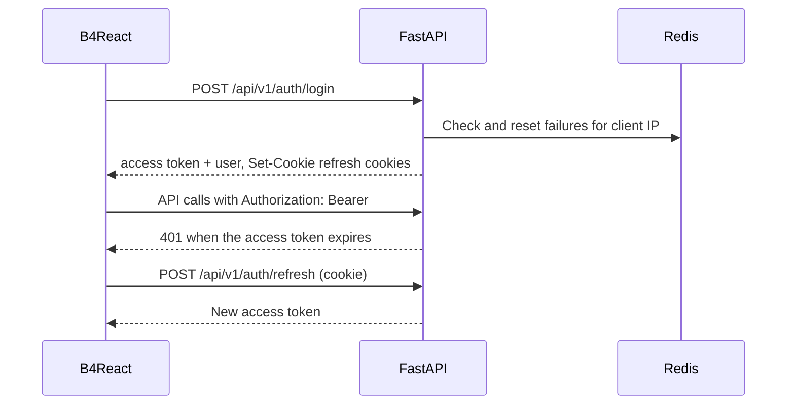
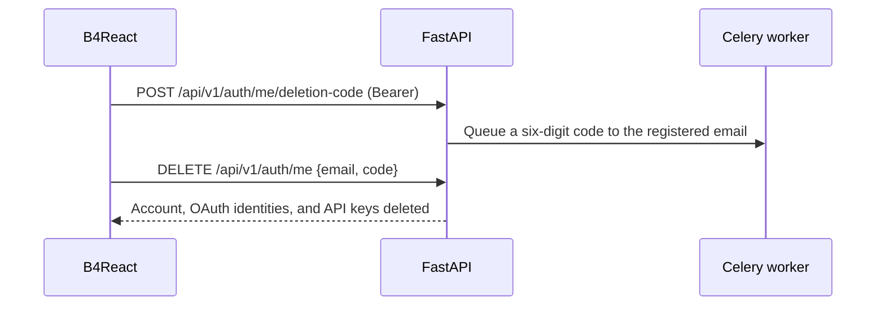

# Authentication

Email and password accounts with short-lived access tokens, a refresh cookie, login lockout, verified account deletion, and a login-disabled mode for single-user development tools.

|               |                                                                                                                        |
| ------------- | ---------------------------------------------------------------------------------------------------------------------- |
| **Enable**    | On by default (`LOGIN_ENABLED=true`)                                                                                   |
| **Settings**  | `SECRET_KEY`, `ACCESS_TOKEN_EXPIRE_MINUTES`, `REFRESH_TOKEN_EXPIRE_DAYS`, `LOGIN_FAILED_LIMIT`, `LOGIN_LOCKED_MINUTES` |
| **Endpoints** | `/api/v1/auth/signup`, `login`, `refresh`, `logout`, `me`, `token`, `me/deletion-code`                                 |
| **Frontend**  | `/login`, `/signup` dialogs over the home page                                                                         |

## Sessions

1. `POST /api/v1/auth/login` returns an access token and the user in the body.
2. It also sets two HttpOnly cookies, `template_refresh_token` and `template_refresh_sid`. Over HTTPS they are `Secure` with `SameSite=None`; over HTTP they use `SameSite=Lax`.
3. With `remember_me=true` the cookies persist for `REFRESH_TOKEN_EXPIRE_DAYS`; otherwise they last for the browser session.
4. B4React sends the access token as a Bearer token and calls `POST /api/v1/auth/refresh` when it expires.
5. `POST /api/v1/auth/logout` clears the session.

`POST /api/v1/auth/token` accepts the OAuth2 password form, so the **Authorize** button in Swagger UI works.

## Lockout

Failed logins are counted in Redis per client IP. After `LOGIN_FAILED_LIMIT` failures (default 5), logins from that IP return `ACCOUNT_LOCKED` for `LOGIN_LOCKED_MINUTES` (default 5). Failed responses include `remaining_attempts`.

When several requests get `401` at once, B4React shares one refresh and replays each request at most once.

## Roles

Every user has the role `user`, `manager`, or `admin`. Role-guarded endpoints check the current database role on each request. See [Admin & roles](/docs/features/admin-and-roles).

## Account deletion \{#account-deletion\}

Users delete their own account from **Settings → Account**. Deletion proves access to the registered mailbox:

1. `POST /api/v1/auth/me/deletion-code` sends a six-digit code to the account's own address. A resend replaces the previous code, and the UI waits for the server's retry interval.
2. `DELETE /api/v1/auth/me` requires the matching email and code. The code is bound to the user, stored as an HMAC, valid for ten minutes, and consumed once.
3. Both calls require a Bearer session; API keys are rejected. Opening the email alone cannot delete anything.

- Deletion requires email to be enabled, and is never offered to login-disabled bootstrap identities.
- The last active admin cannot be deleted.
- An account with subscription Checkout history returns `ACCOUNT_BILLING_REVIEW_REQUIRED` (409) until an operator reconciles it in Stripe. See [Billing](/docs/features/billing).
- Deleted user IDs are never reused, so old tokens cannot resolve to a new account.
- After deletion, a confirmation email is sent through the durable lifecycle outbox. See [Email](/docs/features/email).

## Login-disabled mode

Set `LOGIN_ENABLED=false` to run without accounts, for example for a local internal tool. It is allowed only with `APP_MODE=development`:

- Startup provisions a dedicated bootstrap admin from `BOOTSTRAP_USER_EMAIL` and `BOOTSTRAP_USER_NAME`. It fails if a normal account already uses that email.
- `/config` hands the frontend a bootstrap access token, and the app opens signed in. An expired token is renewed through `/config`.
- Email and OAuth are forced off at runtime.

See [Runtime modes](/docs/environment/runtime-modes) for how production rejects bootstrap identities.

## Recent accounts

**Remember accounts** is opt-in on the login form. The browser keeps up to five identities for 90 days (email, name, provider, last use, and an optional avatar thumbnail), never passwords or tokens. From the profile menu, users can switch to a remembered account or add another; switching always requires signing in again.

## Code

- Backend: `src/backend/app/routers/v1/auth.py`, `services/auth.py`, `deps.py`, `utils/cookies.py`
- Frontend: `src/frontend/src/pages/login/`, `hooks/api/auth/`
