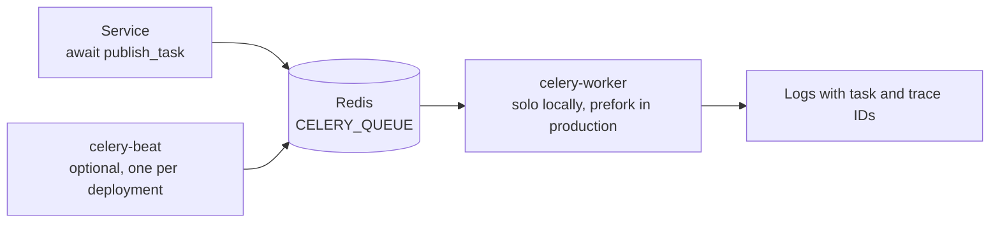

# Background jobs

Celery 5.6 runs slow, retryable work outside the API process. Authentication email already uses it; Beat is ready for scheduled work but has no schedules by default.

|              |                                                                                   |
| ------------ | --------------------------------------------------------------------------------- |
| **Requires** | Real Redis, even when the API uses `REDIS_IN_MEMORY=true`                         |
| **Settings** | `CELERY_BROKER_URL`, `CELERY_QUEUE`, `CELERY_KEY_PREFIX`                          |
| **Local**    | `make celery-worker`, `make celery-beat`, `make celery-ping`, `make celery-probe` |
| **Docker**   | `make docker-celery-up`, `make docker-celery-down` (`celery` Compose profile)     |



## Run locally

Start Redis, then use separate terminals:

```bash
make celery-worker   # solo pool for macOS development
make celery-beat     # optional scheduler
make celery-ping     # check running workers
make celery-probe    # send a harmless task; look for "Celery probe completed" in worker logs
```

An empty `CELERY_BROKER_URL` reuses `REDIS_HOST`, `REDIS_PORT`, `REDIS_DB`, and `REDIS_PASSWORD`. Use a `rediss://` URL for TLS. On Linux production, run the prefork pool: `CELERY_POOL=prefork CELERY_CONCURRENCY=2 make celery-worker`.

## Run in Docker

The worker (prefork, two processes) and Beat use the same app image. When both `LOGIN_ENABLED` and `EMAIL_ENABLED` are true, `make docker-up` and `make docker-deploy` start and health-check the worker before the API. Beat stays opt-in with `make docker-celery-up`. Run exactly one Beat per deployment.

## Execution contract

| Rule                   | Value                                                                        |
| ---------------------- | ---------------------------------------------------------------------------- |
| Serialization and time | JSON only, UTC                                                               |
| Acknowledgment         | Late ack, redelivered on worker loss, prefetch 1                             |
| Time limits            | 240 s soft, 300 s hard; 3600 s visibility timeout                            |
| Retries                | None by default; define bounded retries per task                             |
| Isolation              | Separate `CELERY_QUEUE` and `CELERY_KEY_PREFIX` per deployment sharing Redis |

Tasks must be idempotent. Publish from services with `await publish_task(name, payload=...)`, which attaches task and trace IDs for log correlation.

:::note

The API readiness check does not cover Celery. Monitor worker availability, retry logs, and the mail failure archive separately.

:::

See `src/backend/CELERY.md` in B4FastAPI for the full contract.
