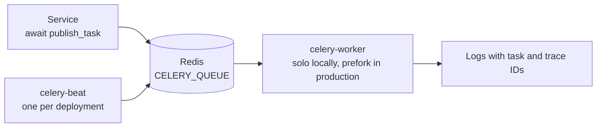

# Background jobs

Celery 5.6 runs slow, retryable work outside the API process. Account email, lifecycle notifications, and billing reconciliation use it; Beat schedules the outbox scan and the reconciliation job.

|              |                                                                                   |
| ------------ | --------------------------------------------------------------------------------- |
| **Requires** | Real Redis, even when the API uses `REDIS_IN_MEMORY=true`                         |
| **Settings** | `CELERY_BROKER_URL`, `CELERY_QUEUE`, `CELERY_KEY_PREFIX`                          |
| **Local**    | `make celery-worker`, `make celery-beat`, `make celery-ping`, `make celery-probe` |
| **Docker**   | `make docker-celery-up`, `make docker-celery-down` (`celery` Compose profile)     |



## Run locally

Start Redis, then use separate terminals:

```bash
make celery-worker   # solo pool for macOS development
make celery-beat     # scheduler for the outbox and billing reconciliation
make celery-ping     # check running workers
make celery-probe    # send a harmless task; look for "Celery probe completed" in worker logs
```

An empty `CELERY_BROKER_URL` reuses `REDIS_HOST`, `REDIS_PORT`, `REDIS_DB`, and `REDIS_PASSWORD`. Use a `rediss://` URL for TLS. On Linux production, run the prefork pool: `CELERY_POOL=prefork CELERY_CONCURRENCY=2 make celery-worker`.

## Schedules

Beat runs two schedules. They are required when the matching feature is enabled:

| Schedule                 | Task                            | Interval | Needed for                                                                             |
| ------------------------ | ------------------------------- | -------- | -------------------------------------------------------------------------------------- |
| `lifecycle-mail-outbox`  | `b4fastapi.notifications.drain` | 60 s     | [Lifecycle email](/docs/features/email#lifecycle-email)                                |
| `billing-reconciliation` | `b4fastapi.billing.reconcile`   | 300 s    | [Subscription snapshot](/docs/features/billing#webhooks-and-the-subscription-snapshot) |

## Run in Docker

The worker (prefork, two processes) and Beat use the same app image. When both `LOGIN_ENABLED` and `EMAIL_ENABLED` are true, `make docker-up` and `make docker-deploy` start and health-check the worker before the API. Beat starts with `make docker-celery-up`; start it, and the worker, whenever billing or lifecycle email is enabled. Run exactly one Beat per deployment. The worker mounts the object storage and SQLite volumes, and both run as the unprivileged UID 10001.

## Execution contract

| Rule                   | Value                                                                        |
| ---------------------- | ---------------------------------------------------------------------------- |
| Serialization and time | JSON only, UTC                                                               |
| Acknowledgment         | Late ack, redelivered on worker loss, prefetch 1                             |
| Time limits            | 240 s soft, 300 s hard; 3600 s visibility timeout                            |
| Retries                | None by default; define bounded retries per task                             |
| Isolation              | Separate `CELERY_QUEUE` and `CELERY_KEY_PREFIX` per deployment sharing Redis |

Tasks must be idempotent. Publish from services with `await publish_task(name, payload=...)`, which attaches task and trace IDs for log correlation.

:::note

The API readiness check does not cover Celery. Monitor worker availability, retry logs, and the mail failure archive separately.

:::

See `src/backend/CELERY.md` in B4FastAPI for the full contract.
