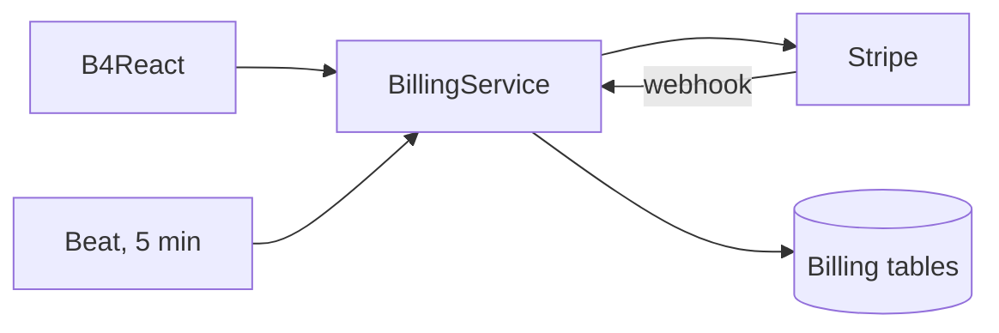
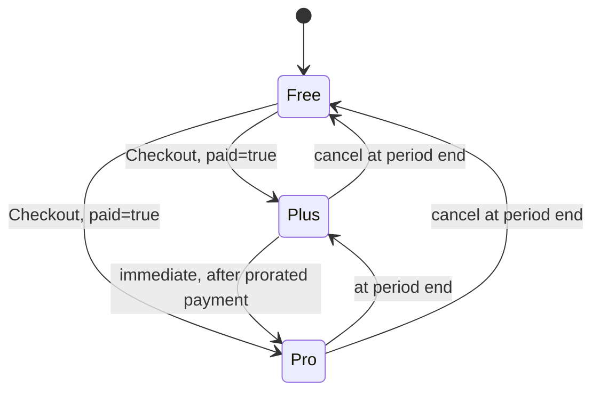

# Billing

Stripe-backed billing: saved cards and Link wallets, Free/Plus/Pro subscriptions with monthly or annual billing, invoices, and a billing profile, all managed inside the app. Stripe stays the source of truth; the backend stores only customer mappings, reservations, and a verified subscription snapshot.

|               |                                                                                                                   |
| ------------- | ----------------------------------------------------------------------------------------------------------------- |
| **Enable**    | `STRIPE_ENABLED=true` (off by default). One switch enables every billing feature together.                        |
| **Requires**  | Stripe secret key, recurring Price IDs, return URLs; a Celery worker and one Beat for webhooks and reconciliation |
| **Settings**  | `STRIPE_*` — see [Environment variables](/docs/environment/environment-variables#billing)                         |
| **Endpoints** | `/api/v1/billing/*` (Bearer or `X-API-Key`), `POST /api/v1/billing/webhook` (Stripe signature)                    |
| **Frontend**  | **Settings → Billing**, `/plans` from the profile menu                                                            |

## Architecture

- **Server-owned parameters.** Callers never choose the customer, price, amount, or return URL. A plan request carries only the plan, currency, and a request UUID.
- **Provider-verified results.** A return URL is never proof of success. Only status endpoints that check the Stripe object, its owner, and the mode of the session and its inner SetupIntent or subscription (`registered=true`, `paid=true`) confirm a registration or payment.
- **Ownership and mode.** Every customer, session, payment method, and invoice is checked against the signed-in user and the key's test/live mode. Test and live mappings are isolated.
- **Idempotency.** Retries of one action reuse its request UUID. Per-customer database locks and durable Checkout reservations prevent duplicate customers and subscriptions across devices and workers.

## Startup validation

With `STRIPE_ENABLED=true`, the API validates its configuration and calls Stripe read-only before running migrations or serving traffic:

1. Key prefix, return URLs, the `{CHECKOUT_SESSION_ID}` placeholder, and HTTPS in live mode.
2. A read-only Checkout Session list call to prove authentication.
3. Every configured Price ID: active, recurring, matching interval, currency, and mode.
4. The customer portal configuration, when `STRIPE_PORTAL_CONFIGURATION_ID` is set.

Any failure aborts startup. With `STRIPE_ENABLED=false`, no Stripe request is made and `/config` reports `billing_enabled=false`.

## Plans and pricing

Free, Plus, and Pro are tiers; monthly and annual are billing intervals. Each paid card on `/plans` has its own monthly/annual control, and a shared $/₩ toggle previews USD or KRW prices.

| Tier | Monthly KRW / USD | Annual KRW / USD |
| ---- | ----------------- | ---------------- |
| Plus | 3,990 / 3.99      | 43,092 / 43.09   |
| Pro  | 11,970 / 11.97    | 129,276 / 129.28 |

These are the sandbox example prices. Real amounts come from the configured Stripe Prices through `GET /billing/plans`, in minor currency units; KRW and USD are independent prices, not exchange-rate conversions.

| Price setting                                       | Purpose                                         |
| --------------------------------------------------- | ----------------------------------------------- |
| `STRIPE_{MONTHLY\|ANNUAL}_{KRW\|USD}_PRICE_ID`      | Plus prices; required when billing is enabled   |
| `STRIPE_PLUS_{MONTHLY\|ANNUAL}_{KRW\|USD}_PRICE_ID` | Optional Plus override for new purchases        |
| `STRIPE_PRO_{MONTHLY\|ANNUAL}_{KRW\|USD}_PRICE_ID`  | Optional Pro prices; unset options are not sold |

## Subscription lifecycle

| Change                                   | Applies                                                                    |
| ---------------------------------------- | -------------------------------------------------------------------------- |
| Free → paid                              | Stripe-hosted Checkout; confirmed by `GET /billing/checkout-sessions/{id}` |
| Plus → Pro                               | Immediately, only after Stripe accepts the prorated payment                |
| Pro → Plus, monthly ↔ annual in one tier | At the end of the paid period, with no refund or extra charge              |
| Cancel (→ Free)                          | At the end of the paid period                                              |
| Undo a scheduled change                  | Any time before it applies (`plan: keep`)                                  |

- `POST /billing/subscription/change` takes the target plan, the `change_version` read just before confirmation, and a request UUID. A stale version returns `BILLING_CHANGE_CONFLICT` (409).
- A pending upgrade payment keeps the current tier and offers a verified hosted invoice link to complete payment or authentication.
- Existing subscriptions keep their billing currency. Only simple active single-item subscriptions are self-service; discounts, trials, pauses, and external schedules need operator review.

## Payment methods and billing profile

**Settings → Billing** shows, in order: Current plan, Transactions, Billing information, Payment methods, and Cancel plan.

- **Cards** are added in an in-app dialog with Stripe Elements when `STRIPE_PUBLISHABLE_KEY` is set. Card data goes directly to Stripe; registration is confirmed by `GET /billing/card-setups/{id}`. Hosted Checkout setup (card and Link) remains available.
- Saved cards show brand, last four digits, and expiry. **Link** wallets show the Link logo, because Stripe does not expose their card details.
- Set a method as default or remove it. The default of an active subscription cannot be removed until another default is chosen (`BILLING_METHOD_REQUIRED`).
- **Billing information** edits email, name, and address. With a publishable key, Stripe AddressElement adapts fields to the selected country; otherwise a manual form is used.
- **Transactions** shows recent invoices; the history dialog paginates all invoices with detail views, and only the receipt action opens Stripe.
- The customer portal is optional and restricted to profile, payment methods, and invoices. A portal configuration that allows subscription changes is rejected.

## Webhooks and the subscription snapshot \{#webhooks-and-the-subscription-snapshot\}

`GET /billing/subscription` reads a stored snapshot instead of calling Stripe on every request. The snapshot is updated by:

| Source                             | When                                                     |
| ---------------------------------- | -------------------------------------------------------- |
| Verified Checkout and plan changes | Immediately, with the provider-confirmed state           |
| Signed webhook                     | On subscription, invoice, Checkout, and schedule events  |
| Reconciliation task                | Every 5 minutes, up to 50 snapshots older than 5 minutes |

Configure the webhook at `/api/v1/billing/webhook` with `STRIPE_WEBHOOK_SECRET`; an empty secret disables it. Subscribe to `customer.subscription.*` (created, updated, deleted, paused, resumed), `invoice.paid`, `invoice.payment_failed`, `invoice.payment_action_required`, `checkout.session.*` (completed, async payment succeeded/failed), and `subscription_schedule.*` (updated, released, canceled, completed, aborted).

Handlers fetch the current Stripe state under the customer lock, so duplicate or out-of-order events cannot restore an old plan. Multiple active subscriptions are stored as an unknown, non-manageable state that still counts as a subscription, so no tier is granted and no new purchase is offered. B4React shares one in-memory snapshot per account between the sidebar and pages, with no polling; the sidebar profile shows the tier.

Confirmed subscription starts and plan changes also send [lifecycle email](/docs/features/email#lifecycle-email).

## Errors

| Code                              | Status | Meaning                                                   |
| --------------------------------- | ------ | --------------------------------------------------------- |
| `BILLING_DISABLED`                | 503    | Billing is turned off                                     |
| `BILLING_UNAVAILABLE`             | 502    | Stripe failed or timed out (sanitized)                    |
| `BILLING_NOT_FOUND`               | 404    | Missing or foreign session, method, or invoice            |
| `BILLING_CHECKOUT_CONFLICT`       | 409    | Another Checkout attempt or an existing subscription      |
| `BILLING_CHANGE_CONFLICT`         | 409    | Stale or unsupported plan change                          |
| `BILLING_RECONCILIATION_REQUIRED` | 409    | An old customer reservation needs operator review         |
| `ACCOUNT_BILLING_REVIEW_REQUIRED` | 409    | Account deletion blocked by subscription Checkout history |

## Operating notes

- Use one Stripe account per application database, and separate test and live Price IDs.
- Local account deletion does not delete Stripe customers or detach saved methods. Accounts with Checkout history require operator reconciliation before deletion.
- Turning billing off does not cancel existing Stripe subscriptions.
- The subscription tier is shown in the UI but does not authorize application features by itself.
- Billing is implemented for Stripe only, without a provider abstraction. `notes/payment-provider-research.md` in B4FastAPI compares Toss Payments, PortOne, and Paddle and lists what adopting another provider would require.

Before production:

1. Register the webhook events listed above and set `STRIPE_WEBHOOK_SECRET`.
2. Run a Celery worker and exactly one Beat.
3. Review the Stripe Dashboard customer email and revenue recovery settings. See [Who sends what](/docs/features/email#who-sends-what).
4. In test mode, complete a Checkout, a card or Link registration with 3D Secure, and a failed payment with controlled recipients.

## Code

- Backend: `routers/v1/billing.py`, `routers/v1/billing_webhook.py`, `services/billing.py`, `services/billing_reconciliation.py`, `core/celery/billing.py`
- Frontend: `src/frontend/src/pages/billing/`, `components/features/billing/`, `hooks/api/billing/`
- Guides: `notes/billing.md` in B4FastAPI and B4React
