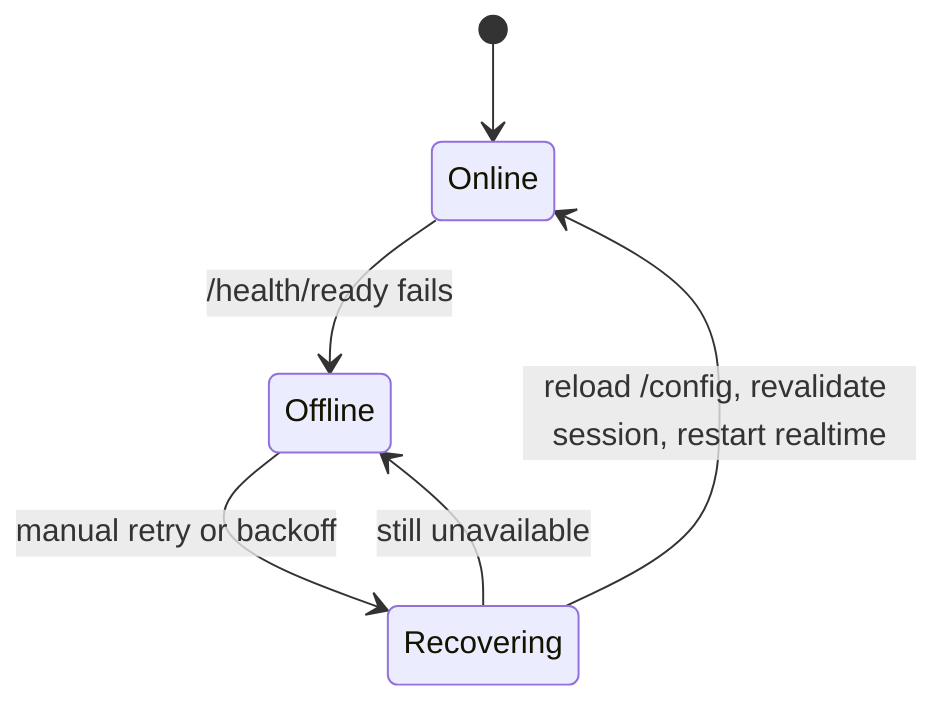

# Desktop app

B4React includes an optional Tauri 2 shell that packages the same React app for macOS, Windows, and Linux. The browser app remains the default.

|              |                                            |
| ------------ | ------------------------------------------ |
| **Requires** | Rust and the platform's Tauri dependencies |
| **Develop**  | `make frontend-desktop-dev`                |
| **Build**    | `make frontend-desktop-build`              |
| **CI**       | `.github/workflows/desktop-build.yml`      |

## Pointing at a server

A packaged app has no same-origin backend, so set `VITE_API_BASE_URL` to the deployed API origin at build time, and allow the app origin (`tauri://localhost`) in `CORS_ORIGINS`. The default `CORS_ORIGINS` already includes it.

## Connectivity recovery

1. The app polls `/health/ready` to track server availability.
2. While the server is unavailable, API and realtime work pause and the UI shows the disconnected state. The local session is kept.
3. Manual retry and backoff reconnect.
4. On recovery, the app reloads `/config`, revalidates the session, restarts realtime subscriptions, and refreshes stale data.

The browser app never starts this polling.

## Build pipeline

The desktop workflow builds macOS Apple Silicon, macOS Intel, Linux x64, and Windows x64 bundles on manual dispatch, a nightly schedule, releases, and `v*` tags.

- The API origin comes from the `api_base_url` input, then the `DESKTOP_API_BASE_URL` variable, then `http://localhost:8000`.
- Bundles are uploaded as workflow artifacts, and attached to the GitHub Release for releases and tags.
- Artifacts are unsigned. Public distribution still needs macOS and Windows signing and notarization.

## Identity

`project.json` sets the product name, window title, and bundle identifier through the npm and Make launchers. See [project initialization](/docs/getting-started/project-initialization). Native installer icons stay in `src-tauri/icons`.
