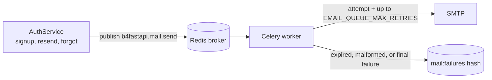

# Email

Signup verification and password reset emails, rendered in English or Korean and delivered by a standalone Celery worker.

|               |                                                                                                                                               |
| ------------- | --------------------------------------------------------------------------------------------------------------------------------------------- |
| **Enable**    | `EMAIL_ENABLED=true` (requires `LOGIN_ENABLED=true`)                                                                                          |
| **Requires**  | SMTP credentials, real Redis, and a running [Celery worker](/docs/features/background-jobs)                                                   |
| **Settings**  | `EMAIL_FROM`, `EMAIL_BRAND_NAME`, `SMTP_*`, `EMAIL_VERIFICATION_TOKEN_EXPIRE_MINUTES`, `PASSWORD_RESET_TOKEN_EXPIRE_MINUTES`, `EMAIL_QUEUE_*` |
| **Endpoints** | `/api/v1/auth/verify-email`, `resend-verification`, `forgot-password`, `reset-password`                                                       |

## Behavior

| Flow           | With email enabled                                     | With email disabled (default)   |
| -------------- | ------------------------------------------------------ | ------------------------------- |
| Signup         | Account starts unverified; a verification link is sent | Account is verified immediately |
| Login          | Unverified accounts get `EMAIL_NOT_VERIFIED`           | No verification check           |
| Password reset | A reset link is sent                                   | Not available                   |

Request confirmations never reveal whether an account exists.

## Delivery

1. The API publishes a `b4fastapi.mail.send` task; it never sends SMTP itself.
2. The worker makes one SMTP attempt plus up to `EMAIL_QUEUE_MAX_RETRIES` delayed retries (default 3, `EMAIL_QUEUE_RETRY_DELAY_SECONDS` apart).
3. Expired or malformed jobs are archived without sending.
4. Terminal failures are stored in the Redis hash `<CELERY_KEY_PREFIX>mail:failures`, keyed by task ID.

:::warning[Operational notes]

- A Celery `SUCCESS` means processing finished, not that the message was delivered.
- The failure archive contains recipients and secret links. Restrict Redis access and define a retention policy. Ask users to request a fresh link instead of replaying archived mail.
- With `SMTP_VALIDATE_ON_STARTUP=true`, the worker checks the SMTP connection when it starts.

:::

## Templates

Verification and reset messages share one table-based 480px layout with a plain-text alternative and a visible fallback link. No web fonts, scripts, or remote assets are loaded.

## Code

- `src/backend/app/core/mail/` (service, queue, templates)
- `src/backend/app/core/celery/mail.py`
