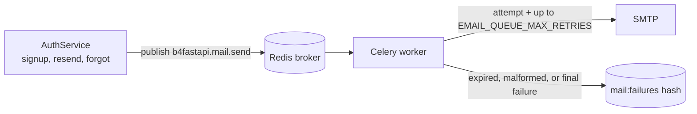
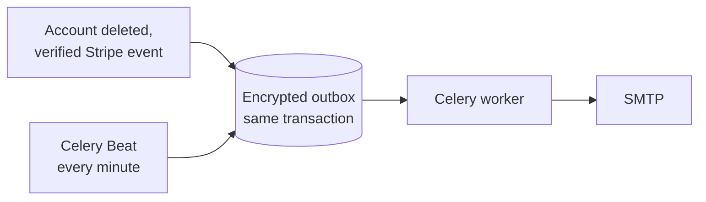

# Email

Account email (verification, password reset, welcome, password-change and deletion codes) and lifecycle notifications (subscription and account deletion), rendered in English or Korean and delivered by a standalone Celery worker.

|               |                                                                                                                                               |
| ------------- | --------------------------------------------------------------------------------------------------------------------------------------------- |
| **Enable**    | `EMAIL_ENABLED=true` (requires `LOGIN_ENABLED=true`)                                                                                          |
| **Requires**  | SMTP credentials, real Redis, a running [Celery worker](/docs/features/background-jobs), and one Beat for lifecycle notifications             |
| **Settings**  | `EMAIL_FROM`, `EMAIL_BRAND_NAME`, `SMTP_*`, `EMAIL_VERIFICATION_TOKEN_EXPIRE_MINUTES`, `PASSWORD_RESET_TOKEN_EXPIRE_MINUTES`, `EMAIL_QUEUE_*` |
| **Endpoints** | `/api/v1/auth/verify-email`, `resend-verification`, `forgot-password`, `reset-password`                                                       |

## Behavior

| Flow             | With email enabled                                       | With email disabled (default)   |
| ---------------- | -------------------------------------------------------- | ------------------------------- |
| Signup           | Account starts unverified; a verification link is sent   | Account is verified immediately |
| Login            | Unverified accounts get `EMAIL_NOT_VERIFIED`             | No verification check           |
| Password reset   | A reset link is sent                                     | Not available                   |
| Password change  | A six-digit code to confirm the change                   | Not available                   |
| Activation       | A welcome email after verification or first OAuth signup | No email                        |
| Account deletion | A six-digit code, then a deletion notice                 | Not available                   |

Request confirmations never reveal whether an account exists.

## Delivery

1. The API publishes a `b4fastapi.mail.send` task; it never sends SMTP itself.
2. The worker makes one SMTP attempt plus up to `EMAIL_QUEUE_MAX_RETRIES` delayed retries (default 3, `EMAIL_QUEUE_RETRY_DELAY_SECONDS` apart).
3. Expired or malformed jobs are archived without sending.
4. Terminal failures are stored in the Redis hash `<CELERY_KEY_PREFIX>mail:failures`, keyed by task ID.

:::warning[Operational notes]

- A Celery `SUCCESS` means processing finished, not that the message was delivered.
- The failure archive contains recipients and secret links. Restrict Redis access and define a retention policy. Ask users to request a fresh link instead of replaying archived mail.
- With `SMTP_VALIDATE_ON_STARTUP=true`, the worker checks the SMTP connection when it starts.

:::

## Lifecycle email \{#lifecycle-email\}

Subscription and account-deletion notices go through a durable outbox, so a committed change is never lost between the database and the queue.

| Notice                 | Sent when                                                            |
| ---------------------- | -------------------------------------------------------------------- |
| Subscription started   | The first `invoice.paid` of a subscription                           |
| Plan changed           | A plan change is applied (`customer.subscription.updated`)           |
| Subscription cancelled | A requested cancellation completes (`customer.subscription.deleted`) |
| Account deleted        | The deletion transaction commits                                     |

Renewals and payment failures do not send email.

- Billing notices need the [Stripe webhook](/docs/features/billing#webhooks-and-the-subscription-snapshot). Signatures, mode, and current provider state are checked before a notice is stored, and semantic keys prevent duplicates.
- Recipient data is encrypted with a key derived from `SECRET_KEY`, erased after delivery, and erased after 72 hours if undelivered. Drain pending mail before rotating `SECRET_KEY`.
- Delivery uses up to five attempts with five-minute leases. A crash after SMTP acceptance can duplicate a message; delivery is at least once, not exactly once.
- Mail or broker failures never undo a committed deletion or subscription change.

## Templates

All messages share one table-based 480px layout with a plain-text alternative. Link messages include a visible fallback link; the deletion code replaces the action button and contains no link. No web fonts, scripts, or remote assets are loaded. The brand defaults to `B4A`; set `EMAIL_BRAND_NAME` to change it, then recreate the workers.

## Code

- `src/backend/app/core/mail/` (service, queue, templates)
- `src/backend/app/core/celery/mail.py`, `core/celery/notifications.py`
- `src/backend/app/services/notifications.py`, `services/billing_notifications.py`
