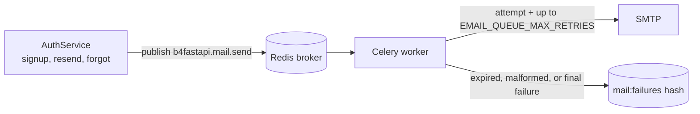
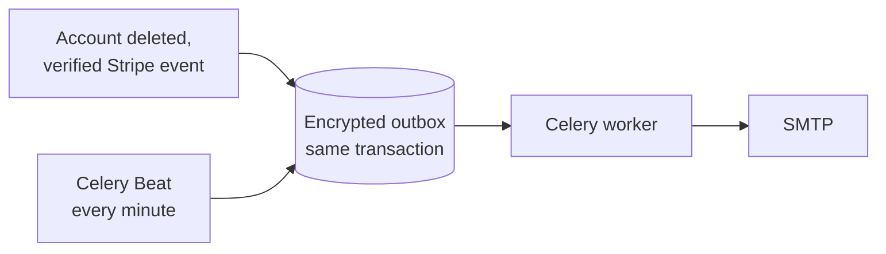

# Email

Account email (verification, password reset, welcome, password-change and deletion codes) and lifecycle notifications (subscription and account deletion), rendered in English or Korean and delivered by a standalone Celery worker.

|               |                                                                                                                                               |
| ------------- | --------------------------------------------------------------------------------------------------------------------------------------------- |
| **Enable**    | `EMAIL_ENABLED=true` (requires `LOGIN_ENABLED=true`)                                                                                          |
| **Requires**  | SMTP credentials, real Redis, a running [Celery worker](/docs/features/background-jobs), and one Beat for lifecycle notifications             |
| **Settings**  | `EMAIL_FROM`, `EMAIL_BRAND_NAME`, `SMTP_*`, `EMAIL_VERIFICATION_TOKEN_EXPIRE_MINUTES`, `PASSWORD_RESET_TOKEN_EXPIRE_MINUTES`, `EMAIL_QUEUE_*` |
| **Endpoints** | `/api/v1/auth/verify-email`, `resend-verification`, `forgot-password`, `reset-password`                                                       |

## Behavior

| Flow             | With email enabled                                       | With email disabled (default)   |
| ---------------- | -------------------------------------------------------- | ------------------------------- |
| Signup           | Account starts unverified; a verification link is sent   | Account is verified immediately |
| Login            | Unverified accounts get `EMAIL_NOT_VERIFIED`             | No verification check           |
| Password reset   | A reset link is sent                                     | Not available                   |
| Password change  | A six-digit code to confirm the change                   | Not available                   |
| Activation       | A welcome email after verification or first OAuth signup | No email                        |
| Account deletion | A six-digit code, then a deletion notice                 | Not available                   |

Request confirmations never reveal whether an account exists.

## Delivery



1. The API publishes a `b4fastapi.mail.send` task; it never sends SMTP itself.
2. The worker makes one SMTP attempt plus up to `EMAIL_QUEUE_MAX_RETRIES` delayed retries (default 3, `EMAIL_QUEUE_RETRY_DELAY_SECONDS` apart).
3. Expired or malformed jobs are archived without sending.
4. Terminal failures are stored in the Redis hash `<CELERY_KEY_PREFIX>mail:failures`, keyed by task ID.

:::warning[Operational notes]

- A Celery `SUCCESS` means processing finished, not that the message was delivered.
- The failure archive contains recipients and secret links. Restrict Redis access and define a retention policy. Ask users to request a fresh link instead of replaying archived mail.
- With `SMTP_VALIDATE_ON_STARTUP=true`, the worker checks the SMTP connection when it starts.

:::

## Lifecycle email \{#lifecycle-email\}

Subscription and account-deletion notices go through a durable outbox, so a committed change is never lost between the database and the queue.



| Notice                 | Sent when                                                                                                      |
| ---------------------- | -------------------------------------------------------------------------------------------------------------- |
| Subscription started   | The initial `invoice.paid`, for a paid single-line invoice whose price matches the current active subscription |
| Plan changed           | `customer.subscription.updated` with an actual price change, active and with no pending update                 |
| Subscription cancelled | `customer.subscription.deleted` after a requested cancellation, with no replacement subscription               |
| Account deleted        | The deletion transaction commits                                                                               |

Scheduling or undoing a cancellation, renewals, payment failures, required authentication, pending upgrades, and unknown prices do not send app email.

### Who sends what \{#who-sends-what\}

| Owner  | Messages                                                                            |
| ------ | ----------------------------------------------------------------------------------- |
| App    | The four notices above, account email, and codes                                    |
| Stripe | Financial receipts, renewal reminders, payment failure and action-required recovery |

Review the Stripe Dashboard customer email and revenue recovery settings before launch. The app does not change them. If Stripe cancellation emails are enabled, decide which side owns the completion message.

### Language and links

- Billing notices use the first `ko` or `en` entry in the Stripe Customer's `preferred_locales`, otherwise English. Changing the app language does not update Stripe.
- The account-deleted notice uses the language of the confirmed deletion request.
- Billing notices link to `/settings?section=billing`; the deletion notice links to `/home`.

### Delivery and retention

- Billing notices need the [Stripe webhook](/docs/features/billing#webhooks-and-the-subscription-snapshot). The webhook commits the synchronized state and the outbox row before acknowledging; a failure returns non-2xx so Stripe redelivers.
- Redelivered events are deduplicated by subscription and event ID, so repeated changes within one second are not merged. Obsolete events are suppressed after checking current provider state.
- Each claim holds a five-minute lease. At most five claims are made, including workers that crash mid-delivery. SMTP failures back off 2, 4, 8, and 16 minutes; the fifth failure is terminal (`delivery_failed`, or `delivery_unconfirmed` for an abandoned lease).
- Recipient data is encrypted (Fernet, key derived from `SECRET_KEY`), erased on success, and erased 72 hours after reservation even for failed jobs. Opaque metadata without recipients is kept. Drain pending mail before rotating `SECRET_KEY`.
- A crash after SMTP acceptance can duplicate a message; delivery is at least once, not exactly once. Mail or broker failures never undo a committed deletion or subscription change.

### Operator commands

Trusted deployment operators inspect and retry failed notices from the backend shell:

```bash
cd src/backend
uv run python -m app.manage_notifications list --limit 50
uv run python -m app.manage_notifications retry <64-character-notification-id>
```

- `list` shows safe metadata only (up to 100 rows) and never decrypts recipients.
- `retry` resets the attempt budget of one failed notice but never extends its 72-hour expiry; the next Beat scan delivers it. Expired, erased, sent, or pending notices are rejected.
- No user, manager, or admin HTTP endpoint inspects or retries other users' mail.

## Templates

All messages share one table-based 480px layout with a plain-text alternative. Link messages include a visible fallback link; the deletion code replaces the action button and contains no link. No web fonts, scripts, or remote assets are loaded. The brand defaults to `B4A`; set `EMAIL_BRAND_NAME` to change it, then recreate the workers.

## Code

- `src/backend/app/core/mail/` (service, queue, templates)
- `src/backend/app/core/celery/mail.py`, `core/celery/notifications.py`
- `src/backend/app/services/notifications.py`, `services/billing_notifications.py`
