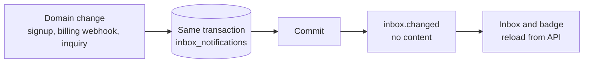

# Notification inbox

Every signed-in user has a persistent inbox of in-app notifications. Records are stored in the database, separately from email, so they survive missed realtime events and work with `EMAIL_ENABLED=false`.

|               |                                                                                         |
| ------------- | --------------------------------------------------------------------------------------- |
| **Enable**    | Always on for signed-in users                                                           |
| **Endpoints** | `/api/v1/inbox` (list, `summary`, `read-all`, `read-selected`, `{id}/read`, `selected`) |
| **Frontend**  | **Notifications** in the profile menu (`/notifications`)                                |
| **Realtime**  | `inbox.changed` on the [event stream](/docs/features/realtime-events)                   |
| **Storage**   | `inbox_notifications` table                                                             |

## Architecture

- A producer writes the record inside its own domain transaction and owns the commit. There is no public creation endpoint.
- After the commit, `inbox.changed` tells the user's open clients to reload. The event carries no message content; reconnect and window focus also reload the authoritative state.
- Action links are application-relative paths only, never external URLs. Titles are capped at 160 characters and bodies at 2,000.

## What creates a notification

| Kind                   | Created when                                                                    | Recipient                   |
| ---------------------- | ------------------------------------------------------------------------------- | --------------------------- |
| `welcome`              | Email or OAuth signup, in the signup transaction                                | The new user                |
| `subscription_started` | A validated Stripe webhook confirms a new subscription                          | The subscriber              |
| `plan_changed`         | A validated webhook confirms an applied plan change or a requested cancellation | The subscriber              |
| `inquiry_received`     | A user opens a [support inquiry](/docs/features/support)                        | The owner and active admins |
| `inquiry_reply`        | A user or an admin replies                                                      | The other side              |
| `inquiry_status`       | An admin changes the inquiry status                                             | The owner                   |

Billing notifications are deduplicated by a unique delivery key, so webhook retries never create duplicates, and they are created even when email is off. Existing accounts are not backfilled.

## Reading and deleting

- The list is paginated (`page_size` 1–100, default 20) and can show unread items only. Every request is scoped to the current user, including admins; API keys act as their owner.
- **View details** opens the full notification in a modal and marks it read. The modal only closes; deletion lives in the list.
- Row checkboxes and a header checkbox select the visible page. **Mark selected read** and **Delete selected** act on an explicit list of up to 100 owned IDs, and deletion asks for confirmation.
- **Mark all read** stops at the newest ID the user has seen, so a notification that arrives meanwhile stays unread.
- A deleted record loses its title, body, and link, but keeps its delivery key as a tombstone, so a retried webhook cannot recreate it. Deleted records never appear in lists, counts, or reads.
- Account deletion removes the user's inbox.

## Frontend

**Notifications** sits directly below Profile in the profile menu, with an unread badge capped at `99+`. The page opens inside the sidebar family the user came from and reuses the admin table. Changing the filter or page keeps the previous table visible, with actions disabled, until the response arrives.

## Code

- Backend: `routers/v1/inbox.py`, `services/inbox.py`, `models/inbox.py`, `core/realtime/domain_events/inbox.py`
- Frontend: `/notifications` page and `hooks/realtime/` inbox handling in `src/frontend`
