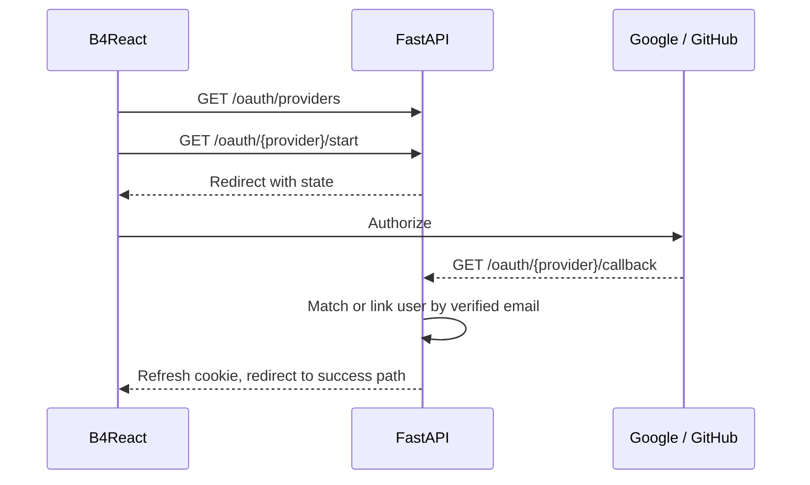

# OAuth

Google and GitHub sign-in. A provider identity is linked to the existing account with the same verified email.

|               |                                                                                                                                                           |
| ------------- | --------------------------------------------------------------------------------------------------------------------------------------------------------- |
| **Enable**    | `OAUTH_ENABLED=true` (requires `LOGIN_ENABLED=true`)                                                                                                      |
| **Settings**  | `OAUTH_ALLOWED_PROVIDERS`, `OAUTH_GOOGLE_*`, `OAUTH_GITHUB_*`, `OAUTH_STATE_EXPIRE_MINUTES`, `OAUTH_FRONTEND_SUCCESS_PATH`, `OAUTH_FRONTEND_FAILURE_PATH` |
| **Endpoints** | `/api/v1/auth/oauth/providers`, `/oauth/{provider}/start`, `/oauth/{provider}/callback`                                                                   |

## Setup

1. Create an OAuth app with Google and/or GitHub.
2. Register the callback URL `<backend origin>/api/v1/auth/oauth/<provider>/callback`, for example `http://localhost:8000/api/v1/auth/oauth/github/callback`.
3. Set `OAUTH_<PROVIDER>_CLIENT_ID` and `OAUTH_<PROVIDER>_CLIENT_SECRET`.
4. List the providers to show in `OAUTH_ALLOWED_PROVIDERS` (`google,github` by default).
5. Set `OAUTH_ENABLED=true` and restart the backend.

The authorize, token, and user-info URLs default to each provider's public endpoints and rarely need changes.

## Flow

1. The login dialog lists enabled providers from `/oauth/providers`. Disabled providers stay hidden.
2. `/oauth/{provider}/start` redirects to the provider with a state value valid for `OAUTH_STATE_EXPIRE_MINUTES`.
3. The callback signs the user in with the refresh cookie and redirects to `OAUTH_FRONTEND_SUCCESS_PATH`, or to `OAUTH_FRONTEND_FAILURE_PATH` on failure.
4. Linked providers appear in the user's `oauth_providers` and in **Settings → Account**.

## Account matching

| Situation                               | Result                              |
| --------------------------------------- | ----------------------------------- |
| The provider email is not verified      | Sign-in is rejected                 |
| The provider identity is already linked | Signs in to that user               |
| A user with the same email exists       | The identity is linked to that user |
| No matching user                        | A new verified user is created      |

A provider identity that cannot be linked to the matching account is rejected with `OAUTH_IDENTITY_CONFLICT`.
