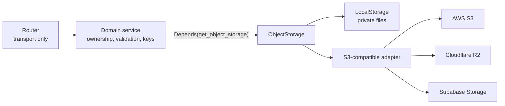
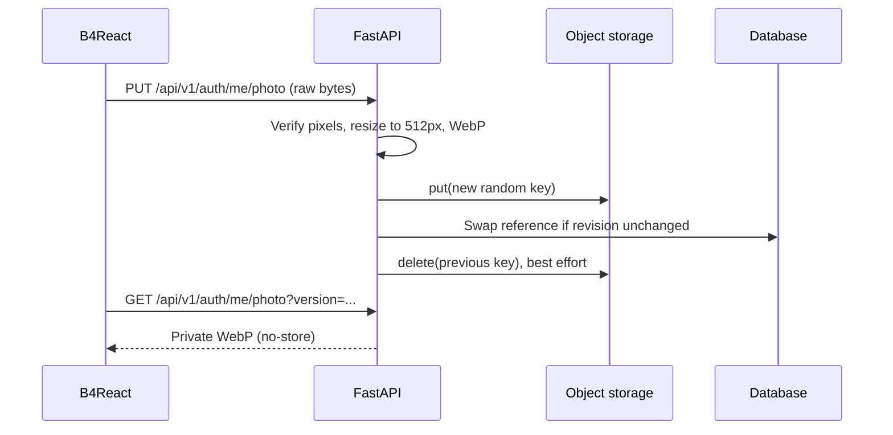

# Object storage

A backend storage interface that domain services use to save, read, and delete files without depending on a vendor SDK or filesystem path. Profile photos are its first consumer.

|              |                                                                                                          |
| ------------ | -------------------------------------------------------------------------------------------------------- |
| **Enable**   | Always on; `OBJECT_STORAGE_PROVIDER=local` by default                                                    |
| **Choices**  | `local`, `s3` (AWS or another S3-compatible vendor), `r2`, `supabase`                                    |
| **Settings** | `OBJECT_STORAGE_*` — see [Environment variables](/docs/environment/environment-variables#object-storage) |
| **Startup**  | Required: a failed storage check aborts startup                                                          |

## Architecture

- `app/core/object_storage/` defines the `ObjectStorage` protocol, immutable `ObjectMetadata` (key, size, content type), and sanitized `StorageError` codes.
- The provider is created once in the FastAPI lifespan, exposed through `get_object_storage` in `app/deps.py`, and closed on shutdown. Non-HTTP workers use `create_object_storage(SETTINGS)` and close it themselves.
- Routers and models never instantiate SDKs. Image checks, key naming, and replacement policy belong to the domain, not to the storage core.
- The three remote choices share one S3 adapter; they differ only in defaults and required settings.

## Operations

| Operation                       | Behavior                                                              |
| ------------------------------- | --------------------------------------------------------------------- |
| `put(key, bytes, content_type)` | Stores or replaces the object and returns its metadata                |
| `get(key)`                      | Returns bounded bytes and metadata                                    |
| `stat(key)`                     | Returns metadata only                                                 |
| `delete(key)`                   | Succeeds when the object is already absent                            |
| `check_connection()`            | Local: write, read, and delete a temporary file. Remote: `HeadBucket` |

- Keys are portable ASCII paths up to 512 characters: no absolute paths, dot segments, backslashes, or URLs.
- Objects are limited to `OBJECT_STORAGE_MAX_BYTES` (8 MiB by default).
- Errors are `NOT_FOUND`, `ACCESS_DENIED`, `UNAVAILABLE`, `TOO_LARGE`, `INVALID_INPUT`, `CORRUPT_OBJECT`, or `CLOSED`. Domains translate them into their own HTTP errors.
- Blocking I/O runs in a bounded thread pool. Remote calls use at most three attempts with per-connect and per-read timeouts.
- A remote failure never falls back to local storage, and no bucket, ACL, public URL, or signed URL is created.

## Providers

| Provider   | Endpoint                                                         | Region            | Credentials                                      |
| ---------- | ---------------------------------------------------------------- | ----------------- | ------------------------------------------------ |
| `local`    | —                                                                | —                 | None; files under `OBJECT_STORAGE_LOCAL_ROOT`    |
| `s3`       | Empty for AWS, or a custom S3-compatible endpoint                | Required          | Explicit keys or the AWS SDK credential chain    |
| `r2`       | `https://<ACCOUNT_ID>.r2.cloudflarestorage.com` (no bucket path) | `auto`            | R2 S3 access key and secret                      |
| `supabase` | `https://<PROJECT_REF>.storage.supabase.co/storage/v1/s3`        | Project S3 region | Supabase S3 keys (not anon or service-role keys) |

Remote endpoints must use HTTPS in production. `HeadBucket` proves bucket access only; verify object write and delete permissions separately before rollout.

## Local storage

- Each object is one private file: a header, JSON metadata, and the raw bytes, written with a temporary file, `fsync`, and an atomic replace.
- Logical keys are hashed into flat filenames. Symlinks and non-regular files are rejected.
- An empty `OBJECT_STORAGE_LOCAL_ROOT` uses `src/backend/data/object-storage`. Docker mounts the `object_storage_data` volume at `/var/lib/b4fastapi/objects` in both the app and the Celery worker.
- Back up the storage directory or volume together with the database. `docker compose down -v` deletes it.
- Never serve the directory as static files.

Changing the provider, bucket, or root does not migrate existing objects.

## Profile photos \{#profile-photos\}

| Endpoint                       | Behavior                                                                                                                                                                               |
| ------------------------------ | -------------------------------------------------------------------------------------------------------------------------------------------------------------------------------------- |
| `PUT /api/v1/auth/me/photo`    | Raw image body up to 8 MiB. PNG, JPEG, WebP, or GIF pixels are verified (16 million pixels at most), orientation applied, resized within 512px, metadata stripped, and stored as WebP. |
| `GET /api/v1/auth/me/photo`    | The owner's current photo only, with `private, no-store` and `nosniff`. Old versions return 404.                                                                                       |
| `DELETE /api/v1/auth/me/photo` | Clears the reference, then deletes the object. Repeating succeeds.                                                                                                                     |

- The user record keeps a versioned private API reference, never a storage URL or credential.
- A failed upload keeps the current photo. A concurrent replacement returns 409 and removes only the losing upload.
- B4React keeps one Blob URL per account and photo version, shared by Settings and the sidebar, and shows initials if a read fails.
- Existing external photo URLs, such as OAuth avatars, keep displaying.
- Cleanup of replaced objects is best effort and logged; reconcile unreferenced `profile-photos/` keys against the database before deleting anything.

The admin [server status](/docs/features/admin-and-roles#server-status) shows the configured provider with its transport, port, status, and latency, never bucket names, endpoints, or paths.

## Code

- Backend: `app/core/object_storage/` (`base.py`, `local.py`, `s3.py`), `services/profile_photo.py`, `deps.py`
- Guide: `notes/object-storage.md` in B4FastAPI
