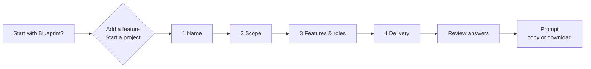

# Prompt builder

The prompt builder turns a service idea into implementation instructions for a coding agent. It asks four short questions, then produces localized Markdown with requirements, scope boundaries, RBAC rules, and verification and delivery steps. It is a template builder that runs entirely in the browser: it calls no model, scans no repository, and never commits, merges, or deploys.

|             |                                                                                                        |
| ----------- | ------------------------------------------------------------------------------------------------------ |
| **Enable**  | Always on, in development and production                                                               |
| **Route**   | `/prompt-builder`, lazy-loaded inside the app shell                                                    |
| **Who**     | Guests and signed-in users                                                                             |
| **Menu**    | **Prompt builder**, directly after Home in every [layout](/docs/features/settings-and-profile#layouts) |
| **Backend** | None: no endpoint, setting, or storage                                                                 |
| **Output**  | Copy to clipboard, or download `blueprint-<path>-prompt.md` (UTF-8)                                    |

## Flow

The central capsule opens the path chooser: **Add a feature** or **Start a project**. Both paths ask the same four questions:

| Step             | Input                                                                                                                                                                                                 | Required                          |
| ---------------- | ----------------------------------------------------------------------------------------------------------------------------------------------------------------------------------------------------- | --------------------------------- |
| Name             | Feature name, free text                                                                                                                                                                               | Yes                               |
| Scope            | 12 multi-select cards: Backend, Frontend, UI design, API, Database, Auth & permissions, Realtime, Background jobs, File uploads, Payments, Tests, Deployment setup                                    | At least one                      |
| Features & roles | 6 multi-select capability cards (Create, edit & delete; Search & filters; Notifications; Dashboard & metrics; Approval workflow; File attachments), the RBAC matrix, and optional additional requests | No; **Skip** keeps the defaults   |
| Delivery         | How far the agent goes: local checks, a reviewable PR (recommended, default), verify and merge, or deploy and verify live                                                                             | Deployment target only for deploy |

- Required and Optional badges mark each input. Only the name needs typing by default.
- **Review answers** lists the four groups with **Edit** on each. An edit that adds a question marks it **Answer needed**. A deployment target typed earlier is dropped when delivery is no longer deploy.
- **Create my prompt** shows the result. **Edit answers** goes back; **New prompt** asks for confirmation and clears both paths.

## RBAC defaults

The matrix sets read, create, edit, and delete per role. Signed-in roles also choose an Own or All data scope.

| Role    | Default                                  |
| ------- | ---------------------------------------- |
| Guest   | No access; any grant is public data only |
| User    | Read, create, edit, delete — own records |
| Manager | Read — all records in the service/tenant |
| Admin   | Read, create, edit, delete — all records |

These are editable defaults for the prompt. They do not change the running service's [roles](/docs/features/admin-and-roles).

## Generated prompt

The output is deterministic Markdown in the current language:

- **Requirements**: the four answers, with the RBAC summary and additional requests.
- **Scope**: one rule per selected area. Unselected areas are out of scope; UI-only work excludes API, business-rule, and data-policy changes and names backend dependencies instead.
- **RBAC**: permissions must be enforced on the server, and conflicts with existing policy are flagged rather than weakened.
- **Acceptance**: a base check plus one behavioral check per selected capability. With no capability selected, the agent derives minimal behavior from the name and the existing project and clarifies only essential missing rules.
- **Steps**: repository inspection, design, an implementation section when both backend and frontend are selected, verification, integration, and report.
- **Stopping point**: the selected delivery scope. Choosing deployment setup as a scope never authorizes a deployment.

The prompt never claims that analysis or checks have already run. If the clipboard is unavailable, the page asks the user to select the text manually or download the Markdown file, which contains exactly the visible text.

## State

- Steps and answers live in page memory, with a separate draft for each path. Leaving or reloading the page resets them.
- Nothing is stored persistently or sent to an API. The page adds no provider, store, dependency, backend contract, or realtime or background work.
- The existing configuration and server-readiness gates still apply before the page renders.

## Frontend

- The page uses `MainPageTemplate` with the General settings shell, header, width, and mobile padding. Controls are the shared `InputField`, `TextareaField`, `FormCheckbox`, `DropdownMenu`, `SelectionCard`, capsule `Button` variants, and `Modal`.
- Path and scope cards have equal widths. The ambient background never intercepts pointer input, and it stops, along with step transitions, under reduced motion.
- Each step moves focus to its heading so screen readers announce it; controls keep the shared visible focus style.
- `make test-ui` runs `tests/e2e/prompt-builder.spec.ts`. It covers both guest paths in production, review edits, clipboard success and failure, exact downloads, all three layouts, and a Korean light and dark comparison with the General page at 390 and 1440 px. The production route check covers the lazy chunk and direct reload.

## Code

- Frontend: `src/pages/prompts/PromptBuilderPage.tsx` (wizard) and `src/pages/prompts/promptBuilder.ts` (draft model, validation, prompt assembly), with `promptBuilder.*` strings in `src/locales/` in `src/frontend`
- Backend: none; B4FastAPI pins the B4React revision and serves it like any other route
