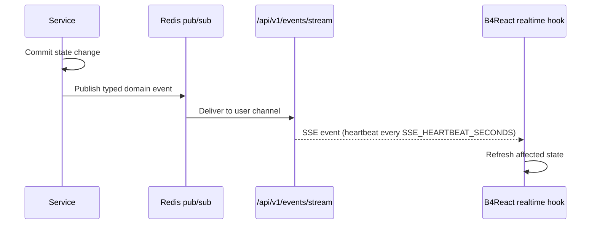

# Realtime events

A per-user Server-Sent Events stream pushes domain events to every open tab, so screens refresh without polling.

|               |                                                                         |
| ------------- | ----------------------------------------------------------------------- |
| **Enable**    | Always on for signed-in users                                           |
| **Endpoint**  | `GET /api/v1/events/stream` (Bearer token or API key)                   |
| **Settings**  | `SSE_HEARTBEAT_SECONDS` (default 20), `SSE_RETRY_MILLIS` (default 5000) |
| **Transport** | Redis pub/sub, so events reach users on any API instance                |

## How it works



1. A service finishes a state change, for example creating an API key.
2. It publishes a typed domain event (`app/core/realtime/domain_events/`) through the Redis broker.
3. The stream sends it to the user's connections, with heartbeats every `SSE_HEARTBEAT_SECONDS`.
4. B4React's realtime hooks parse the event and refresh the affected state in one place.

## Delivery guarantees

Events are notifications, not a message log:

- There is no replay; `Last-Event-ID` is accepted for diagnostics only.
- Publishing is best effort and bounded to two seconds. A failed publish never changes the HTTP result.
- After a reconnect, window activation, or desktop recovery, the client refetches instead of trusting missed events.

## Adding an event

1. Define the event type under `app/core/realtime/domain_events/<domain>.py`.
2. Publish it from the service after the change is committed. Routers never publish events.
3. Handle it in `src/frontend/src/hooks/realtime/<domain>/` and update state through the domain hook.

This is the backend **domain event loop** and the frontend **realtime refresh loop** described in each repository's guide.

For example, `inbox.changed` is published after an inbox or inquiry commit and carries no message content; the [notification inbox](/docs/features/notifications) and [support](/docs/features/support) screens reload from the API when it arrives.

## WebSocket provider (opt-in) \{#websocket-provider\}

B4React includes `WebSocketProvider` (`src/hooks/realtime/websocket/`) as a reusable transport template for a future feature that needs two-way messaging. It is **not mounted** in the app and opens no connection by default; the backend has no WebSocket route. Notifications and support keep using SSE.

```tsx
const connection = useCallback(async (signal: AbortSignal) => {
    // Domain API that returns an authorized { url, protocols? } descriptor.
    return getAuthorizedSocketConnection(signal);
}, []);

<WebSocketProvider
    enabled={featureEnabled && Boolean(user)}
    sessionKey={user?.id ?? null}
    getConnection={connection}
    onMessage={handleDomainMessage}
>
    <Feature />
</WebSocketProvider>;
```

| Behavior | Rule                                                                                                                                            |
| -------- | ----------------------------------------------------------------------------------------------------------------------------------------------- |
| API      | `useWebSocket()` returns `status` (`idle`, `connecting`, `open`, `reconnecting`, `closed`, `error`), `send(string): boolean`, and `reconnect()` |
| URL      | Only `ws://` or `wss://` without credentials; use `wss` in deployment                                                                           |
| Sending  | Returns `false` when not open or when more than 64 KiB is buffered; nothing is queued or replayed                                               |
| Retries  | 1, 2, 4, 8, 16 seconds, at most five per connection; `reconnect()` starts over. Close codes 1000 and 1008 stop retries                          |
| Cleanup  | Changing the session, disabling, going offline, or unmounting aborts pending factories and closes the socket                                    |
| Recovery | Browser online and desktop connectivity recovery reconnect                                                                                      |

The feature that adopts it owns authentication and authorization of both the connection and each message, payload validation, and HTTP reconciliation. Browsers cannot set an `Authorization` header on a WebSocket, so use cookie and `Origin` validation or a short-lived socket ticket, and never put a long-lived bearer token in the URL. Incoming payloads are delivered as `unknown` and are not kept in shared state.
