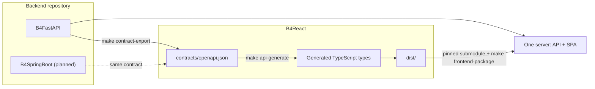

# B4Agent overview

B4Agent is a full-stack web server blueprint built for agentic coding. It combines a backend blueprint, a shared frontend, and a verification harness so that a team, or an agent working for it, can start a production-shaped project from the first commit.

<CardGrid>
    <Card
        icon="server"
        title="B4FastAPI"
        badge="Backend"
        href="https://github.com/Blueprint4Agent/B4FastAPI"
    >
        FastAPI, SQLAlchemy, Alembic, Redis, Celery, and Docker delivery.
    </Card>
    <Card
        icon="frontend"
        title="B4React"
        badge="Frontend"
        href="https://github.com/Blueprint4Agent/B4React"
    >
        React, TypeScript, and Vite with an optional Tauri desktop shell.
    </Card>
    <Card
        icon="leaf"
        title="B4SpringBoot"
        badge="Planned"
        badgeTone="planned"
        href="/docs/backends/b4springboot"
    >
        A Spring Boot backend for the same frontend and API contract.
    </Card>
</CardGrid>

## Project purpose

Most templates stop at a runnable skeleton. B4Agent also ships the rules an agent needs to keep the project healthy:

- **De facto first.** Mainstream libraries and conventions, so generated code looks like code a team would write by hand.
- **Guides agents can follow.** Every repository has an `AGENTS.md` read order, domain guides, and runtime loops to check before changing code.
- **Verification by default.** Change-scoped checks, pinned API contracts, architecture boundaries, worklogs, and git governance run locally through Git hooks before every push.

## Project composition

| Repository                                                                                | Role                                                                       | Stack                                          |
| ----------------------------------------------------------------------------------------- | -------------------------------------------------------------------------- | ---------------------------------------------- |
| [B4FastAPI](https://github.com/Blueprint4Agent/B4FastAPI)                                 | Backend blueprint, OpenAPI provider, integrated packaging, Docker delivery | FastAPI, SQLAlchemy, Alembic, Redis, Celery    |
| [B4React](https://github.com/Blueprint4Agent/B4React)                                     | Shared frontend, pinned as a Git submodule at `src/frontend`               | React, TypeScript, Vite, Tauri 2, lucide icons |
| B4SpringBoot                                                                              | Planned backend blueprint on the same contract                             | Spring Boot                                    |
| [Blueprint4Agent.github.io](https://github.com/Blueprint4Agent/Blueprint4Agent.github.io) | This manual                                                                | Docusaurus                                     |

The organization also maintains [B4Bot](https://github.com/Blueprint4Agent/B4Bot), an agent-based issue generation action. It is independent of the blueprint stack and is not covered in this manual.

## How the pieces connect

1. The backend exports its OpenAPI schema to `contracts/openapi.json`.
2. B4React adopts that snapshot, generates TypeScript types, and builds `dist/`.
3. The backend pins a reviewed B4React commit and packages its `dist/` into the backend static directory, so one server serves both the API and the SPA.
4. A second backend, such as B4SpringBoot, can serve the same frontend by implementing the same contract.

## Where to go next

<CardGrid columns={2}>
    <Card icon="rocket" title="Quick start" href="/docs/getting-started/quick-start">
        Clone, install, and run the backend and frontend locally.
    </Card>
    <Card icon="sparkles" title="Features" href="/docs/features">
        Everything that works out of the box, one page per feature.
    </Card>
    <Card icon="settings" title="Environment & options" href="/docs/environment">
        Environment variables, data stores, observability, Docker, and make targets.
    </Card>
    <Card icon="list-checks" title="Verification" href="/docs/verification">
        How changes are checked, committed, and reviewed.
    </Card>
</CardGrid>
