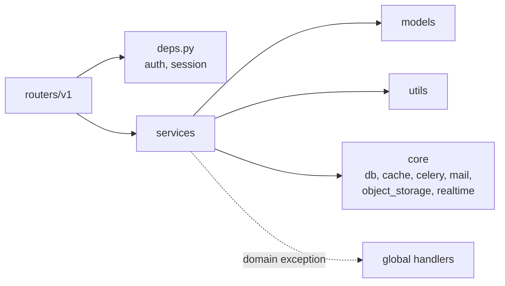
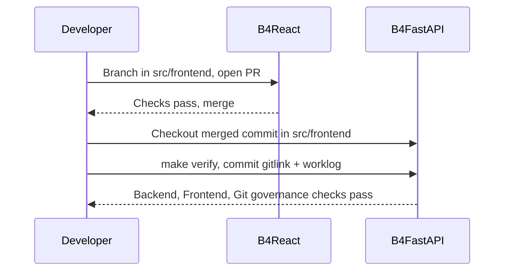

# Repository layout

B4FastAPI is the repository you clone and deploy. B4React lives inside it as a pinned Git submodule, so the frontend has its own history, reviews, and releases.

## Ownership

| Concern                                                    | Owner                                       |
| ---------------------------------------------------------- | ------------------------------------------- |
| Backend code, OpenAPI export, migrations                   | B4FastAPI `src/backend/`                    |
| Integrated packaging, Docker, release workflows            | B4FastAPI `docker/`, `.github/workflows/`   |
| Frontend source, tests, desktop shell, generated API types | B4React (`src/frontend/` in B4FastAPI)      |
| The API contract both sides agree on                       | `contracts/openapi.json` in each repository |

## B4FastAPI tree

```text
B4FastAPI/
├── AGENTS.md              # agent read order, verification, and git governance
├── DEPLOY.md              # Docker deployment modes and pipelines
├── PROJECT_SETUP.md       # project.json initialization
├── Makefile               # every workflow hook (make help)
├── project.example.json
├── branding/              # optional project logos
├── contracts/             # exported OpenAPI baseline
├── docker/
│   ├── docker-compose.yml
│   ├── observability/     # collector, Tempo, Loki, Prometheus, Grafana config
│   └── scripts/           # build, up, down, deploy, export
├── notes/                 # verification, collections, submodule guides (+ ko/)
├── scripts/               # env, verification, governance, and architecture tooling
├── src/
│   ├── backend/           # FastAPI app, Alembic, tests, backend guides
│   └── frontend/          # B4React submodule
└── worklog/               # one entry per commit
```

The backend application follows a strict layering:

```text
src/backend/app/
├── routers/v1/   # HTTP endpoints (auth, admin, api-keys, billing, events)
├── services/     # domain logic called by routers
├── models/       # SQLAlchemy models and Pydantic schemas
├── core/         # config, db, cache, celery, mail, object_storage, realtime, observability, errors
└── utils/        # cookies, security, tokens
```

Routers delegate to services, and lower layers never import routers. `make architecture-check` enforces these boundaries.



## Working with the submodule



The submodule is checked out at a detached commit. Frontend changes go to B4React first:

1. Create a named branch inside `src/frontend`, push it to B4React, and open a PR there.
2. After it merges, move the pin in B4FastAPI:

    ```bash
    git -C src/frontend fetch origin
    git -C src/frontend checkout <reviewed-commit-sha>
    make verify
    git add src/frontend
    ```

3. Commit the new gitlink with a worklog and open the B4FastAPI PR.

:::warning

Never run `git submodule update --remote` in CI. Builds always use the reviewed, pinned commit.

:::

## Changing the API contract

1. Change FastAPI declarations and run `make contract-export` on a backend branch.
2. In a B4React branch, adopt the snapshot into `contracts/openapi.json`, record its source commit in `contracts/source.json`, run `make api-generate`, and update consumers.
3. Merge B4React first, then pin that commit in the backend PR and run `make verify`.

`make contract-check` requires the backend export and the pinned frontend snapshot to be equal, so a contract change cannot land on one side only.

## Build ownership

| Command                 | Output                                                      |
| ----------------------- | ----------------------------------------------------------- |
| `make frontend-build`   | `src/frontend/dist` only                                    |
| `make frontend-package` | Builds and copies `dist` into `src/backend/app/static/dist` |
| `make build`            | Backend environment plus integrated frontend packaging      |

With a packaged `dist`, the backend serves the SPA and falls back to `index.html` for non-API routes. B4React's `dist` can also be hosted separately with `VITE_API_BASE_URL` and matching backend CORS and cookie settings.
