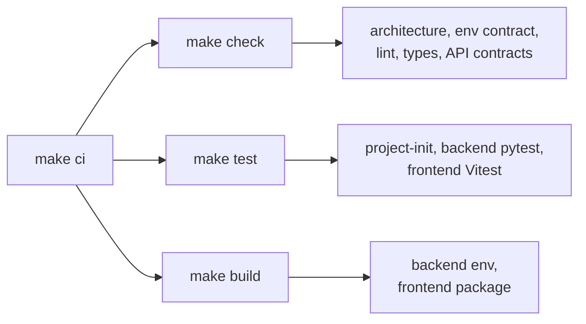

# Checks & tests

`make verify` selects from the same targets you can run directly. `make ci` runs all of them locally. Full verification also runs `make hooks-test`, which tests the Git hooks and receipt invalidation; `make verification-test` tests change classification.

## Aggregate targets



| Target       | Runs                                                                                                                                                                     |
| ------------ | ------------------------------------------------------------------------------------------------------------------------------------------------------------------------ |
| `make check` | `project-init-check`, `architecture-check`, `env-contract-check`, `backend-check`, `frontend-format-check`, `frontend-typecheck`, `contract-check`, `frontend-api-check` |
| `make test`  | `project-init-test`, `backend-test`, `frontend-test`                                                                                                                     |
| `make build` | `backend-build`, `frontend-package`                                                                                                                                      |
| `make ci`    | `check`, `test`, `build`                                                                                                                                                 |

## Static checks

| Check                                         | Guards                                                                                                                                                 |
| --------------------------------------------- | ------------------------------------------------------------------------------------------------------------------------------------------------------ |
| `backend-check`                               | Ruff lint and format                                                                                                                                   |
| `frontend-format-check`, `frontend-typecheck` | Prettier and strict TypeScript                                                                                                                         |
| `backend-architecture-check`                  | Routers never touch the DB layer; lower layers never import routers or `app.main`                                                                      |
| `frontend-architecture-check`                 | Pages and components use domain hooks instead of importing API modules; shared styles only in `app.css`; every shared UI export has a showcase example |
| `frontend-react-performance-check`            | State ownership, route splitting, and memoization safeguards                                                                                           |
| `env-contract-check`                          | Backend and Docker env examples declare the same shared keys                                                                                           |
| `contract-check`                              | Backend OpenAPI export equals the pinned B4React snapshot                                                                                              |
| `frontend-api-check`                          | Generated TypeScript types match the snapshot                                                                                                          |

## Backend tests

```bash
cd src/backend
uv run pytest                                  # everything (make backend-test)
uv run pytest -m api_test                      # router contract tests
uv run pytest -m primary_data                  # integration, clean data
uv run pytest -m mocked_data                   # integration, seeded data
uv run pytest -m email_enabled                 # EMAIL_ENABLED=true behavior
uv run pytest -m "mocked_data and scenario_flow"   # full-system scenarios
```

## Frontend tests

| Target                      | Runs                                                                                                    |
| --------------------------- | ------------------------------------------------------------------------------------------------------- |
| `make frontend-test`        | Vitest unit and component tests                                                                         |
| `make test-ui` (in B4React) | Chromium: prompt builder, component layout, tooltips, contrast, auth smoke, admin panel, config sharing |
| `make frontend-test-routes` | Production build: lazy routes, delayed and failed chunk downloads                                       |
| `make project-build-test`   | Custom-branded production build in English and Korean                                                   |

## Runtime loops

Before committing, confirm each relevant loop is followed, or record why it does not apply.

| Side     | Loop                 | Check that                                                                      |
| -------- | -------------------- | ------------------------------------------------------------------------------- |
| Backend  | Request lifecycle    | Router → `deps.py` → service → models/DB → domain result or exception → handler |
| Backend  | Domain event         | Services publish typed events after commit; routers never publish               |
| Backend  | Background task      | Slow or retryable work is queued with minimal payload and idempotent handling   |
| Frontend | API state            | Page → domain hook → API wrapper with generated types; components get props     |
| Frontend | Realtime refresh     | Domain realtime hooks refresh state in one place; reconnect logic stays in core |
| Frontend | Desktop connectivity | Work pauses while offline; recovery revalidates before resuming                 |
| Frontend | UI composition       | Reuse shared components and `app.css`; check mobile and desktop widths          |
