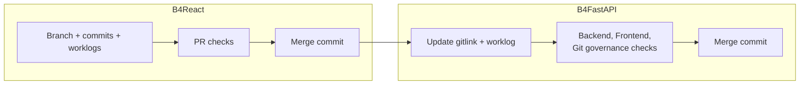

# Git governance

Commit and PR metadata follow fixed rules so that agents produce reviewable history. `make git-governance-check` validates them locally, and the required **Git governance** check validates every commit of a PR.

## Branches

```text
<type>/<short-kebab-title>
```

Types: `feat`, `fix`, `docs`, `test`, `refactor`, `chore`, `ci`, `build`, `perf`, `style`, `revert`, `hotfix`. Example: `feat/api-key-pagination`.

## Commits

The title follows Conventional Commits, and non-trivial bodies need three sections:

```text
feat(frontend): add API key pagination

Changes:
- What changed.

Affected Files:
- Key files or directories.

Verification:
- How it was tested.
```

## Worklogs

Every commit adds or modifies `worklog/NNNN-short-kebab-title.md`. Its `# Commit Title` must equal the actual commit title, and every section must be filled in:

| Section            | Content                                                                            |
| ------------------ | ---------------------------------------------------------------------------------- |
| Commit Title       | The exact commit title                                                             |
| Changed File Scope | Files and layers changed                                                           |
| Reason             | Problem and intended outcome                                                       |
| Design             | Request, service, data, event, or page and hook path; contract or migration impact |
| Verification Plan  | Make targets and runtime checks planned                                            |
| Impact             | Behavior, compatibility, rollout, and data implications                            |
| Loop Alignment     | Runtime loops applied, and why others do not apply                                 |
| Verification       | Observed results and reasons for skipped checks                                    |

Frontend runtime changes in B4React also need **State Ownership**, **Memoization**, and **Performance Evidence** sections.

## Pull requests

- Title: `[type] Concise title`, for example `[feat] Add API key pagination`.
- Description sections: Summary, Scope, Reason, Verification, Documentation, Risk / Impact (the Korean headings 요약, 범위, 이유, 검증, 문서, 위험 / 영향 are also accepted).
- Open PRs ready for review. Use drafts only when asked or when a blocker remains.
- Merge with a merge commit, including auto-merge: `gh pr merge <number> --auto --merge`. Squash and rebase require an explicit request.

## Validating before you commit

```bash
COMMIT_TITLE="feat(frontend): add API key pagination" \
COMMIT_BODY_FILE=/tmp/body.txt \
PR_TITLE="[feat] Add API key pagination" \
PR_BODY_FILE=/tmp/pr.md \
make git-governance-check
```

With `COMMIT_TITLE`, the check validates the staged snapshot; without it, it checks `HEAD`. Untracked worklogs do not count.

## Across repositories



B4React has the same rules and its own harness. Frontend changes are committed and merged in B4React first; B4FastAPI then commits the updated gitlink with its own worklog. This manual repository uses the same branch, commit, worklog, and PR rules.
