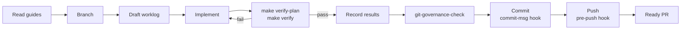
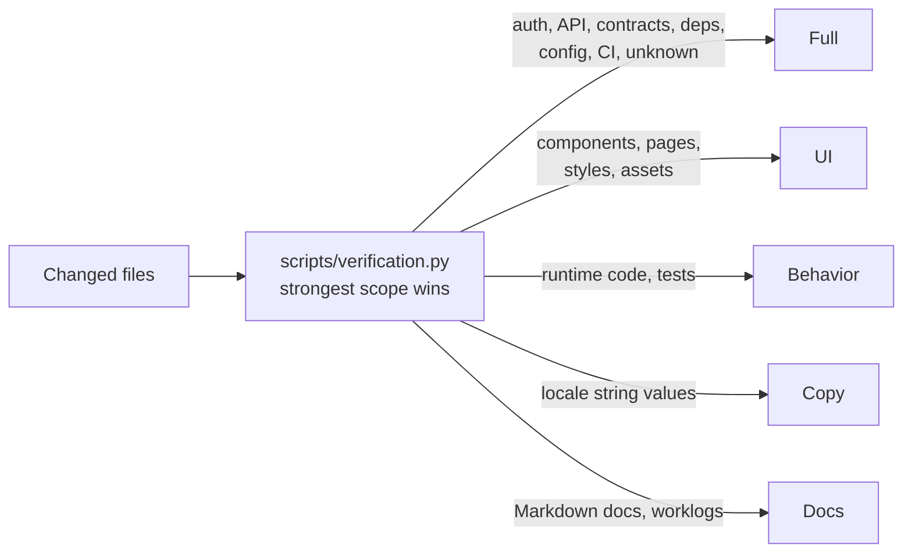
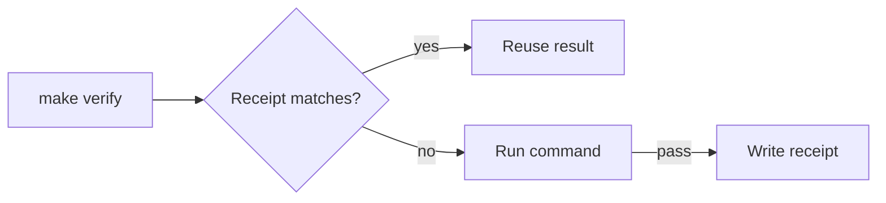

# Verification process

Every task in B4Agent follows the same loop, whether a person or an agent does the work. The checks are selected from the actual change, so a documentation fix does not pay for a full build, and a risky change cannot skip one.

## Task loop



1. **Read.** `AGENTS.md`, then the domain guide (`src/backend/BACKEND.md` or `src/frontend/FRONTEND.md`), then the relevant README or test guide.
2. **Branch.** Create `<type>/<short-kebab-title>`.
3. **Plan.** Draft `worklog/NNNN-title.md` from `.github/WORKLOG_TEMPLATE.md`: reason, design, verification plan, and the runtime loops involved.
4. **Implement.** Keep the change scoped to one work unit.
5. **Verify.** `make verify-plan`, then `make verify`.
6. **Record.** Write the observed results, and any skipped checks with reasons, into the worklog.
7. **Validate metadata.** `COMMIT_TITLE=... COMMIT_BODY_FILE=... make git-governance-check`.
8. **Commit and push.** The `commit-msg` hook checks the message and its staged worklog; the `pre-push` hook verifies the whole branch. Then open a ready PR and check its actual metadata with `PR_NUMBER=<number> make git-governance-pr-check`.

## Change-scoped verification

```bash
make verify-plan   # show the scope and the commands it selects
make verify        # run them
```

`scripts/verification.py` classifies the changed files. `make verify`, the pre-push hook, and manual workflows use the same planner.



| Scope    | Changes                                                                                              | Verification                                                                     |
| -------- | ---------------------------------------------------------------------------------------------------- | -------------------------------------------------------------------------------- |
| Docs     | Markdown documentation and worklogs (not `AGENTS.md`)                                                | Text, whitespace, and UTF-8 checks                                               |
| Copy     | Locale JSON string values with identical keys, placeholders, and markup                              | Text and JSON validation, including duplicate keys                               |
| Behavior | Non-protected runtime utilities, hooks, tests; backend application code                              | Affected domain checks and tests, frontend build                                 |
| UI       | Components, pages, styles, assets, browser tests                                                     | Frontend checks, tests, build, and the browser UI suite                          |
| Full     | Auth, session, API, connectivity, contracts, dependencies, configuration, CI, tooling, unknown paths | Every affected check, production routes, style studio, integration and packaging |

- Mixed changes take the strongest scope. There is no downgrade flag or label bypass.
- Backend application changes always run the entire backend suite.
- Locale additions, deletions, renamed keys, or changed interpolation require full verification.

### Options

| Option                                           | Effect                                                                     |
| ------------------------------------------------ | -------------------------------------------------------------------------- |
| _(default)_                                      | Compare `HEAD` with the working tree, including staged and untracked files |
| `VERIFY_BASE=$(git merge-base origin/main HEAD)` | Verify the whole branch                                                    |
| `VERIFY_FULL=1`                                  | Force every check                                                          |
| `make verify-light`                              | Text and JSON checks only, without installing dependencies                 |
| `python3 scripts/verification.py plan --json`    | Machine-readable plan                                                      |

Full output goes to `.git/verification-logs/`. On failure the runner prints the last 80 lines.

### Affected suites

Within a scope, the planner narrows tests only where ownership is registered:

- Registered billing and admin pages, features, and domain hooks select their own unit, integration, and browser suites.
- Edits confined to a registered component's JSX return select its reviewed render scenarios; CSS is narrowed only when every changed selector resolves to registered components.
- Static checks, types, contracts, builds, and git governance always run. Backend application changes always run the full backend suite.
- Shared, unmapped, protected (auth, API, config), or unknown changes fall back to broad suites.

## Verification receipts

`make verify` stores a receipt for every successful command under `.git/verification-receipts/`. An identical command with identical inputs reuses its receipt instead of running again, so the pre-push hook and parent integration do not repeat checks that already passed.



| A receipt is invalidated by                             | Not by                   |
| ------------------------------------------------------- | ------------------------ |
| Changed source, config, docs, branding, or build output | Worklog-only edits       |
| Changed tools, tool versions, or environment            | Duplicate `PATH` entries |
| Age over 24 hours, corruption, or a failed rerun        |                          |

- B4FastAPI reuses identical B4React receipts during integration, and still runs its own branding, contract, and packaging checks.
- Use one shell and toolchain per task, for example `make -C src/frontend verify` and `git -C src/frontend push` from the parent.
- `VERIFY_FULL=1 make verify` and manual workflows ignore receipts and scoped selection.
- Receipts are local evidence, not signed CI attestations.

## Local Git hooks \{#local-git-hooks\}

`make hooks-install` (run by `make init`) sets `core.hooksPath=.githooks` in the clone, and in the B4React submodule.

| Hook         | Checks                                                                                                                                                                    |
| ------------ | ------------------------------------------------------------------------------------------------------------------------------------------------------------------------- |
| `commit-msg` | Conventional Commit title and body, and a matching staged worklog. Integration merges are exempt.                                                                         |
| `pre-push`   | A clean tree including submodules, pushed refs equal to `HEAD`, every non-merge commit since the merge base with remote `main`, then `make verify-plan` and `make verify` |

Missing history, network, or dependencies, or a failed check, block the push. `make hooks-test` tests the hooks in isolated repositories.

## GitHub workflows

| Workflow            | Runs                                                       |
| ------------------- | ---------------------------------------------------------- |
| `build.yml`         | Full checks for a ref or PR; publishes an image on request |
| `governance.yml`    | Git governance for a given PR number                       |
| `desktop-build.yml` | Desktop bundles for a selected ref                         |

All workflows run only on manual dispatch, with full verification and no receipts. `main` requires a pull request and resolved conversations, and forbids deletion and force pushes; there are no required status checks and zero required approvals. Because hooks can be skipped or not installed, contributors and agents must install them, keep worklog evidence, and check PR metadata before merging.

## Evidence rules

- Do not rerun a check that already passed for the same content; record the earlier result instead.
- New runtime edits invalidate earlier runtime evidence.
- Keep related edits in one task PR. For frontend work, merge B4React first, then update the backend pin once.
- Read the runner's summary and failure excerpts instead of dumping every log.
