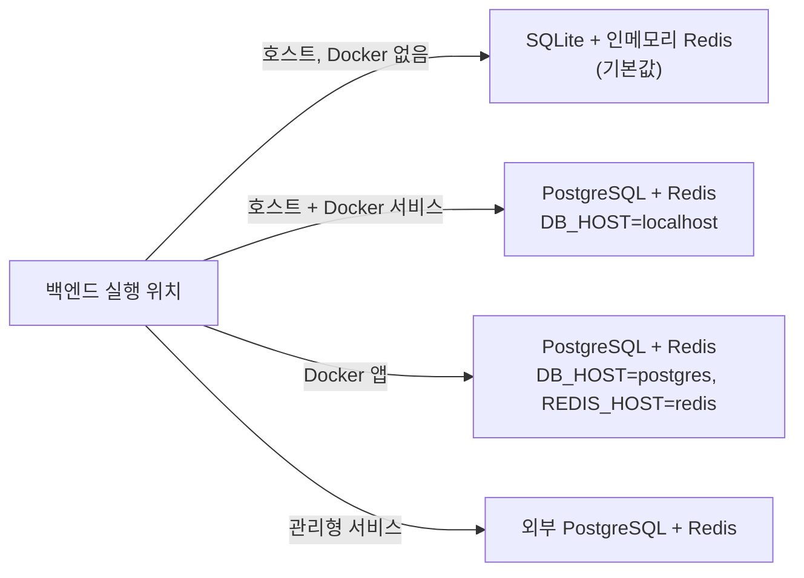

# 데이터베이스와 Redis

백엔드는 로컬 개발에서 SQLite와 인메모리 Redis로, Docker나 운영 환경에서는 PostgreSQL과 실제 Redis로 실행됩니다. 둘 다 환경변수로 선택합니다.

## 데이터베이스 선택



| 실행 환경                         | `DB_DRIVER`          | `DB_NAME`                                 | `DB_HOST`   |
| --------------------------------- | -------------------- | ----------------------------------------- | ----------- |
| 로컬 SQLite(개발 기본값)          | `sqlite+aiosqlite`   | `template.db`(파일)                       | 무시        |
| 호스트 백엔드 + Docker PostgreSQL | `postgresql+asyncpg` | `template`(데이터베이스)                  | `localhost` |
| Docker 앱 + Docker PostgreSQL     | `postgresql+asyncpg` | `template`(데이터베이스)                  | `postgres`  |
| Docker 앱 + SQLite                | `sqlite+aiosqlite`   | `/var/lib/b4fastapi/database/template.db` | 무시        |

:::warning[엔진 전환]

`DB_DRIVER`와 `DB_NAME`은 함께 바꿉니다. `env-sync`는 기존 값을 유지하므로 `template.db`가 남아 있으면 PostgreSQL에서 `database "template.db" does not exist` 오류가 납니다.

:::

- 로컬 PostgreSQL 컨테이너는 볼륨이 새로 만들어질 때만 `DB_USER`, `DB_PASSWORD`, `DB_NAME`으로 사용자, 비밀번호, 데이터베이스를 만듭니다. 나중에 `.env`를 바꿔도 기존 비밀번호는 바뀌지 않으므로 볼륨을 지우지 말고 데이터베이스에서 변경합니다.
- 배포에서는 실제 `DB_PASSWORD`를 설정합니다. 비밀번호는 원문 그대로 입력하면 백엔드가 URL 인코딩합니다. 운영 사전 점검은 비어 있거나 `postgres`, `CHANGE_ME`인 비밀번호를 거부합니다.
- Docker SQLite는 앱과 메일 워커가 공유하는 `sqlite_data` 볼륨에 있어 컨테이너를 재생성해도 유지됩니다. 배포 명령은 상대 경로나 `/var/lib/b4fastapi/database` 밖의 경로를 거부합니다. 기존 SQLite 파일을 볼륨으로 옮기려면 쓰기를 멈추고 SQLite 백업 기능으로 백업한 뒤 가져오고, 트래픽을 다시 열기 전에 Alembic 리비전을 확인합니다.

## 마이그레이션

앱은 시작할 때 `alembic upgrade head`를 실행하고 `Database schema migration check complete (target=head).`를 로그로 남깁니다. 서버를 시작하지 않고 마이그레이션을 확인하거나 적용하려면 다음을 실행합니다.

```bash
make db-current   # 설정된 데이터베이스의 리비전 확인
make db-migrate   # 대기 중인 마이그레이션 모두 적용
```

모델을 바꿀 때는 다음을 실행합니다.

```bash
cd src/backend
uv run alembic revision --autogenerate -m "describe-schema-change"
# 생성된 스크립트 검토
uv run alembic upgrade head
uv run alembic downgrade -1   # downgrade 경로 확인
```

| 규칙                | 내용                                                                |
| ------------------- | ------------------------------------------------------------------- |
| 리비전 ID           | `NNNN_snake_case`, 최대 32자                                        |
| 데이터 마이그레이션 | 멱등하게 작성                                                       |
| 공유·운영 환경 실패 | downgrade하지 않고 롤포워드(`src/backend/MIGRATION_ROLLFORWARD.md`) |

## 백업과 복구

Docker PostgreSQL(저장소 루트에서 실행):

```bash
mkdir -p docker/artifacts/db-backups
docker compose -f docker/docker-compose.yml --env-file docker/.env exec -T postgres \
  sh -c 'pg_dump -U "$POSTGRES_USER" -d "$POSTGRES_DB" -Fc' > docker/artifacts/db-backups/template-$(date +%Y%m%d-%H%M%S).dump

docker compose -f docker/docker-compose.yml --env-file docker/.env exec -T postgres \
  sh -c 'pg_restore -U "$POSTGRES_USER" -d "$POSTGRES_DB" --clean --if-exists --no-owner --no-privileges' < docker/artifacts/db-backups/<file>.dump
```

`-T`는 TTY 할당을 꺼서 바이너리 덤프가 손상되지 않게 하며, 고정 컨테이너 이름 대신 Compose 서비스 이름을 사용합니다. SQLite는 `src/backend/template.db`, Docker에서는 `sqlite_data` 볼륨의 파일을 SQLite 백업 기능으로 백업합니다. 이미지 아카이브는 데이터 백업이 아닙니다.

복구 후에는 `uv run alembic upgrade head`와 스모크 테스트(`uv run pytest tests/test_smoke.py`)를 실행합니다. 운영 백업은 암호화해 보관하고 복구를 정기적으로 시험합니다. 외부 PostgreSQL은 `src/backend/DB_BACKUP_RESTORE.md`를 참고하세요.

## Redis

Redis는 로그인 잠금, 삭제·인증 코드, 실시간 pub/sub, Celery 브로커에 쓰입니다. API는 시작할 때 5초 제한으로 `PING`을 보내며, Redis에 연결할 수 없으면 시작이 중단됩니다.

| 모드          | 설정                                                                         | 용도                                    |
| ------------- | ---------------------------------------------------------------------------- | --------------------------------------- |
| 인메모리      | `REDIS_IN_MEMORY=true`                                                       | 서버 없는 로컬 개발, 단일 프로세스 전용 |
| 로컬 컨테이너 | `REDIS_IN_MEMORY=false`, `REDIS_HOST=redis`(Docker) 또는 `localhost`(호스트) | Docker Compose                          |
| 외부          | `REDIS_IN_MEMORY=false`, `REDIS_HOST=<host>`                                 | 관리형 Redis                            |

- `REDIS_PASSWORD`를 설정하면 로컬 컨테이너, 앱, 헬스체크 모두 인증을 사용합니다. 배포에서는 반드시 설정합니다.
- Celery는 API가 인메모리 모드여도 항상 실제 Redis가 필요합니다. [백그라운드 작업](/docs/features/background-jobs)을 참고하세요.

## 헬스체크

| 엔드포인트          | 확인 내용                                                   |
| ------------------- | ----------------------------------------------------------- |
| `GET /health/live`  | 프로세스 실행 여부                                          |
| `GET /health/ready` | 데이터베이스와 Redis 연결 여부(Docker와 데스크톱 앱이 사용) |
