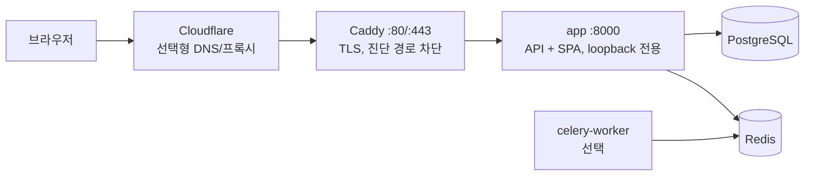
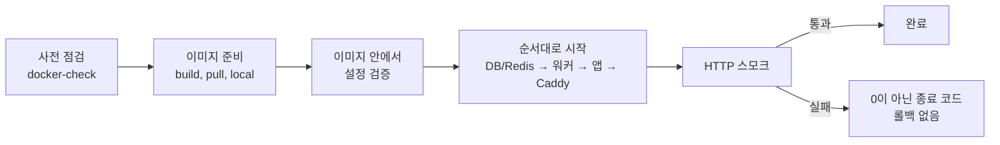

# 서버 배포

B4FastAPI는 모놀리식으로 배포됩니다. 하나의 앱 컨테이너가 `/api/v1`, `/config`, 패키징된 B4React SPA를 모두 제공하며 별도의 프론트엔드 서버는 없습니다. PostgreSQL, Redis, 선택형 워커는 그 옆에서 비공개로 실행되거나, 앱이 기존 외부 서비스에 연결합니다.

|               |                                                                                      |
| ------------- | ------------------------------------------------------------------------------------ |
| **호스트**    | Docker Engine과 Compose 플러그인, Python 3, Git, Make가 있는 Linux                   |
| **환경**      | `docker/.env`, 또는 `DOCKER_ENV_FILE`로 선택한 파일                                  |
| **명령**      | `make docker-init`, `docker-check`, `docker-deploy`, `docker-status`, `docker-smoke` |
| **공개 진입** | 루트 경로는 Caddy HTTPS 오버레이, basePath는 운영자가 관리하는 Nginx                 |

Node, uv, Python 의존성은 Docker 빌드 안에서 설치됩니다. Compose는 `up --wait --wait-timeout`과 `run --pull never`를 지원해야 합니다.

## 구성



- 인터넷에는 TCP 80과 443만 엽니다. 앱 포트 8000, PostgreSQL 5432, Redis 6379, 옵저버빌리티 포트는 비공개로 둡니다.
- 서버 CPU 아키텍처에 맞는 이미지를 빌드하거나 받습니다(예: AWS EC2의 arm64 또는 amd64).
- Cloudflare를 쓰면 원본 인증서가 발급될 때까지 DNS 전용 모드로 시작하고, 이후 필요하면 **Full (strict)**로 프록시를 켭니다. `/api/*`, `/config`, `/health/*`, 인증된 페이지, SSE는 캐시하지 않습니다.

## 초기화

```bash
git clone --recurse-submodules https://github.com/Blueprint4Agent/B4FastAPI.git
cd B4FastAPI
make docker-init PUBLIC_DOMAIN=app.example.com
```

`docker-init`은 서명 키, 데이터베이스, Redis용 무작위 자격 증명을 담은 **새** `docker/.env`를 권한 `0600`으로 만듭니다. 자격 증명을 출력하지 않으며 기존 파일은 덮어쓰지 않습니다. `PUBLIC_DOMAIN`을 주면 `APP_BASE_URL`, `CORS_ORIGINS`, 공개 공유 origin을 `https://<도메인>`으로 맞추고 `COMPOSE_FILE=docker-compose.yml:docker-compose.https.yml`을 저장합니다.

첫 배포 전에 파일을 검토합니다.

- `APP_MODE=production`과 `LOGIN_ENABLED=true`를 유지합니다.
- **데이터를 만들기 전에** 고정된 `COMPOSE_PROJECT_NAME`을 정합니다. 이 값이 네트워크와 볼륨을 선택하므로 업데이트를 위해 바꾸지 않습니다.
- `APP_IMAGE`에는 명시적인 릴리스 태그나 레지스트리 digest를 지정하고, 복구용으로 이전 값을 보관합니다.
- 이메일, OAuth, Stripe, 원격 오브젝트 스토리지는 제공자 설정을 마칠 때까지 꺼져 있습니다.

기존 설치에서는 키를 다시 만들지 말고 필요한 값만 직접 수정합니다. 다른 환경 파일을 쓰려면 모든 Docker 명령에 `DOCKER_ENV_FILE=/absolute/path/production.env`를 전달합니다. 셸 변수가 Compose 보간보다 우선하므로, 배포 대상을 바꿀 때는 남아 있는 `COMPOSE_FILE`, `PUBLIC_DOMAIN`, `APP_IMAGE` export를 지웁니다.

## 점검과 배포 \{#check-and-deploy\}

```bash
make docker-check
make docker-deploy
make docker-status
```



**사전 점검**(`docker-check`)은 Compose 설정을 출력하지 않고 해석하며 Docker 데몬 접근을 확인합니다. 외부 제공자에 연결하거나 DNS·인증서 발급을 보장하지는 않습니다. 운영 모드에서는 다음을 거부합니다.

| 검사           | 요구 사항                                                                                                         |
| -------------- | ----------------------------------------------------------------------------------------------------------------- |
| 로그인         | `LOGIN_ENABLED=true`                                                                                              |
| 서명 키        | [운영 서명 키](/docs/environment/runtime-modes#production-signing-key) 참고                                       |
| PostgreSQL     | `DB_PASSWORD`가 비어 있거나 `postgres`, `CHANGE_ME`가 아님                                                        |
| 로컬 Redis     | `REDIS_PASSWORD` 설정                                                                                             |
| SQLite         | `DB_NAME`이 `/var/lib/b4fastapi/database` 안의 절대 경로                                                          |
| HTTPS 오버레이 | `PUBLIC_DOMAIN`은 호스트 이름만, `APP_BASE_URL`·`CORS_ORIGINS`·`VITE_PUBLIC_SITE_URL`은 `https://<도메인>`과 일치 |
| basePath       | `APP_BASE_URL`이 `APP_BASE_PATH`로 끝나고 Caddy 오버레이를 선택하지 않음                                          |

**배포**는 이미지를 준비하고, 그 이미지 안에서 애플리케이션 설정을 검증한 뒤, 선택된 단계를 `--wait`로 하나씩 시작합니다. 순서는 로컬 PostgreSQL과 Redis(재생성하지 않음), 로그인과 이메일이 켜져 있을 때의 메일 워커, API, 선택된 경우 Caddy입니다. 앱, 워커, 프록시는 재생성되므로 단일 인스턴스 구성에서는 잠깐 트래픽이 끊길 수 있습니다. 같은 프로젝트를 동시에 두 번 배포하지 않습니다.

**스모크** 검사는 공개 HTTPS origin에서 정상적인 인증서 검증으로 실행하며, 오버레이가 없으면 loopback 앱 포트에서 실행합니다.

- `/health/ready`와 `/config`의 기대한 `app_mode`
- SPA HTML과 빌드된 JavaScript 자산 하나
- Caddy 사용 시 `/metrics`, `/docs`, OpenAPI 스키마가 404

각 단계와 HTTP 재시도 시간은 기본 120초입니다(`HEALTH_TIMEOUT_SECONDS`). 실패하면 0이 아닌 코드로 끝나고, 성공을 보고하지 않으며, 마이그레이션을 롤백하지 않습니다. 이미지 아카이브는 만들지 않습니다.

### 이미지 출처

| `DEPLOY_SOURCE` | 이미지                                         |
| --------------- | ---------------------------------------------- |
| `build`(기본)   | 이 체크아웃과 고정된 프론트엔드로 빌드         |
| `pull`          | 레지스트리에서 `APP_IMAGE`를 받음(먼저 로그인) |
| `local`         | 이 호스트에 이미 빌드했거나 로드한 이미지      |

pull 또는 local 이미지는 빌드할 때의 공개 프론트엔드 빌드 값을 그대로 유지합니다. `make docker-build`는 배포 없이 빌드·검증만 하고, `make docker-up`은 강제 재생성과 HTTP 스모크 없이 서비스를 시작하며, `make docker-export`는 의도적인 오프라인 전송을 위한 아카이브만 만듭니다.

## Caddy로 HTTPS 제공 \{#https\}

`docker/docker-compose.https.yml`은 포트 80·443과 영속 볼륨 `caddy_data`, `caddy_config`를 가진 `caddy` 서비스를 추가합니다.

- Caddy가 `PUBLIC_DOMAIN`의 TLS 인증서를 발급하고 갱신합니다.
- `/metrics`, `/docs`, `/redoc`, `/openapi.json`은 외부에서 404를 반환합니다. Prometheus는 비공개 네트워크에서 `app:8000`을 계속 수집할 수 있습니다.
- 응답을 버퍼링 없이 전달하므로 SSE가 프록시를 거쳐도 동작합니다.
- 앱은 비공개 Compose 네트워크에서 온 forwarded 헤더를 신뢰하므로 OAuth 리디렉션이 HTTPS를 유지합니다. 이 네트워크에는 신뢰할 수 있는 서비스만 연결합니다.

켜 둔 OAuth 콜백과 Stripe 반환·웹훅 URL을 HTTPS origin으로 바꾸고, API 문서가 필요 없으면 `SWAGGER_ENABLED=false`로 둡니다.

## Nginx 뒤 basePath \{#base-path\}

같은 이미지를 URL 접두사 아래에 마운트할 수 있어, 운영자가 관리하는 Nginx 뒤에서 여러 독립 앱이 하나의 호스트 이름을 함께 쓸 수 있습니다.

```dotenv
APP_BASE_PATH=/my-app
APP_BASE_URL=https://example.com/my-app
CORS_ORIGINS=https://example.com
VITE_PUBLIC_SITE_URL=https://example.com
APP_HOST_PORT=8001
COMPOSE_PROJECT_NAME=my-app
COMPOSE_FILE=docker-compose.yml
```

- `APP_BASE_PATH`는 런타임 전용입니다. FastAPI가 JavaScript 실행 전에 제공하는 HTML에 base path를 넣고 생성된 공유·검색 URL을 옮기므로, 한 번 빌드한 이미지를 어느 접두사에서든 실행할 수 있습니다. 접두사를 바꾸려면 환경과 Nginx 조각을 고친 뒤 `DEPLOY_SOURCE=local make docker-deploy`를 실행합니다. `docker restart`는 Compose 환경 파일을 다시 읽지 않습니다.
- 경로에는 ASCII 문자, 숫자, `_`, `-`, 단일 `/` 구분자만 쓸 수 있습니다. 중첩 경로도 가능하며 끝의 슬래시는 제거됩니다. 비어 있거나 `/`이면 루트입니다. `CORS_ORIGINS`와 `VITE_PUBLIC_SITE_URL`은 경로 없는 origin으로 둡니다.
- 앱마다 `docker/nginx/app-location.conf.template`을 `envsubst '${APP_BASE_PATH} ${APP_UPSTREAM}'`로 렌더링해 기존 HTTPS `server` 블록에 포함합니다. `proxy_pass`가 접두사를 제거하므로 `/my-app/api/v1/...`는 앱에 `/api/v1/...`로 도착합니다. Uvicorn `--root-path`는 함께 설정하지 않습니다. 이 조각은 SSE를 스트리밍하고 문서와 메트릭을 비공개로 유지합니다.
- `FORWARDED_ALLOW_IPS`에는 실제 비공개 프록시 IP나 CIDR을 지정합니다(기본 `127.0.0.1`). 외부에서 닿는 업스트림에는 절대 `*`를 쓰지 않습니다.
- refresh 쿠키는 `<basePath>/`로 범위가 정해지고 브라우저 저장소 키에도 경로가 들어갑니다. 접두사를 바꾸면 다시 로그인해야 합니다. 한 origin 안의 경로는 보안 경계가 아니므로 앱마다 비밀값과 데이터 저장소를 따로 둡니다.
- OAuth 콜백과 Stripe URL은 접두사를 포함해 등록합니다. 예: `https://example.com/my-app/api/v1/auth/oauth/google/callback`. 이메일 링크는 `APP_BASE_URL`을 따릅니다.
- `/robots.txt`와 IndexNow는 origin 전체에 적용되므로 게이트웨이 운영자가 도메인 루트에서 통합합니다.

`make base-path-deployment-test`는 임시 이미지 하나를 빌드해 실제 Nginx 뒤 두 접두사에서 실행하고 라우팅, 새로고침, 자산, SSE, 세션 격리를 확인합니다. Docker, 프론트엔드 의존성, Playwright Chromium이 필요하며 기존 스택은 건드리지 않습니다.

## 공개 빌드 값 \{#public-build-values\}

일부 값은 프론트엔드에 컴파일됩니다. 비밀값이 아닌 공개 값이며, 바꾸려면 다시 빌드해야 합니다(기본 `build` 출처로 `make docker-deploy`, 또는 수동 Build 워크플로의 새 입력).

| 변수                    | 효과                                                                       |
| ----------------------- | -------------------------------------------------------------------------- |
| `VITE_PUBLIC_SITE_URL`  | Open Graph·Twitter 태그용 HTTP(S) origin, 비우면 URL·이미지 태그 생략      |
| `VITE_SITE_DESCRIPTION` | 정적 HTML의 설명                                                           |
| `VITE_PUBLIC_DISCOVERY` | `/about/`, `/about/ko/`의 정적 B4A 소개와 `robots.txt`, `sitemap.xml` 게시 |
| `VITE_INDEXNOW_KEY`     | `/<key>.txt`로 제공되는 공개 IndexNow 소유 증명                            |

검색 공개를 켜면 앱 페이지는 `noindex`가 되고, 소개 URL만 사이트맵에 들어가며, `robots.txt`는 검색 크롤러를 허용하고 GPTBot과 ClaudeBot을 차단합니다. 검색 공개에는 기본 B4A 식별 정보와 공개 origin이 필요하며, 사용자 정의 프로젝트는 자체 콘텐츠를 게시합니다. 없는 `/about/` 페이지와 정적 파일은 SPA 대신 404를 반환합니다.

`INDEXNOW_ENABLED=true`이면 `make docker-deploy`가 성공한 뒤 배포된 검색 manifest를 `docker/.indexnow/accepted.json`과 비교해 추가·변경·삭제된 공개 URL만 제출합니다. 제출이 실패하면 명령은 실패하지만 정상 컨테이너를 롤백하지는 않습니다. `python3 scripts/indexnow.py --origin <origin> --key <key>`로 dry run을 확인할 수 있습니다.

## 업데이트와 복구

```bash
make docker-status
make docker-smoke
make docker-logs DOCKER_SERVICE=app
make docker-logs DOCKER_SERVICE=caddy
```

1. `docker-status`로 배포된 이미지 식별자를 기록하고 데이터베이스와 비공개 오브젝트 데이터를 백업합니다. 이미지 아카이브는 데이터 백업이 아닙니다.
2. 체크아웃을 갱신하고 `git submodule update --init --recursive`를 실행합니다. 마이그레이션을 검토합니다.
3. 같은 환경과 프로젝트로 새 명시적 이미지 태그를 배포하고 `docker-smoke`를 실행한 뒤, 브라우저에서 로그인, refresh, 설정된 제공자 콜백, SSE를 확인합니다.

배포가 실패해도 데이터와 인프라는 유지되지만 이전 API는 이미 교체되었을 수 있습니다. 스키마 호환성을 확인한 뒤 알려진 이전 `APP_IMAGE`를 `DEPLOY_SOURCE=pull` 또는 `local`로 다시 배포합니다. 호환되지 않는 마이그레이션이라면 쓰기를 멈춘 상태에서 백업으로 복원합니다. `make docker-down`은 named 볼륨을 유지합니다. 업데이트 단계로 `down -v`, 볼륨 prune, 프로젝트 이름 변경을 사용하지 않습니다.

Celery Beat와 옵저버빌리티 스택은 선택 사항입니다. 운영 중이라면 같은 릴리스로 직접 갱신합니다.

전체 운영 절차는 B4FastAPI의 `notes/monolithic-deployment.md`와 `notes/base-path-deployment.md`를, 서비스와 볼륨은 [Docker](/docs/environment/docker)를 참고하세요.
