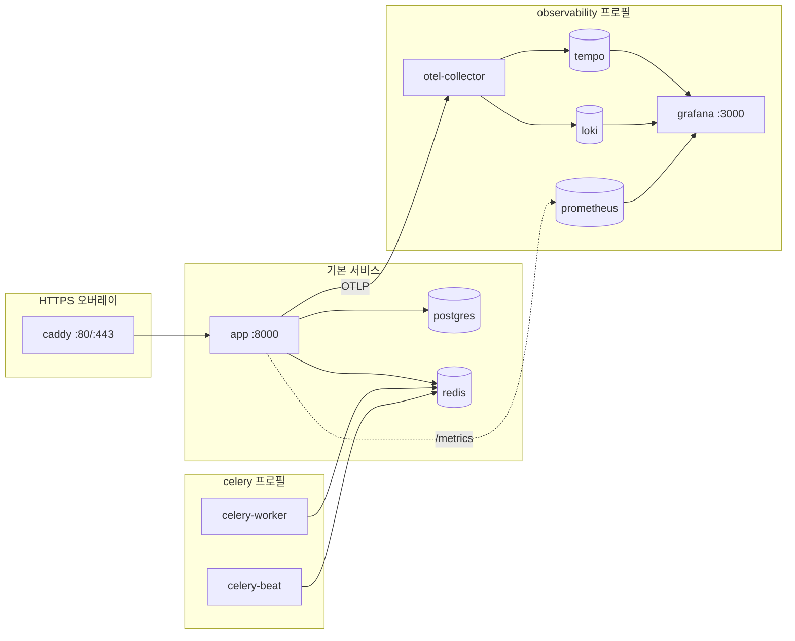

# Docker

하나의 앱 이미지가 API와 패키징된 B4React 프론트엔드를 함께 제공합니다. Docker Compose가 PostgreSQL, Redis, 선택형 Celery 프로세스, 선택형 Caddy HTTPS 프록시, 옵저버빌리티 스택을 더합니다. 운영 배포 절차는 [서버 배포](/docs/environment/deployment)를 참고하세요.

## 서비스



| 서비스           | 이미지                                         | 시작 조건                                                      | 용도                                        |
| ---------------- | ---------------------------------------------- | -------------------------------------------------------------- | ------------------------------------------- |
| `app`            | `APP_IMAGE`(기본 `blueprint4fastapi:local`)    | `make docker-up`                                               | FastAPI API와 SPA                           |
| `postgres`       | `postgres:16-alpine`                           | `DB_HOST=postgres`일 때 `docker-up`                            | 데이터베이스                                |
| `redis`          | `redis:7-alpine`                               | `REDIS_HOST=redis`일 때 `docker-up`                            | 캐시, pub/sub, Celery 브로커                |
| `celery-worker`  | 앱 이미지                                      | `celery` 프로필, 또는 로그인·이메일이 켜져 있을 때 `docker-up` | 백그라운드 작업(prefork, 프로세스 2개)      |
| `celery-beat`    | 앱 이미지                                      | `make docker-celery-up`                                        | 아웃박스·결제 스케줄(정확히 하나)           |
| `caddy`          | `caddy:2.11.7-alpine`(digest 고정)             | `COMPOSE_FILE`에 `docker-compose.https.yml` 포함               | 공개 HTTPS, TLS 인증서, 진단 경로 차단      |
| `otel-collector` | `otel/opentelemetry-collector-contrib:0.114.0` | `observability` 프로필                                         | OTLP 트레이스·로그 수신                     |
| `tempo`          | `grafana/tempo:2.6.1`                          | `observability` 프로필                                         | 트레이스 저장                               |
| `loki`           | `grafana/loki:3.6.0`                           | `observability` 프로필                                         | 로그 저장(7일 보관)                         |
| `loki-init`      | `busybox:1.37.0`                               | `observability` 프로필                                         | 1회성 볼륨 소유권 정리, `Exited (0)`은 정상 |
| `prometheus`     | `prom/prometheus:v2.55.1`                      | `observability` 프로필                                         | 메트릭                                      |
| `grafana`        | `grafana/grafana:11.3.1`                       | `observability` 프로필                                         | 대시보드와 Explore                          |

## 컨테이너 보안

- 앱, 워커, Beat는 UID/GID `10001:10001`로 실행되며 모든 Linux capability를 제거하고 `no-new-privileges`를 적용합니다.
- 새 named 볼륨은 이미지 디렉터리의 쓰기 가능한 소유권을 물려받습니다. 기존에 root 소유였던 오브젝트 스토리지, SQLite, Beat 볼륨은 업그레이드 전에 백업하고 UID/GID 10001로 옮겨야 하며, 소유권은 자동으로 바뀌지 않습니다.
- 앱 포트는 `127.0.0.1`에만 게시됩니다. 공개 트래픽은 [Caddy 오버레이](/docs/environment/deployment#https)나 운영자가 관리하는 프록시를 거칩니다.

## 배포 모드

`docker/.env`에서 모드를 고릅니다.

| 모드             | 데이터베이스    | Redis      | 핵심 설정                                                                                               |
| ---------------- | --------------- | ---------- | ------------------------------------------------------------------------------------------------------- |
| A. 로컬 컨테이너 | 로컬 PostgreSQL | 로컬 Redis | `DB_HOST=postgres`, `REDIS_IN_MEMORY=false`, `REDIS_HOST=redis`                                         |
| B. 외부 서비스   | 외부 PostgreSQL | 외부 Redis | `DB_HOST=<host>`, `DB_NAME=<기존 DB>`, `REDIS_HOST=<host>`                                              |
| C. 단일 컨테이너 | SQLite          | 인메모리   | `DB_DRIVER=sqlite+aiosqlite`, `DB_NAME=/var/lib/b4fastapi/database/template.db`, `REDIS_IN_MEMORY=true` |

Docker 명령은 해석된 앱 환경을 읽고 모드에 필요한 인프라만 시작합니다. 모드 C에서 SQLite 파일은 `sqlite_data` 볼륨에 있으며, 사전 점검은 상대 경로, `/var/lib/b4fastapi/database` 밖의 경로, `..` 세그먼트를 거부합니다. 인메모리 Redis는 영속되지 않고 API 프로세스 사이에서 공유되지 않습니다.

## 명령

| 명령                 | 동작                                                                                 |
| -------------------- | ------------------------------------------------------------------------------------ |
| `make init`          | 로컬용 `docker/.env`를 예시에서 생성                                                 |
| `make docker-init`   | 무작위 자격 증명으로 새 운영용 `docker/.env` 생성, `PUBLIC_DOMAIN`을 주면 HTTPS 구성 |
| `make docker-check`  | 비밀값을 출력하지 않고 해석된 설정을 사전 점검                                       |
| `make docker-build`  | 사전 점검, 이미지 빌드·검증(배포 없음)                                               |
| `make docker-up`     | 기존 이미지로 선택된 서비스를 시작하고 준비 상태까지 대기                            |
| `make docker-deploy` | 사전 점검, 이미지 준비(`DEPLOY_SOURCE`), 서비스 재생성, HTTP 스모크                  |
| `make docker-status` | 컨테이너와 이미지 식별자 표시                                                        |
| `make docker-smoke`  | 준비 상태, 런타임 설정, SPA, 공개 프록시 경계 확인                                   |
| `make docker-logs`   | `DOCKER_SERVICE`(기본 `app`)의 최근 100줄부터 따라가기                               |
| `make docker-down`   | 프로젝트를 멈추고 named 볼륨은 유지                                                  |
| `make docker-export` | 오프라인 전송용 이미지 아카이브를 `docker/artifacts/`에 저장                         |

모든 명령은 같은 환경 파일(`DOCKER_ENV_FILE`, 기본 `docker/.env`)과 그 안의 `COMPOSE_FILE` 오버레이 목록을 사용합니다. Python 표준 라이브러리 진입점으로 실행되므로 호스트에 uv가 필요 없습니다. 단계와 스모크 검사는 [점검과 배포](/docs/environment/deployment#check-and-deploy)를 참고하세요.

- 배포는 기존 PostgreSQL과 Redis 컨테이너를 재생성하지 않습니다. 설정을 바꿨다면 해당 서비스를 명시적으로 재생성합니다.

    ```bash
    docker compose -f docker/docker-compose.yml --env-file docker/.env up -d --no-deps --force-recreate postgres
    ```

- 시작 단계마다 최대 120초 기다리며 `HEALTH_TIMEOUT_SECONDS`로 바꿀 수 있습니다.

배포 후 `/health/live`, `/health/ready`, `/config`를 확인하고 앱 로그에서 `Database schema migration check complete (target=head).`를 찾습니다.

## 호스트 포트와 여러 스택

| 설정                                          | 기본값      | 바인딩      |
| --------------------------------------------- | ----------- | ----------- |
| `APP_HOST_PORT`                               | 8000        | `127.0.0.1` |
| `POSTGRES_HOST_PORT`                          | 5432        | `127.0.0.1` |
| `REDIS_HOST_PORT`                             | 6379        | `127.0.0.1` |
| `GRAFANA_HOST_PORT`                           | 3000        | `127.0.0.1` |
| `PROMETHEUS_HOST_PORT`                        | 9090        | `127.0.0.1` |
| `OTEL_GRPC_HOST_PORT` / `OTEL_HTTP_HOST_PORT` | 4317 / 4318 | `127.0.0.1` |

같은 호스트에서 두 번째 스택을 실행하려면 고유한 `COMPOSE_PROJECT_NAME`, 사용하지 않는 호스트 포트, 다른 `APP_IMAGE` 태그를 지정합니다. 새 프로젝트 이름은 새 볼륨을 만들 뿐 데이터를 옮기지 않습니다. 기존 설치는 `docker`를 유지합니다.

## 볼륨

| 볼륨                         | 마운트 위치            | 내용                                                                                  |
| ---------------------------- | ---------------------- | ------------------------------------------------------------------------------------- |
| `postgres_data`              | `postgres`             | 데이터베이스                                                                          |
| `redis_data`                 | `redis`                | Redis 데이터                                                                          |
| `object_storage_data`        | `app`, `celery-worker` | `OBJECT_STORAGE_LOCAL_ROOT`의 [로컬 오브젝트 스토리지](/docs/features/object-storage) |
| `sqlite_data`                | `app`, `celery-worker` | `/var/lib/b4fastapi/database`의 SQLite 데이터베이스                                   |
| `celery_beat_data`           | `celery-beat`          | Beat 스케줄 상태                                                                      |
| `caddy_data`, `caddy_config` | `caddy`                | TLS 인증서와 프록시 상태                                                              |

옵저버빌리티 서비스는 별도 볼륨을 사용합니다. 컨테이너를 다시 만들어도 볼륨은 유지되며, `docker compose down -v`는 볼륨을 삭제합니다. 데이터베이스와 오브젝트 스토리지는 함께 백업합니다.

## 운영 설정

`docker/.env.example`은 `APP_MODE=production`을 선택하므로 로그인을 켜 두어야 하고, 개발용 UI는 숨겨지며, [서명 키](/docs/environment/runtime-modes#production-signing-key)는 고유한 무작위 값이어야 합니다. 결제나 생명주기 메일을 켰다면 `make docker-celery-up`도 실행해 워커와 Beat가 웹훅, 메일 아웃박스, 동기화를 처리하게 합니다.

## 이미지 파이프라인

`.github/workflows/build.yml`은 수동 실행(Actions → Run workflow 또는 `gh workflow run`)으로만 동작합니다. 선택한 ref에 대해 백엔드·프론트엔드 검사를 실행하고, 요청한 경우에만 `docker/Dockerfile`로 이미지를 빌드해 게시합니다.

| 입력            | 효과                                            |
| --------------- | ----------------------------------------------- |
| `ref`           | 빌드할 브랜치, 태그, SHA(게시 시 기본값 `main`) |
| `pr_number`     | PR 검증, `ref`보다 우선하며 게시하지 않음       |
| `publish_image` | 이미지를 빌드해 `ghcr.io/<owner>/<repo>`에 게시 |

공개 프론트엔드 입력(`public_site_url`, `public_discovery`, `indexnow_key`, `coffee_enabled`, `coffee_url`)은 [공개 빌드 값](/docs/environment/deployment#public-build-values)으로 프론트엔드 빌드에 전달됩니다.

게시 태그는 `manual-<ref>`(예: `manual-main`), PR 선택 시 `manual-pr-<번호>`, 짧은 커밋 SHA입니다. PR, push, 스케줄, 태그, 릴리스에서 자동으로 실행되는 워크플로우는 없으며 nightly·릴리스 이미지도 없습니다.
