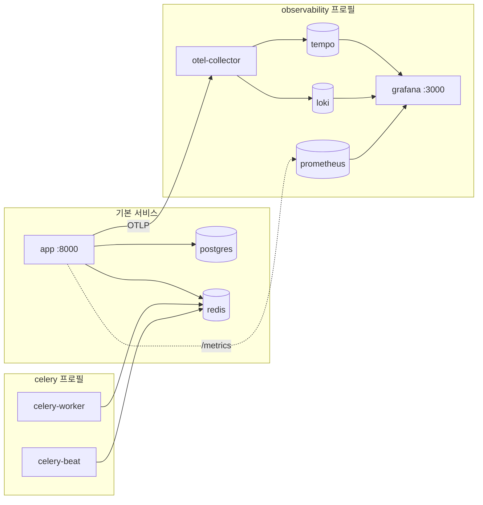
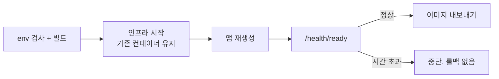

# Docker

하나의 앱 이미지가 API와 패키징된 B4React 프론트엔드를 함께 제공합니다. Docker Compose가 PostgreSQL, Redis, 선택형 Celery 프로세스, 옵저버빌리티 스택을 더합니다.

## 서비스



| 서비스           | 이미지                                         | 시작 조건                                                      | 용도                                        |
| ---------------- | ---------------------------------------------- | -------------------------------------------------------------- | ------------------------------------------- |
| `app`            | `APP_IMAGE`(기본 `blueprint4fastapi:local`)    | `make docker-up`                                               | FastAPI API와 SPA                           |
| `postgres`       | `postgres:16-alpine`                           | `DB_HOST=postgres`일 때 `docker-up`                            | 데이터베이스                                |
| `redis`          | `redis:7-alpine`                               | `REDIS_HOST=redis`일 때 `docker-up`                            | 캐시, pub/sub, Celery 브로커                |
| `celery-worker`  | 앱 이미지                                      | `celery` 프로필, 또는 로그인·이메일이 켜져 있을 때 `docker-up` | 백그라운드 작업(prefork, 프로세스 2개)      |
| `celery-beat`    | 앱 이미지                                      | `make docker-celery-up`                                        | 스케줄러(정확히 하나)                       |
| `otel-collector` | `otel/opentelemetry-collector-contrib:0.114.0` | `observability` 프로필                                         | OTLP 트레이스·로그 수신                     |
| `tempo`          | `grafana/tempo:2.6.1`                          | `observability` 프로필                                         | 트레이스 저장                               |
| `loki`           | `grafana/loki:3.6.0`                           | `observability` 프로필                                         | 로그 저장(7일 보관)                         |
| `loki-init`      | `busybox:1.37.0`                               | `observability` 프로필                                         | 1회성 볼륨 소유권 정리, `Exited (0)`은 정상 |
| `prometheus`     | `prom/prometheus:v2.55.1`                      | `observability` 프로필                                         | 메트릭                                      |
| `grafana`        | `grafana/grafana:11.3.1`                       | `observability` 프로필                                         | 대시보드와 Explore                          |

## 배포 모드

`docker/.env`에서 모드를 고릅니다.

| 모드             | 데이터베이스    | Redis      | 핵심 설정                                                                   |
| ---------------- | --------------- | ---------- | --------------------------------------------------------------------------- |
| A. 로컬 컨테이너 | 로컬 PostgreSQL | 로컬 Redis | `DB_HOST=postgres`, `REDIS_IN_MEMORY=false`, `REDIS_HOST=redis`             |
| B. 외부 서비스   | 외부 PostgreSQL | 외부 Redis | `DB_HOST=<host>`, `DB_NAME=<기존 DB>`, `REDIS_HOST=<host>`                  |
| C. 단일 컨테이너 | SQLite          | 인메모리   | `DB_DRIVER=sqlite+aiosqlite`, `DB_NAME=template.db`, `REDIS_IN_MEMORY=true` |

`make docker-up`은 해석된 앱 환경을 읽고 모드에 필요한 인프라만 시작합니다.

## 배포



```bash
make init                 # 최초 1회: docker/.env 생성
make docker-build         # 앱 이미지 빌드
make docker-up            # 인프라 후 앱 시작, /health/ready까지 대기
make docker-logs DOCKER_SERVICE=app
make docker-down
```

업데이트에는 한 번에 배포하는 명령을 사용합니다.

```bash
make docker-deploy
```

`docker/.env` 키를 확인하고, 이미지를 빌드하고, 앱만 재생성하고, 준비 상태를 기다린 뒤 이미지를 `docker/artifacts/`로 내보냅니다. 준비 상태 확인이 실패하면 내보내기 전에 멈추며 자동 롤백은 없습니다.

- 기존 PostgreSQL과 Redis 컨테이너는 유지됩니다(`--no-recreate`). 설정을 바꿨다면 해당 서비스를 명시적으로 재생성합니다.

    ```bash
    docker compose -f docker/docker-compose.yml --env-file docker/.env up -d --no-deps --force-recreate postgres
    ```

- 시작 단계마다 최대 120초 기다리며 `HEALTH_TIMEOUT_SECONDS`로 바꿀 수 있습니다.
- `uv`와 `up --wait --wait-timeout`을 지원하는 Docker Compose가 필요합니다.

배포 후 `http://localhost:8000/health/ready`를 확인하고 앱 로그에서 `Database schema migration check complete (target=head).`를 찾습니다.

## 호스트 포트와 여러 스택

| 설정                                          | 기본값      | 바인딩          |
| --------------------------------------------- | ----------- | --------------- |
| `APP_HOST_PORT`                               | 8000        | 모든 인터페이스 |
| `POSTGRES_HOST_PORT`                          | 5432        | `127.0.0.1`     |
| `REDIS_HOST_PORT`                             | 6379        | `127.0.0.1`     |
| `GRAFANA_HOST_PORT`                           | 3000        | `127.0.0.1`     |
| `PROMETHEUS_HOST_PORT`                        | 9090        | `127.0.0.1`     |
| `OTEL_GRPC_HOST_PORT` / `OTEL_HTTP_HOST_PORT` | 4317 / 4318 | `127.0.0.1`     |

같은 호스트에서 두 번째 스택을 실행하려면 고유한 `COMPOSE_PROJECT_NAME`, 사용하지 않는 호스트 포트, 다른 `APP_IMAGE` 태그를 지정합니다. 새 프로젝트 이름은 새 볼륨을 만들 뿐 데이터를 옮기지 않습니다. 기존 설치는 `docker`를 유지합니다.

## 이미지 파이프라인

`.github/workflows/build.yml`은 백엔드와 프론트엔드 검사를 실행하고, 게시할 때만 `docker/Dockerfile`로 이미지를 빌드합니다.

| 트리거                 | 검사 | `ghcr.io/<owner>/<repo>`에 게시 |
| ---------------------- | ---- | ------------------------------- |
| `main` 대상 PR         | 예   | 아니요                          |
| 야간(00:00 KST)        | 예   | `nightly-main`                  |
| 수동 실행              | 예   | `publish_image=true`일 때만     |
| 릴리스 게시, `v*` 태그 | 예   | 예                              |

`main`에 병합해도 이미지가 자동으로 빌드되지는 않습니다.
