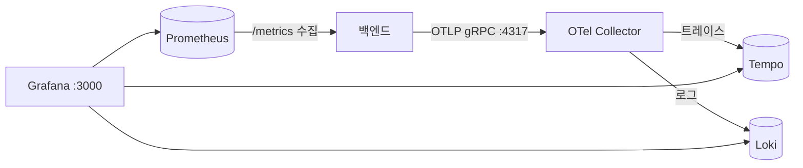

# 옵저버빌리티

백엔드는 Prometheus 메트릭을 제공하고 OpenTelemetry 트레이스와 로그를 내보냅니다. Collector, Tempo, Loki, Prometheus, Grafana로 이루어진 로컬 스택은 `observability` Compose 프로필로 실행됩니다.



| 신호     | 활성화                         | 저장소         | Grafana에서 조회               |
| -------- | ------------------------------ | -------------- | ------------------------------ |
| 메트릭   | `METRICS_ENABLED=true`(기본값) | Prometheus     | 대시보드, Explore → Prometheus |
| 트레이스 | `TRACING_ENABLED=true`         | Tempo          | Explore → Tempo                |
| 로그     | `LOGS_ENABLED=true`            | Loki(7일 보관) | Explore → Loki                 |

## 스택 시작

1. `make docker-env-sync`를 실행하고 `docker/.env`에 `GRAFANA_ADMIN_PASSWORD`를 설정합니다. 빈 값, `admin`, `CHANGE_ME*`는 거부됩니다.
2. `PROMETHEUS_BACKEND_TARGET`으로 Prometheus가 수집할 백엔드를 지정합니다.

    | 백엔드                        | 값                            |
    | ----------------------------- | ----------------------------- |
    | 호스트에서 `make backend-dev` | `host.docker.internal:8000`   |
    | 다른 포트의 호스트 백엔드     | `host.docker.internal:<port>` |
    | `make docker-up` 앱           | `app:8000`                    |

3. 스택을 시작합니다.

    ```bash
    make docker-observability-up
    ```

4. 백엔드 env 파일에서 원하는 신호를 켜고 백엔드를 재시작합니다. 호스트에서는 `OTEL_EXPORTER_OTLP_ENDPOINT=http://localhost:4317`, Docker에서는 `http://otel-collector:4317`을 사용합니다.
5. `http://localhost:3000`에서 Grafana를 엽니다.

`make docker-observability-down`은 옵저버빌리티 서비스만 멈추고 데이터 볼륨은 유지합니다. 앱, PostgreSQL, Redis는 계속 실행됩니다.

## 로그

```logql
{service_name="blueprint4fastapi-backend"}
```

- 애플리케이션, 워커, Uvicorn 서버, 접근 로그를 `LOG_LEVEL` 기준으로 원래 레코드 그대로 내보냅니다. 간결한 콘솔 형식은 [시작 화면과 콘솔 로그](/docs/environment/startup-and-logs)를 참고하세요.
- 요청 ID와 작업 ID는 라벨이 아닌 구조화 메타데이터입니다. `| request_id="..."` 또는 `| task_id="..."`로 필터링합니다.
- 로그는 메모리에서 묶어 보내므로 갑작스러운 종료나 긴 Collector 장애 시 유실될 수 있습니다. 감사 로그 용도가 아닙니다.

## 트레이스

- FastAPI, SQL, Redis 작업이 트레이스됩니다. `@observe_service("domain.action")`을 붙인 서비스는 결과와 오류 코드를 담은 span을 추가합니다.
- 응답 헤더 `X-Trace-ID`와 로그 레코드는 활성 span의 trace ID를 사용하므로 로그 한 줄에서 해당 트레이스로 이동할 수 있습니다.
- `/metrics`와 헬스체크 엔드포인트는 트레이싱에서 제외됩니다.

## 네트워크와 접근

- Grafana, Prometheus, OTLP 포트는 `127.0.0.1`에만 공개됩니다. 원격 접근은 SSH 터널을 사용합니다.
- Tempo와 Loki는 공개 포트가 없고 Grafana가 Compose 네트워크로 접근합니다.
- Grafana 익명 접근은 꺼져 있습니다.
