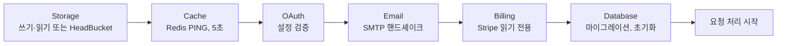

# 시작 화면과 콘솔 로그

API는 시작하는 동안 B4A 배너와 실시간 서비스 패널을, 종료할 때 정리 패널을 출력하며, 요청·애플리케이션 로그를 간결하게 정렬해 보여줍니다. 바뀌는 것은 콘솔 표시뿐이며, 파일·OTLP 핸들러는 원래 레코드를 그대로 받습니다.

|               |                                                 |
| ------------- | ----------------------------------------------- |
| **설정**      | `STARTUP_DISPLAY=auto\|plain\|off`(기본 `auto`) |
| **색상**      | 터미널 지원을 따르며 `NO_COLOR=1`로 끔          |
| **숨김 조건** | `LOG_LEVEL=WARNING` 이상                        |

## 시작 패널

헤더에 **Mode**(`APP_MODE` 기준 Development 또는 Production)와 **Login**(Enabled, 또는 부트스트랩 세션이 있는 Disabled)이 표시됩니다. 이어서 서비스별 행이 제자리에서 갱신됩니다.

```text
SERVICE     STACK             ENABLED  CHECK
Storage     Local             Yes      ✓ Verified
Cache       Redis             Yes      ✓ Verified
OAuth       Google · GitHub   Yes      ✓ Configured
Email       Gmail SMTP        Yes      ✓ Verified
Billing     Stripe · Test     No       — Not checked
Database    PostgreSQL        Yes      ✓ Ready
```



| 결과            | 의미                                                                                        |
| --------------- | ------------------------------------------------------------------------------------------- |
| Verified, Ready | 검사가 실제로 연결에 성공함                                                                 |
| Configured      | 설정은 유효하지만 연결은 시도하지 않음(OAuth, 또는 `SMTP_VALIDATE_ON_STARTUP=false`인 SMTP) |
| Not checked     | 해당 통합이 꺼져 있음                                                                       |
| Failed          | 시작이 중단되고 열린 클라이언트를 닫으며, 이후 서비스는 **Not run**으로 표시                |

스토리지, 캐시, 데이터베이스는 필수입니다. 스택 이름은 설정에서 정해집니다(Local, Amazon S3, Cloudflare R2, Supabase / Gmail SMTP 또는 SMTP / Stripe Test 또는 Live / PostgreSQL 또는 SQLite). 패널은 예외 타입만 보여주며 연결 문자열이나 제공자 응답은 표시하지 않습니다. 같은 시작 결과가 관리자 [서버 상태](/docs/features/admin-and-roles#server-status) 화면에도 표시됩니다.

## 종료 패널

정상 종료 시 Database, Cache, Storage가 Pending → Closing… → Closed로 바뀐 뒤 `B4A · Bye!!`가 표시됩니다. 이는 API 프로세스가 자신의 클라이언트를 닫는 과정이며, 데이터베이스·Redis·Celery를 멈추는 것은 아닙니다. 시작 실패, 정리 실패, 강제 종료에서는 작별 인사가 나오지 않습니다.

## 표시 모드

| 값      | 동작                                                                                                  |
| ------- | ----------------------------------------------------------------------------------------------------- |
| `auto`  | 76열 이상의 대화형 터미널에서는 애니메이션 패널, Docker와 리디렉션된 로그에서는 정적 배너와 최종 패널 |
| `plain` | 로그 수집용 줄 단위 생명주기 레코드                                                                   |
| `off`   | 기존 서비스·Uvicorn 생명주기 로그                                                                     |

dumb 터미널이나 좁은 터미널, Uvicorn 워커가 둘 이상인 경우(`--workers`, `WEB_CONCURRENCY`, `UVICORN_WORKERS`)에는 자동으로 plain 출력을 사용합니다.

## 콘솔 로그 형식

```text
19:22:15  GET     /api/v1/admin/status                                 200 OK
19:22:16  OPTIONS /api/v1/admin/status                                 400 Bad Request
```

- 로컬 `HH:MM:SS` 시각과 정렬된 메서드·경로·상태 열을 사용합니다. 클라이언트 포트, 반복되는 `INFO` 접두사, HTTP 버전은 생략하고 전체 경로와 쿼리 문자열은 유지합니다.
- 성공한 `2xx` `OPTIONS` 프리플라이트는 콘솔에서만 숨깁니다. 실패한 프리플라이트와 실제 요청은 모두 표시됩니다. `/metrics` 수집 요청은 접근 로그에서 제외됩니다.
- 애플리케이션 메시지도 같은 시각과 정렬된 레벨 열을 사용합니다. DEBUG와 오류 줄에는 `[source]` 태그가 붙고, `LOG_LEVEL=DEBUG`이면 모든 줄에 붙습니다. 요청·trace·작업 ID와 전체 traceback은 유지됩니다.
- 색상(256색 터미널): 메서드는 GET 초록, POST 청록, PUT 노랑, PATCH 자홍, DELETE 빨강, HEAD 파랑, OPTIONS 회색이며 시각은 회색, 경로는 파랑입니다. 심각도 라벨은 별도 팔레트(INFO 보라, WARNING 주황, ERROR 장미색, CRITICAL 버건디 배경의 흰색)와 더 옅은 메시지 색을 사용합니다.
- Docker와 파일 출력에는 터미널·색상 환경을 명시하지 않는 한 ANSI 코드가 들어가지 않습니다.

전체 사양은 B4FastAPI의 `notes/startup-display.md`, 내보내는 로그는 [옵저버빌리티](/docs/environment/observability)를 참고하세요.
