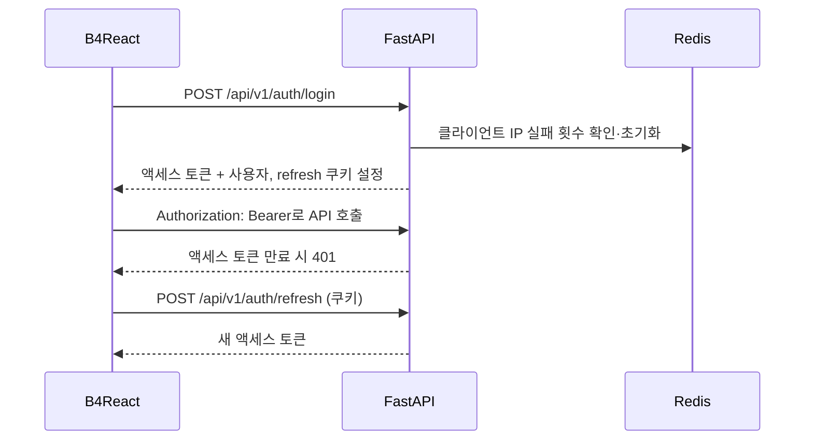
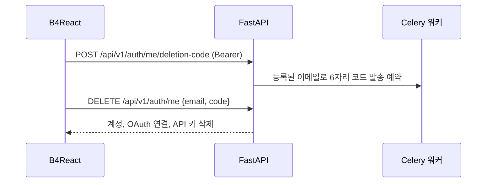

# 인증

짧은 수명의 액세스 토큰, refresh 쿠키, 로그인 잠금, 메일 인증을 거치는 계정 삭제, 단일 사용자 개발 도구를 위한 로그인 비활성화 모드를 갖춘 이메일·비밀번호 계정입니다.

|                |                                                                                                                        |
| -------------- | ---------------------------------------------------------------------------------------------------------------------- |
| **활성화**     | 기본 활성화(`LOGIN_ENABLED=true`)                                                                                      |
| **설정**       | `SECRET_KEY`, `ACCESS_TOKEN_EXPIRE_MINUTES`, `REFRESH_TOKEN_EXPIRE_DAYS`, `LOGIN_FAILED_LIMIT`, `LOGIN_LOCKED_MINUTES` |
| **엔드포인트** | `/api/v1/auth/signup`, `login`, `refresh`, `logout`, `me`, `token`, `me/password`, `me/deletion-code`                  |
| **프론트엔드** | 홈 화면 위에 뜨는 `/login`, `/signup` 대화상자                                                                         |

## 세션

1. `POST /api/v1/auth/login`은 본문으로 액세스 토큰과 사용자 정보를 반환합니다.
2. 동시에 HttpOnly 쿠키 `template_refresh_token`, `template_refresh_sid` 두 개를 설정합니다. HTTPS에서는 `Secure`, `SameSite=None`, HTTP에서는 `SameSite=Lax`를 사용합니다.
3. `remember_me=true`이면 쿠키가 `REFRESH_TOKEN_EXPIRE_DAYS` 동안 유지되고, 아니면 브라우저 세션 동안만 유지됩니다.
4. B4React는 액세스 토큰을 Bearer 토큰으로 보내고, 만료되면 `POST /api/v1/auth/refresh`를 호출합니다.
5. `POST /api/v1/auth/logout`은 세션을 정리합니다.

`POST /api/v1/auth/token`은 OAuth2 password 폼을 받으므로 Swagger UI의 **Authorize** 버튼이 동작합니다.

## 로그인 잠금

로그인 실패는 클라이언트 IP별로 Redis에 집계됩니다. `LOGIN_FAILED_LIMIT`(기본 5)회 실패하면 해당 IP의 로그인은 `LOGIN_LOCKED_MINUTES`(기본 5분) 동안 `ACCOUNT_LOCKED`를 반환합니다. 실패 응답에는 `remaining_attempts`가 포함됩니다.

여러 요청이 동시에 `401`을 받으면 B4React는 한 번의 갱신을 공유하고 각 요청을 최대 한 번만 다시 보냅니다.

## 역할

모든 사용자는 `user`, `manager`, `admin` 중 하나의 역할을 가집니다. 역할 검사가 있는 엔드포인트는 요청마다 현재 데이터베이스 역할을 확인합니다. [관리자와 역할](/docs/features/admin-and-roles)을 참고하세요.

## 계정 삭제 \{#account-deletion\}

사용자는 **설정 → 계정**에서 본인 계정을 삭제합니다. 삭제하려면 등록된 메일함에 접근할 수 있음을 증명해야 합니다.

1. `POST /api/v1/auth/me/deletion-code`는 계정에 등록된 주소로 6자리 코드를 보냅니다.
2. `POST /api/v1/auth/me/deletion-code/verify`는 코드를 소비하지 않고 확인합니다.
3. `DELETE /api/v1/auth/me`는 일치하는 이메일과 코드가 필요하며 코드를 소비합니다.
4. 모든 호출에 Bearer 세션이 필요하며 API 키는 거부됩니다. 이메일을 여는 것만으로는 아무것도 삭제되지 않습니다. 코드 규칙은 [이메일 코드](#email-codes)를 참고하세요.

- 이메일 기능이 켜져 있어야 하며, 로그인 비활성 부트스트랩 계정에는 제공되지 않습니다.
- 마지막 활성 관리자는 삭제할 수 없습니다.
- 구독 Checkout 기록이 있는 계정은 운영자가 Stripe에서 정리하기 전까지 `ACCOUNT_BILLING_REVIEW_REQUIRED`(409)를 반환합니다. [결제](/docs/features/billing)를 참고하세요.
- 삭제된 사용자 ID는 재사용되지 않으므로 이전 토큰이 새 계정을 가리키지 않습니다.
- 삭제 후에는 내구성 있는 생명주기 아웃박스로 완료 이메일을 보냅니다. [이메일](/docs/features/email)을 참고하세요.

## 비밀번호 변경 \{#password-change\}

이메일 비밀번호가 있는 사용자는 **설정 → 계정**에서 비밀번호를 변경합니다.

1. `POST /api/v1/auth/me/password/code`가 등록된 이메일로 6자리 코드를 보냅니다.
2. `POST /api/v1/auth/me/password/code/verify`는 코드를 소비하지 않고 확인하므로, 새 비밀번호 입력 전에 UI가 결과를 보여줄 수 있습니다.
3. `POST /api/v1/auth/me/password`에 `{code, password}`를 보내면 코드를 다시 검증·소비하고 새 비밀번호를 설정합니다. 가입·재설정과 같은 강도 규칙을 사용합니다.

- 세 호출 모두 Bearer 세션이 필요하며 API 키는 거부됩니다.
- refresh 세션이 폐기되므로 다른 브라우저는 다음 갱신 때 다시 로그인합니다. 이미 발급된 액세스 토큰은 정상 만료되며 API 키는 바뀌지 않습니다.
- OAuth 전용 계정은 해당 제공자에서 비밀번호를 관리합니다. `/auth/me`의 `has_password`로 UI가 이 기능의 적용 여부를 판단합니다.

## 이메일 코드 \{#email-codes\}

비밀번호 변경과 계정 삭제는 용도별로 키를 분리한 하나의 코드 방식을 공유합니다.

| 규칙            | 값                                                   |
| --------------- | ---------------------------------------------------- |
| 형식            | 6자리 숫자, 계정에 등록된 이메일로만 발송            |
| 유효 기간       | 10분, 가장 최근 코드만 유효                          |
| 사용            | 한 번만 사용, verify 엔드포인트는 소비·연장하지 않음 |
| 재발송          | 30초 후, 시간당 최대 5회                             |
| 잘못된 입력     | 5회 틀리면 남은 10분 동안 해당 용도가 잠김           |
| 이메일 비활성화 | 발급, 확인, 최종 작업 모두 거부                      |

코드는 Redis에 HMAC으로 저장됩니다. 캐시나 큐에 장애가 나면 안전하게 거부합니다.

## 로그인 비활성화 모드

로컬 내부 도구처럼 계정 없이 운영하려면 `LOGIN_ENABLED=false`로 설정합니다. `APP_MODE=development`에서만 허용됩니다.

- 시작 시 `BOOTSTRAP_USER_EMAIL`, `BOOTSTRAP_USER_NAME`으로 전용 부트스트랩 관리자가 준비됩니다. 일반 계정이 이미 그 이메일을 쓰고 있으면 시작이 실패합니다.
- `/config`가 프론트엔드에 부트스트랩 액세스 토큰을 전달하고, 앱은 로그인된 상태로 열립니다. 만료된 토큰은 `/config`로 갱신됩니다.
- 이메일과 OAuth는 런타임에 강제로 꺼집니다.

운영 모드가 부트스트랩 계정을 거부하는 방식은 [런타임 모드](/docs/environment/runtime-modes)를 참고하세요.

## 최근 계정

로그인 폼의 **계정 기억하기**는 선택 사항입니다. 브라우저는 최대 5개 계정을 90일 동안 보관하며(이메일, 이름, 제공자, 마지막 사용 시각, 선택적 아바타 썸네일), 비밀번호나 토큰은 저장하지 않습니다. 프로필 메뉴에서 기억된 계정으로 전환하거나 계정을 추가할 수 있고, 전환할 때는 항상 다시 로그인해야 합니다.

## 코드

- 백엔드: `src/backend/app/routers/v1/auth.py`, `services/auth.py`, `deps.py`, `utils/cookies.py`
- 프론트엔드: `src/frontend/src/pages/login/`, `hooks/api/auth/`
