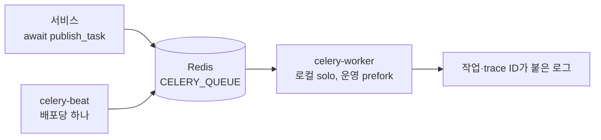

# 백그라운드 작업

Celery 5.6이 느리거나 재시도가 필요한 작업을 API 프로세스 밖에서 실행합니다. 계정 메일, 생명주기 알림, 결제 동기화가 사용하며, Beat는 아웃박스 스캔과 동기화 작업을 예약합니다.

|               |                                                                                   |
| ------------- | --------------------------------------------------------------------------------- |
| **필요 조건** | API가 `REDIS_IN_MEMORY=true`여도 실제 Redis 필요                                  |
| **설정**      | `CELERY_BROKER_URL`, `CELERY_QUEUE`, `CELERY_KEY_PREFIX`                          |
| **로컬**      | `make celery-worker`, `make celery-beat`, `make celery-ping`, `make celery-probe` |
| **Docker**    | `make docker-celery-up`, `make docker-celery-down`(`celery` Compose 프로필)       |



## 로컬 실행

Redis를 실행한 뒤 터미널을 나눠 사용합니다.

```bash
make celery-worker   # macOS 개발용 solo 풀
make celery-beat     # 아웃박스·결제 동기화 스케줄러
make celery-ping     # 실행 중인 워커 확인
make celery-probe    # 무해한 작업 전송, 워커 로그에서 "Celery probe completed" 확인
```

`CELERY_BROKER_URL`이 비어 있으면 `REDIS_HOST`, `REDIS_PORT`, `REDIS_DB`, `REDIS_PASSWORD`를 재사용합니다. TLS는 `rediss://` URL을 사용합니다. Linux 운영 환경에서는 prefork 풀을 사용합니다: `CELERY_POOL=prefork CELERY_CONCURRENCY=2 make celery-worker`

## 스케줄

Beat는 두 가지 스케줄을 실행하며, 해당 기능을 켰다면 필요합니다.

| 스케줄                   | 작업                            | 간격  | 필요한 기능                                                                  |
| ------------------------ | ------------------------------- | ----- | ---------------------------------------------------------------------------- |
| `lifecycle-mail-outbox`  | `b4fastapi.notifications.drain` | 60초  | [생명주기 이메일](/docs/features/email#lifecycle-email)                      |
| `billing-reconciliation` | `b4fastapi.billing.reconcile`   | 300초 | [구독 스냅샷](/docs/features/billing#webhooks-and-the-subscription-snapshot) |

## Docker 실행

워커(prefork, 프로세스 2개)와 Beat는 같은 앱 이미지를 사용합니다. `LOGIN_ENABLED`와 `EMAIL_ENABLED`가 모두 true이면 `make docker-up`과 `make docker-deploy`가 API보다 먼저 워커를 시작하고 상태를 확인합니다. Beat는 `make docker-celery-up`으로 시작하며, 결제나 생명주기 메일을 켰다면 워커와 함께 반드시 실행합니다. 배포마다 Beat는 정확히 하나만 실행합니다. 워커는 오브젝트 스토리지와 SQLite 볼륨을 마운트하며, 두 서비스 모두 권한 없는 UID 10001로 실행됩니다.

## 실행 규약

| 규칙          | 값                                                                 |
| ------------- | ------------------------------------------------------------------ |
| 직렬화와 시간 | JSON만 사용, UTC                                                   |
| 확인 응답     | 지연 ack, 워커 손실 시 재전달, prefetch 1                          |
| 시간 제한     | soft 240초, hard 300초, visibility timeout 3600초                  |
| 재시도        | 기본 없음, 작업별로 제한된 재시도 정의                             |
| 격리          | Redis를 공유하는 배포마다 `CELERY_QUEUE`, `CELERY_KEY_PREFIX` 분리 |

작업은 멱등이어야 합니다. 서비스에서 `await publish_task(name, payload=...)`로 발행하면 로그 연계를 위한 작업 ID와 trace ID가 붙습니다.

:::note

API 준비 상태 확인은 Celery를 포함하지 않습니다. 워커 가용성, 재시도 로그, 메일 실패 보관소는 따로 모니터링합니다.

:::

전체 규약은 B4FastAPI의 `src/backend/CELERY.md`를 참고하세요.
