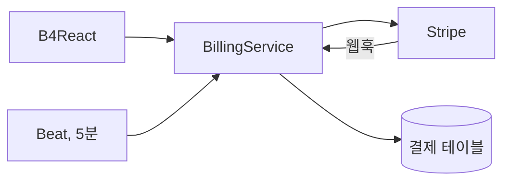
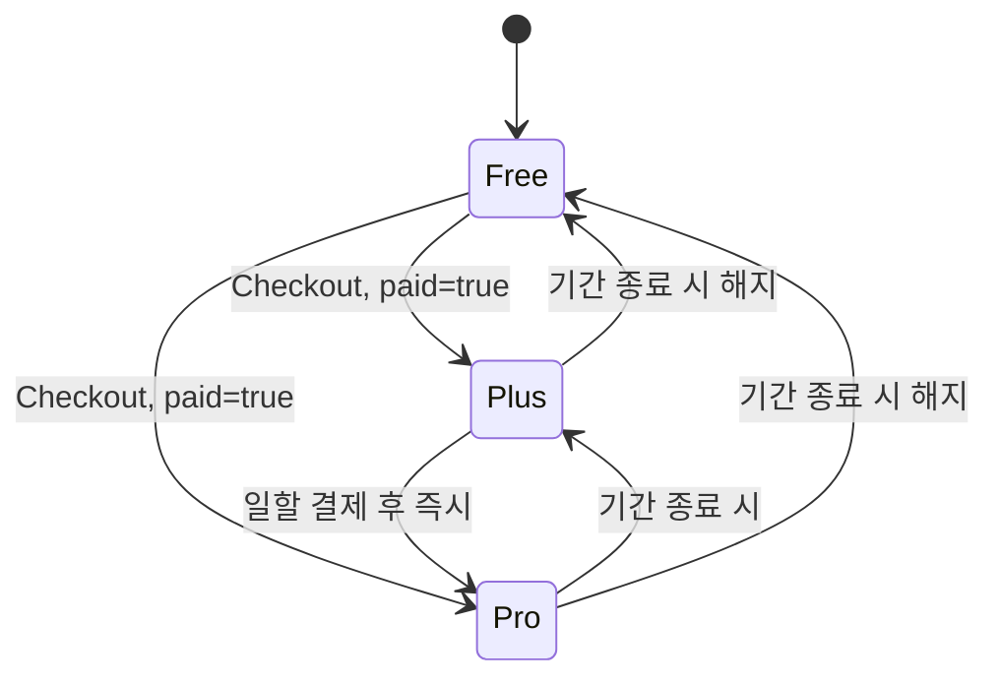

# 결제

Stripe 기반 결제 기능입니다. 카드와 Link 지갑 저장, 월간·연간 결제를 지원하는 Free/Plus/Pro 구독, 청구서, 청구 정보를 모두 앱 안에서 관리합니다. Stripe가 기준 정보이며, 백엔드는 고객 매핑, 예약, 검증된 구독 스냅샷만 저장합니다.

|                |                                                                                           |
| -------------- | ----------------------------------------------------------------------------------------- |
| **활성화**     | `STRIPE_ENABLED=true`(기본 꺼짐). 하나의 스위치가 모든 결제 기능을 함께 켭니다.           |
| **요구 사항**  | Stripe 시크릿 키, 정기 가격 ID, 복귀 URL. 웹훅과 동기화에는 Celery 워커와 Beat 1개        |
| **설정**       | `STRIPE_*` — [환경변수](/docs/environment/environment-variables#billing) 참고             |
| **엔드포인트** | `/api/v1/billing/*`(Bearer 또는 `X-API-Key`), `POST /api/v1/billing/webhook`(Stripe 서명) |
| **프론트엔드** | **설정 → 결제**, 프로필 메뉴의 `/plans`                                                   |

## 아키텍처

- **서버가 정하는 값.** 호출자는 고객, 가격, 금액, 복귀 URL을 지정할 수 없습니다. 요금제 요청에는 요금제, 통화, 요청 UUID만 담습니다.
- **제공자 검증 결과.** 복귀 URL은 성공의 증거가 아닙니다. Stripe 객체와 소유자를 확인하는 상태 엔드포인트(`registered=true`, `paid=true`)만 등록이나 결제를 확정합니다.
- **소유권과 모드.** 모든 고객, 세션, 결제수단, 청구서는 로그인한 사용자와 키의 테스트/라이브 모드로 확인합니다. 테스트와 라이브 매핑은 분리됩니다.
- **멱등성.** 같은 작업의 재시도는 같은 요청 UUID를 사용합니다. 고객별 데이터베이스 잠금과 영속적인 Checkout 예약이 여러 기기·워커에서 고객과 구독이 중복 생성되는 것을 막습니다.

## 시작 검증

`STRIPE_ENABLED=true`이면 API는 마이그레이션이나 요청 처리 전에 설정을 검증하고 Stripe를 읽기 전용으로 호출합니다.

1. 키 접두사, 복귀 URL, `{CHECKOUT_SESSION_ID}` 자리표시자, 라이브 모드의 HTTPS 여부
2. 인증 확인을 위한 읽기 전용 Checkout Session 목록 조회
3. 설정된 모든 가격 ID: 활성 상태, 정기 결제, 결제 주기·통화·모드 일치
4. `STRIPE_PORTAL_CONFIGURATION_ID`가 있으면 고객 포털 설정

하나라도 실패하면 시작이 중단됩니다. `STRIPE_ENABLED=false`이면 Stripe에 요청하지 않으며 `/config`는 `billing_enabled=false`를 반환합니다.

## 요금제와 가격

Free, Plus, Pro는 등급이고 월간·연간은 결제 주기입니다. `/plans`의 유료 카드는 각각 월간/연간 선택을 가지며, 공용 $/₩ 토글로 USD 또는 KRW 가격을 미리 볼 수 있습니다.

| 등급 | 월간 KRW / USD | 연간 KRW / USD   |
| ---- | -------------- | ---------------- |
| Plus | 3,990 / 3.99   | 43,092 / 43.09   |
| Pro  | 11,970 / 11.97 | 129,276 / 129.28 |

위 금액은 샌드박스 예시입니다. 실제 금액은 `GET /billing/plans`가 설정된 Stripe 가격에서 최소 통화 단위로 가져오며, KRW와 USD는 환율 변환이 아닌 별도 가격입니다.

| 가격 설정                                           | 용도                                        |
| --------------------------------------------------- | ------------------------------------------- |
| `STRIPE_{MONTHLY\|ANNUAL}_{KRW\|USD}_PRICE_ID`      | Plus 가격, 결제 활성화 시 필수              |
| `STRIPE_PLUS_{MONTHLY\|ANNUAL}_{KRW\|USD}_PRICE_ID` | 신규 구매용 Plus 대체 가격(선택)            |
| `STRIPE_PRO_{MONTHLY\|ANNUAL}_{KRW\|USD}_PRICE_ID`  | Pro 가격(선택), 비어 있는 옵션은 판매 안 함 |

## 구독 생명주기

| 변경                                | 적용 시점                                                            |
| ----------------------------------- | -------------------------------------------------------------------- |
| Free → 유료                         | Stripe 호스팅 Checkout, `GET /billing/checkout-sessions/{id}`로 확정 |
| Plus → Pro                          | Stripe가 일할 결제를 승인한 직후                                     |
| Pro → Plus, 같은 등급의 월간 ↔ 연간 | 결제된 기간이 끝날 때, 환불이나 추가 청구 없음                       |
| 해지(→ Free)                        | 결제된 기간이 끝날 때                                                |
| 예약된 변경 취소                    | 적용 전 언제든지(`plan: keep`)                                       |

- `POST /billing/subscription/change`는 목표 요금제, 확인 직전에 읽은 `change_version`, 요청 UUID를 받습니다. 버전이 오래되면 `BILLING_CHANGE_CONFLICT`(409)를 반환합니다.
- 업그레이드 결제가 대기 중이면 현재 등급을 유지하고, 결제나 인증을 마칠 수 있는 검증된 호스팅 청구서 링크를 제공합니다.
- 기존 구독은 결제 통화를 유지합니다. 단일 항목의 단순한 활성 구독만 직접 변경할 수 있으며, 할인·체험·일시정지·외부 스케줄은 운영자 검토가 필요합니다.

## 결제수단과 청구 정보

**설정 → 결제**는 현재 요금제, 거래 내역, 청구 정보, 결제수단, 요금제 해지 순으로 구성됩니다.

- **카드**는 `STRIPE_PUBLISHABLE_KEY`가 설정되면 Stripe Elements를 사용하는 앱 내 대화상자에서 추가합니다. 카드 정보는 Stripe로 직접 전송되며, `GET /billing/card-setups/{id}`로 등록을 확정합니다. 호스팅 Checkout 등록(카드, Link)도 계속 사용할 수 있습니다.
- 저장된 카드는 브랜드, 끝 네 자리, 만료일을 보여줍니다. **Link** 지갑은 Stripe가 카드 정보를 제공하지 않으므로 Link 로고로 표시합니다.
- 결제수단을 기본으로 지정하거나 삭제합니다. 활성 구독의 기본 결제수단은 다른 기본 결제수단을 지정하기 전까지 삭제할 수 없습니다(`BILLING_METHOD_REQUIRED`).
- **청구 정보**는 이메일, 이름, 주소를 편집합니다. 공개 키가 있으면 Stripe AddressElement가 선택한 국가에 맞게 입력란을 바꾸고, 없으면 수동 입력 폼을 사용합니다.
- **거래 내역**은 최근 청구서를 보여주고, 내역 대화상자에서 전체 청구서를 페이지별로 상세히 볼 수 있습니다. 영수증 버튼만 Stripe를 엽니다.
- 고객 포털은 선택 사항이며 프로필, 결제수단, 청구서로 제한됩니다. 구독 변경을 허용하는 포털 설정은 거부됩니다.

## 웹훅과 구독 스냅샷 \{#webhooks-and-the-subscription-snapshot\}

`GET /billing/subscription`은 요청마다 Stripe를 호출하지 않고 저장된 스냅샷을 읽습니다. 스냅샷은 다음 경로로 갱신됩니다.

| 경로                          | 시점                                          |
| ----------------------------- | --------------------------------------------- |
| 검증된 Checkout과 요금제 변경 | 즉시, 제공자가 확인한 상태로                  |
| 서명된 웹훅                   | 구독, 청구서, Checkout, 스케줄 이벤트 수신 시 |
| 동기화 작업                   | 5분마다, 5분보다 오래된 스냅샷 최대 50개      |

웹훅은 `/api/v1/billing/webhook`에 `STRIPE_WEBHOOK_SECRET`과 함께 설정하며, 시크릿이 비어 있으면 비활성화됩니다. `customer.subscription.*`(created, updated, deleted, paused, resumed), `invoice.paid`, `invoice.payment_failed`, `invoice.payment_action_required`, `checkout.session.*`(completed, async payment succeeded/failed), `subscription_schedule.*`(updated, released, canceled, completed, aborted) 이벤트를 구독합니다.

핸들러는 고객 잠금 안에서 현재 Stripe 상태를 다시 읽으므로 중복되거나 순서가 바뀐 이벤트가 이전 요금제를 되살리지 않습니다. 활성 구독이 여러 개면 등급을 부여하지 않고 알 수 없음 상태로 저장합니다. B4React는 계정마다 하나의 메모리 스냅샷을 사이드바와 페이지가 공유하며 폴링하지 않고, 사이드바 프로필에 등급을 표시합니다.

확정된 구독 시작과 요금제 변경은 [생명주기 이메일](/docs/features/email#lifecycle-email)도 보냅니다.

## 오류

| 코드                              | 상태 | 의미                                        |
| --------------------------------- | ---- | ------------------------------------------- |
| `BILLING_DISABLED`                | 503  | 결제가 꺼져 있음                            |
| `BILLING_UNAVAILABLE`             | 502  | Stripe 실패 또는 시간 초과(정제된 메시지)   |
| `BILLING_NOT_FOUND`               | 404  | 없거나 다른 사용자의 세션, 결제수단, 청구서 |
| `BILLING_CHECKOUT_CONFLICT`       | 409  | 다른 Checkout 시도 또는 기존 구독 존재      |
| `BILLING_CHANGE_CONFLICT`         | 409  | 오래되었거나 지원하지 않는 요금제 변경      |
| `BILLING_RECONCILIATION_REQUIRED` | 409  | 오래된 고객 예약에 운영자 검토 필요         |
| `ACCOUNT_BILLING_REVIEW_REQUIRED` | 409  | 구독 Checkout 기록으로 계정 삭제가 차단됨   |

## 운영 참고

- 애플리케이션 데이터베이스마다 하나의 Stripe 계정을 사용하고, 테스트와 라이브 가격 ID를 분리합니다.
- 로컬 계정 삭제는 Stripe 고객을 삭제하거나 결제수단을 분리하지 않습니다. Checkout 기록이 있는 계정은 삭제 전에 운영자가 정리해야 합니다.
- 결제를 꺼도 기존 Stripe 구독은 해지되지 않습니다.
- 구독 등급은 UI에 표시되지만 그 자체로 애플리케이션 기능 권한을 부여하지 않습니다.

## 코드

- 백엔드: `routers/v1/billing.py`, `routers/v1/billing_webhook.py`, `services/billing.py`, `services/billing_reconciliation.py`, `core/celery/billing.py`
- 프론트엔드: `src/frontend/src/pages/billing/`, `components/features/billing/`, `hooks/api/billing/`
- 가이드: B4FastAPI와 B4React의 `notes/billing.md`
