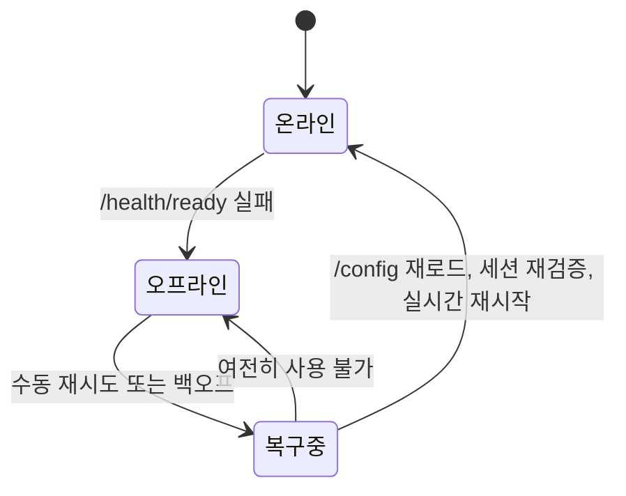

# 데스크톱 앱

B4React에는 같은 React 앱을 macOS, Windows, Linux용으로 패키징하는 선택형 Tauri 2 셸이 포함되어 있습니다. 기본은 여전히 브라우저 앱입니다.

|               |                                       |
| ------------- | ------------------------------------- |
| **필요 조건** | Rust와 플랫폼별 Tauri 의존성          |
| **개발**      | `make frontend-desktop-dev`           |
| **빌드**      | `make frontend-desktop-build`         |
| **CI**        | `.github/workflows/desktop-build.yml` |

## 서버 지정

패키징된 앱에는 같은 origin의 백엔드가 없으므로 빌드할 때 `VITE_API_BASE_URL`을 배포된 API origin으로 지정하고, 앱 origin(`tauri://localhost`)을 `CORS_ORIGINS`에 허용합니다. 기본 `CORS_ORIGINS`에는 이미 포함되어 있습니다.

## 연결 복구

1. 앱이 `/health/ready`를 확인해 서버 가용성을 추적합니다.
2. 서버를 사용할 수 없는 동안 API와 실시간 작업을 멈추고 연결 끊김 상태를 표시합니다. 로컬 세션은 유지됩니다.
3. 수동 재시도와 백오프로 다시 연결합니다.
4. 복구되면 `/config`를 다시 불러오고, 세션을 재검증하고, 실시간 구독을 다시 시작하고, 오래된 데이터를 갱신합니다.

브라우저 앱은 이 확인을 시작하지 않습니다.

## 빌드 파이프라인

데스크톱 워크플로우는 수동 실행, 야간 스케줄, 릴리스, `v*` 태그에서 macOS Apple Silicon, macOS Intel, Linux x64, Windows x64 번들을 빌드합니다.

- API origin은 `api_base_url` 입력, `DESKTOP_API_BASE_URL` 변수, `http://localhost:8000` 순서로 정해집니다.
- 번들은 워크플로우 아티팩트로 업로드되고, 릴리스와 태그에서는 GitHub Release에도 첨부됩니다.
- 아티팩트는 서명되지 않았습니다. 공개 배포에는 macOS·Windows 서명과 공증이 추가로 필요합니다.

## 식별 정보

`project.json`은 npm·Make 실행기를 통해 제품 이름, 창 제목, 번들 식별자를 설정합니다. [프로젝트 초기화](/docs/getting-started/project-initialization)를 참고하세요. 네이티브 설치 아이콘은 `src-tauri/icons`에 유지됩니다.
