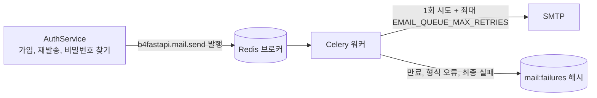

# 이메일

영어나 한국어로 렌더링되어 독립 Celery 워커가 발송하는 가입 인증 메일과 비밀번호 재설정 메일입니다.

|                |                                                                                                                                               |
| -------------- | --------------------------------------------------------------------------------------------------------------------------------------------- |
| **활성화**     | `EMAIL_ENABLED=true`(`LOGIN_ENABLED=true` 필요)                                                                                               |
| **필요 조건**  | SMTP 자격 증명, 실제 Redis, 실행 중인 [Celery 워커](/docs/features/background-jobs)                                                           |
| **설정**       | `EMAIL_FROM`, `EMAIL_BRAND_NAME`, `SMTP_*`, `EMAIL_VERIFICATION_TOKEN_EXPIRE_MINUTES`, `PASSWORD_RESET_TOKEN_EXPIRE_MINUTES`, `EMAIL_QUEUE_*` |
| **엔드포인트** | `/api/v1/auth/verify-email`, `resend-verification`, `forgot-password`, `reset-password`                                                       |

## 동작

| 흐름            | 이메일 활성화                         | 이메일 비활성화(기본값) |
| --------------- | ------------------------------------- | ----------------------- |
| 가입            | 미인증 상태로 시작하고 인증 링크 발송 | 즉시 인증된 계정        |
| 로그인          | 미인증 계정은 `EMAIL_NOT_VERIFIED`    | 인증 확인 없음          |
| 비밀번호 재설정 | 재설정 링크 발송                      | 사용 불가               |

요청 확인 화면은 계정 존재 여부를 드러내지 않습니다.

## 발송

1. API는 `b4fastapi.mail.send` 작업을 발행하며 SMTP를 직접 보내지 않습니다.
2. 워커는 SMTP를 한 번 시도하고, 실패하면 `EMAIL_QUEUE_RETRY_DELAY_SECONDS` 간격으로 최대 `EMAIL_QUEUE_MAX_RETRIES`(기본 3)회 재시도합니다.
3. 만료되었거나 형식이 잘못된 작업은 발송하지 않고 보관합니다.
4. 최종 실패는 Redis 해시 `<CELERY_KEY_PREFIX>mail:failures`에 작업 ID를 키로 저장됩니다.

:::warning[운영 참고]

- Celery `SUCCESS`는 처리가 끝났다는 뜻이며 메일이 전달되었다는 뜻이 아닙니다.
- 실패 보관소에는 수신자와 비밀 링크가 들어 있습니다. Redis 접근을 제한하고 보관 정책을 정하세요. 보관된 메일을 재발송하지 말고 사용자에게 새 링크를 요청하게 합니다.
- `SMTP_VALIDATE_ON_STARTUP=true`이면 워커가 시작할 때 SMTP 연결을 확인합니다.

:::

## 템플릿

인증 메일과 재설정 메일은 하나의 480px 표 기반 레이아웃을 공유하며, 일반 텍스트 대체본과 눈에 보이는 대체 링크를 포함합니다. 웹 폰트, 스크립트, 원격 에셋은 불러오지 않습니다.

## 코드

- `src/backend/app/core/mail/`(서비스, 큐, 템플릿)
- `src/backend/app/core/celery/mail.py`
