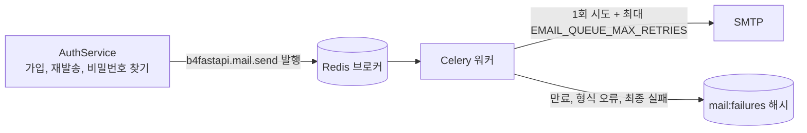
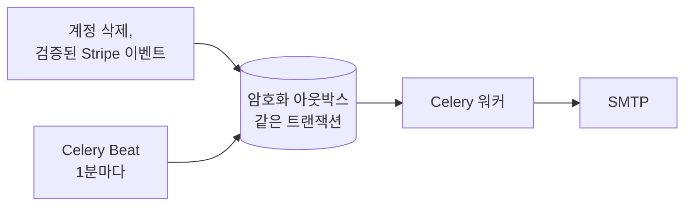

# 이메일

영어나 한국어로 렌더링되어 독립 Celery 워커가 발송하는 계정 메일(가입 인증, 비밀번호 재설정, 환영 메일, 삭제 코드)과 생명주기 알림(구독, 계정 삭제)입니다.

|                |                                                                                                                                               |
| -------------- | --------------------------------------------------------------------------------------------------------------------------------------------- |
| **활성화**     | `EMAIL_ENABLED=true`(`LOGIN_ENABLED=true` 필요)                                                                                               |
| **필요 조건**  | SMTP 자격 증명, 실제 Redis, 실행 중인 [Celery 워커](/docs/features/background-jobs), 생명주기 알림용 Beat 1개                                 |
| **설정**       | `EMAIL_FROM`, `EMAIL_BRAND_NAME`, `SMTP_*`, `EMAIL_VERIFICATION_TOKEN_EXPIRE_MINUTES`, `PASSWORD_RESET_TOKEN_EXPIRE_MINUTES`, `EMAIL_QUEUE_*` |
| **엔드포인트** | `/api/v1/auth/verify-email`, `resend-verification`, `forgot-password`, `reset-password`                                                       |

## 동작

| 흐름            | 이메일 활성화                             | 이메일 비활성화(기본값) |
| --------------- | ----------------------------------------- | ----------------------- |
| 가입            | 미인증 상태로 시작하고 인증 링크 발송     | 즉시 인증된 계정        |
| 로그인          | 미인증 계정은 `EMAIL_NOT_VERIFIED`        | 인증 확인 없음          |
| 비밀번호 재설정 | 재설정 링크 발송                          | 사용 불가               |
| 계정 활성화     | 인증 완료 또는 첫 OAuth 가입 후 환영 메일 | 메일 없음               |
| 계정 삭제       | 6자리 코드, 이후 삭제 완료 안내           | 사용 불가               |

요청 확인 화면은 계정 존재 여부를 드러내지 않습니다.

## 발송

1. API는 `b4fastapi.mail.send` 작업을 발행하며 SMTP를 직접 보내지 않습니다.
2. 워커는 SMTP를 한 번 시도하고, 실패하면 `EMAIL_QUEUE_RETRY_DELAY_SECONDS` 간격으로 최대 `EMAIL_QUEUE_MAX_RETRIES`(기본 3)회 재시도합니다.
3. 만료되었거나 형식이 잘못된 작업은 발송하지 않고 보관합니다.
4. 최종 실패는 Redis 해시 `<CELERY_KEY_PREFIX>mail:failures`에 작업 ID를 키로 저장됩니다.

:::warning[운영 참고]

- Celery `SUCCESS`는 처리가 끝났다는 뜻이며 메일이 전달되었다는 뜻이 아닙니다.
- 실패 보관소에는 수신자와 비밀 링크가 들어 있습니다. Redis 접근을 제한하고 보관 정책을 정하세요. 보관된 메일을 재발송하지 말고 사용자에게 새 링크를 요청하게 합니다.
- `SMTP_VALIDATE_ON_STARTUP=true`이면 워커가 시작할 때 SMTP 연결을 확인합니다.

:::

## 생명주기 이메일 \{#lifecycle-email\}

구독과 계정 삭제 알림은 내구성 있는 아웃박스를 거치므로, 커밋된 변경이 데이터베이스와 큐 사이에서 유실되지 않습니다.

| 알림        | 발송 시점                                                |
| ----------- | -------------------------------------------------------- |
| 구독 시작   | 구독의 첫 `invoice.paid`                                 |
| 요금제 변경 | 요금제 변경이 적용될 때(`customer.subscription.updated`) |
| 구독 해지   | 요청한 해지가 완료될 때(`customer.subscription.deleted`) |
| 계정 삭제   | 삭제 트랜잭션이 커밋될 때                                |

갱신과 결제 실패는 메일을 보내지 않습니다.

- 결제 알림에는 [Stripe 웹훅](/docs/features/billing#webhooks-and-the-subscription-snapshot)이 필요합니다. 알림을 저장하기 전에 서명, 모드, 현재 제공자 상태를 확인하며 의미 기반 키로 중복을 막습니다.
- 수신자 정보는 `SECRET_KEY`에서 파생한 키로 암호화되고, 발송 후 삭제되며 72시간 안에 발송되지 않아도 삭제됩니다. `SECRET_KEY`를 교체하기 전에 대기 중인 메일을 모두 처리합니다.
- 발송은 5분 리스로 최대 5회 시도합니다. SMTP가 수락한 뒤 프로세스가 중단되면 메일이 중복될 수 있으며, 정확히 한 번이 아닌 최소 한 번 전달입니다.
- 메일이나 브로커 장애는 커밋된 삭제나 구독 변경을 되돌리지 않습니다.

## 템플릿

모든 메일은 하나의 480px 표 기반 레이아웃과 일반 텍스트 대체본을 공유합니다. 링크 메일은 눈에 보이는 대체 링크를 포함하고, 삭제 코드 메일은 버튼 대신 코드를 보여주며 링크가 없습니다. 웹 폰트, 스크립트, 원격 에셋은 불러오지 않습니다. 브랜드 기본값은 `B4A`이며 `EMAIL_BRAND_NAME`으로 바꾼 뒤 워커를 다시 만듭니다.

## 코드

- `src/backend/app/core/mail/`(서비스, 큐, 템플릿)
- `src/backend/app/core/celery/mail.py`, `core/celery/notifications.py`
- `src/backend/app/services/notifications.py`, `services/billing_notifications.py`
