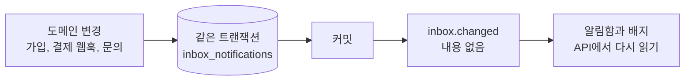

# 알림함

로그인한 모든 사용자는 앱 내 알림을 모아 두는 영속 알림함을 가집니다. 기록은 이메일과 별도로 데이터베이스에 저장되므로 실시간 이벤트를 놓쳐도 남아 있고, `EMAIL_ENABLED=false`에서도 동작합니다.

|                |                                                                                        |
| -------------- | -------------------------------------------------------------------------------------- |
| **사용**       | 로그인 사용자에게 항상 제공                                                            |
| **엔드포인트** | `/api/v1/inbox`(목록, `summary`, `read-all`, `read-selected`, `{id}/read`, `selected`) |
| **프론트엔드** | 프로필 메뉴의 **알림함**(`/notifications`)                                             |
| **실시간**     | [이벤트 스트림](/docs/features/realtime-events)의 `inbox.changed`                      |
| **저장소**     | `inbox_notifications` 테이블                                                           |

## 아키텍처

- 생성자는 자신의 도메인 트랜잭션 안에서 기록을 쓰고 커밋도 직접 책임집니다. 공개 생성 엔드포인트는 없습니다.
- 커밋 후 `inbox.changed`가 사용자의 열린 클라이언트에 다시 읽으라고 알립니다. 이벤트에는 메시지 내용이 없으며, 재연결과 창 포커스 때도 기준 상태를 다시 읽습니다.
- 동작 링크는 애플리케이션 상대 경로만 허용하며 외부 URL은 쓰지 않습니다. 제목은 최대 160자, 본문은 최대 2,000자입니다.

## 알림이 만들어지는 경우

| 종류                   | 생성 시점                                             | 받는 사람            |
| ---------------------- | ----------------------------------------------------- | -------------------- |
| `welcome`              | 이메일 또는 OAuth 가입, 가입 트랜잭션 안에서          | 새 사용자            |
| `subscription_started` | 검증된 Stripe 웹훅이 새 구독을 확인                   | 구독자               |
| `plan_changed`         | 검증된 웹훅이 적용된 플랜 변경이나 요청한 해지를 확인 | 구독자               |
| `inquiry_received`     | 사용자가 [문의](/docs/features/support)를 등록        | 작성자와 활성 관리자 |
| `inquiry_reply`        | 사용자나 관리자가 답글 작성                           | 상대방               |
| `inquiry_status`       | 관리자가 문의 상태를 변경                             | 작성자               |

결제 알림은 고유한 전달 키로 중복을 막으므로 웹훅이 재시도되어도 중복이 생기지 않으며, 이메일이 꺼져 있어도 만들어집니다. 기존 계정에 대해 소급 생성하지 않습니다.

## 읽기와 삭제

- 목록은 페이지 단위이며(`page_size` 1–100, 기본 20) 읽지 않은 항목만 볼 수 있습니다. 모든 요청은 관리자를 포함해 현재 사용자로 범위가 제한되며, API 키는 소유자 권한으로 동작합니다.
- **내용 보기**는 전체 알림을 모달로 열고 읽음으로 표시합니다. 모달에는 닫기만 있고 삭제는 목록에서 합니다.
- 행 체크박스와 헤더 체크박스는 현재 페이지를 선택합니다. **선택 읽음**과 **선택 삭제**는 소유한 ID 최대 100개의 명시적 목록에 적용되며, 삭제는 확인을 받습니다.
- **모두 읽음**은 사용자가 본 가장 최신 ID까지만 처리하므로 그 사이에 도착한 알림은 읽지 않은 상태로 남습니다.
- 삭제된 기록은 제목, 본문, 링크가 지워지지만 전달 키는 tombstone으로 남아, 재시도된 웹훅이 다시 만들 수 없습니다. 삭제된 기록은 목록, 개수, 읽기에 나타나지 않습니다.
- 계정을 삭제하면 해당 사용자의 알림함도 삭제됩니다.

## 프론트엔드

**알림함**은 프로필 메뉴에서 프로필 바로 아래에 있으며, 읽지 않은 개수 배지는 최대 `99+`로 표시됩니다. 페이지는 사용자가 진입한 사이드바 계열 안에서 열리고 관리자 표를 재사용합니다. 필터나 페이지를 바꾸면 응답이 올 때까지 이전 표를 보여 주고 동작 버튼만 비활성화합니다.

## 코드

- 백엔드: `routers/v1/inbox.py`, `services/inbox.py`, `models/inbox.py`, `core/realtime/domain_events/inbox.py`
- 프론트엔드: `src/frontend`의 `/notifications` 페이지와 `hooks/realtime/` 알림함 처리
