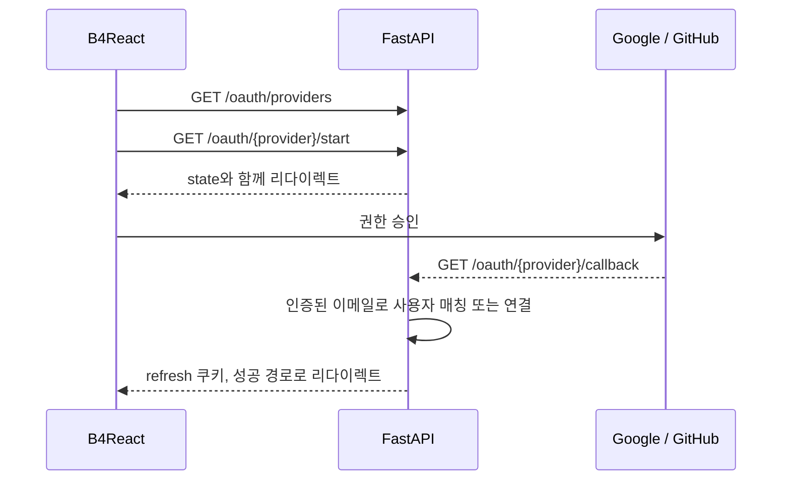

# OAuth

Google과 GitHub 로그인입니다. 제공자 계정은 같은 인증된 이메일을 가진 기존 계정에 연결됩니다.

|                |                                                                                                                                                           |
| -------------- | --------------------------------------------------------------------------------------------------------------------------------------------------------- |
| **활성화**     | `OAUTH_ENABLED=true`(`LOGIN_ENABLED=true` 필요)                                                                                                           |
| **설정**       | `OAUTH_ALLOWED_PROVIDERS`, `OAUTH_GOOGLE_*`, `OAUTH_GITHUB_*`, `OAUTH_STATE_EXPIRE_MINUTES`, `OAUTH_FRONTEND_SUCCESS_PATH`, `OAUTH_FRONTEND_FAILURE_PATH` |
| **엔드포인트** | `/api/v1/auth/oauth/providers`, `/oauth/{provider}/start`, `/oauth/{provider}/callback`                                                                   |

## 설정 방법

1. Google 또는 GitHub에서 OAuth 앱을 만듭니다.
2. 콜백 URL `<백엔드 origin>/api/v1/auth/oauth/<provider>/callback`을 등록합니다. 예: `http://localhost:8000/api/v1/auth/oauth/github/callback`
3. `OAUTH_<PROVIDER>_CLIENT_ID`와 `OAUTH_<PROVIDER>_CLIENT_SECRET`을 설정합니다.
4. 표시할 제공자를 `OAUTH_ALLOWED_PROVIDERS`에 나열합니다(기본 `google,github`).
5. `OAUTH_ENABLED=true`로 설정하고 백엔드를 재시작합니다.

authorize, token, user-info URL은 각 제공자의 공개 엔드포인트가 기본값이라 거의 바꿀 필요가 없습니다.

## 흐름

1. 로그인 대화상자는 `/oauth/providers`에서 활성화된 제공자를 표시합니다. 비활성화된 제공자는 숨겨집니다.
2. `/oauth/{provider}/start`는 `OAUTH_STATE_EXPIRE_MINUTES` 동안 유효한 state 값과 함께 제공자로 리다이렉트합니다.
3. 콜백은 refresh 쿠키로 로그인시키고 `OAUTH_FRONTEND_SUCCESS_PATH`로, 실패하면 `OAUTH_FRONTEND_FAILURE_PATH`로 리다이렉트합니다.
4. 연결된 제공자는 사용자의 `oauth_providers`와 **설정 → 계정**에 표시됩니다.

## 계정 매칭

| 상황                          | 결과                         |
| ----------------------------- | ---------------------------- |
| 제공자 이메일이 인증되지 않음 | 로그인 거부                  |
| 제공자 계정이 이미 연결됨     | 해당 사용자로 로그인         |
| 같은 이메일의 사용자가 있음   | 그 사용자에 제공자 계정 연결 |
| 일치하는 사용자 없음          | 인증된 새 사용자 생성        |

해당 계정에 연결할 수 없는 제공자 계정은 `OAUTH_IDENTITY_CONFLICT`로 거부됩니다.
