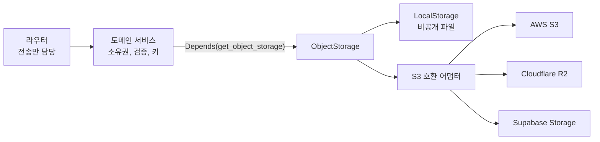
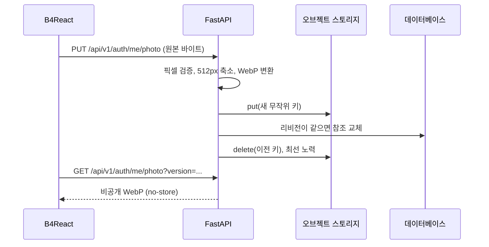

# 오브젝트 스토리지

도메인 서비스가 특정 업체 SDK나 파일 경로에 의존하지 않고 파일을 저장·조회·삭제할 수 있게 하는 백엔드 스토리지 인터페이스입니다. 첫 사용처는 프로필 사진입니다.

|             |                                                                                              |
| ----------- | -------------------------------------------------------------------------------------------- |
| **활성화**  | 항상 활성화, 기본값 `OBJECT_STORAGE_PROVIDER=local`                                          |
| **선택지**  | `local`, `s3`(AWS 또는 다른 S3 호환 업체), `r2`, `supabase`                                  |
| **설정**    | `OBJECT_STORAGE_*` — [환경변수](/docs/environment/environment-variables#object-storage) 참고 |
| **시작 시** | 필수 구성 요소이며, 스토리지 검사에 실패하면 시작이 중단됨                                   |

## 아키텍처

- `app/core/object_storage/`는 `ObjectStorage` 프로토콜, 불변 `ObjectMetadata`(키, 크기, 콘텐츠 타입), 정제된 `StorageError` 코드를 정의합니다.
- 프로바이더는 FastAPI lifespan에서 한 번 만들어 `app/deps.py`의 `get_object_storage`로 제공하고 종료 시 닫습니다. HTTP가 아닌 워커는 `create_object_storage(SETTINGS)`로 만들고 직접 닫습니다.
- 라우터와 모델은 SDK를 직접 만들지 않습니다. 이미지 검증, 키 이름, 교체 정책은 스토리지 코어가 아닌 도메인이 담당합니다.
- 세 원격 선택지는 하나의 S3 어댑터를 공유하며 기본값과 필수 설정만 다릅니다.

## 연산

| 연산                            | 동작                                               |
| ------------------------------- | -------------------------------------------------- |
| `put(key, bytes, content_type)` | 객체를 저장하거나 교체하고 메타데이터 반환         |
| `get(key)`                      | 크기 제한이 있는 바이트와 메타데이터 반환          |
| `stat(key)`                     | 메타데이터만 반환                                  |
| `delete(key)`                   | 객체가 이미 없어도 성공                            |
| `check_connection()`            | 로컬: 임시 파일 쓰기·읽기·삭제. 원격: `HeadBucket` |

- 키는 512자 이하의 이식 가능한 ASCII 경로이며 절대 경로, 점 세그먼트, 백슬래시, URL을 허용하지 않습니다.
- 객체 크기는 `OBJECT_STORAGE_MAX_BYTES`(기본 8 MiB)로 제한됩니다.
- 오류는 `NOT_FOUND`, `ACCESS_DENIED`, `UNAVAILABLE`, `TOO_LARGE`, `INVALID_INPUT`, `CORRUPT_OBJECT`, `CLOSED` 중 하나이며, 도메인이 자신의 HTTP 오류로 변환합니다.
- 블로킹 I/O는 제한된 스레드 풀에서 실행됩니다. 원격 호출은 연결·읽기 시간 제한과 함께 최대 3회 시도합니다.
- 원격 장애 시 로컬로 대체하지 않으며, 버킷·ACL·공개 URL·서명 URL을 만들지 않습니다.

## 프로바이더

| 프로바이더 | 엔드포인트                                                      | 리전             | 자격 증명                                   |
| ---------- | --------------------------------------------------------------- | ---------------- | ------------------------------------------- |
| `local`    | —                                                               | —                | 없음, `OBJECT_STORAGE_LOCAL_ROOT` 아래 파일 |
| `s3`       | AWS는 비움, 또는 사용자 지정 S3 호환 엔드포인트                 | 필수             | 명시적 키 또는 AWS SDK 자격 증명 체인       |
| `r2`       | `https://<ACCOUNT_ID>.r2.cloudflarestorage.com`(버킷 경로 제외) | `auto`           | R2 S3 액세스 키와 시크릿                    |
| `supabase` | `https://<PROJECT_REF>.storage.supabase.co/storage/v1/s3`       | 프로젝트 S3 리전 | Supabase S3 키(anon·service-role 키 아님)   |

운영 환경의 원격 엔드포인트는 HTTPS여야 합니다. `HeadBucket`은 버킷 접근만 증명하므로, 배포 전에 객체 쓰기·삭제 권한을 별도로 확인합니다.

## 로컬 스토리지

- 객체 하나는 헤더, JSON 메타데이터, 원본 바이트를 담은 비공개 파일 하나이며, 임시 파일·`fsync`·원자적 교체로 기록합니다.
- 논리 키는 해시되어 평면 파일 이름이 됩니다. 심볼릭 링크와 일반 파일이 아닌 항목은 거부합니다.
- `OBJECT_STORAGE_LOCAL_ROOT`가 비어 있으면 `src/backend/data/object-storage`를 사용합니다. Docker는 앱과 Celery 워커 모두에 `object_storage_data` 볼륨을 `/var/lib/b4fastapi/objects`로 마운트합니다.
- 스토리지 디렉터리나 볼륨은 데이터베이스와 함께 백업합니다. `docker compose down -v`는 이를 삭제합니다.
- 이 디렉터리를 정적 파일로 제공하지 않습니다.

프로바이더, 버킷, 루트를 바꿔도 기존 객체는 이전되지 않습니다.

## 프로필 사진

| 엔드포인트                     | 동작                                                                                                                                                 |
| ------------------------------ | ---------------------------------------------------------------------------------------------------------------------------------------------------- |
| `PUT /api/v1/auth/me/photo`    | 최대 8 MiB 원본 이미지. PNG, JPEG, WebP, GIF 픽셀을 검증하고(최대 1,600만 픽셀) 방향을 적용해 512px 이내로 축소한 뒤 메타데이터를 제거해 WebP로 저장 |
| `GET /api/v1/auth/me/photo`    | 본인의 현재 사진만 `private, no-store`, `nosniff`로 반환. 이전 버전은 404                                                                            |
| `DELETE /api/v1/auth/me/photo` | 참조를 지운 뒤 객체를 삭제. 반복 호출도 성공                                                                                                         |

- 사용자 레코드에는 버전이 붙은 비공개 API 참조만 저장하며, 스토리지 URL이나 자격 증명은 저장하지 않습니다.
- 업로드에 실패하면 현재 사진을 유지합니다. 동시 교체에서 진 요청은 409를 반환하고 그 업로드만 정리합니다.
- B4React는 계정·사진 버전마다 Blob URL 하나를 만들어 설정과 사이드바가 공유하며, 읽기에 실패하면 이니셜을 보여줍니다.
- OAuth 아바타 같은 기존 외부 사진 URL은 계속 표시됩니다.
- 교체된 객체 정리는 최선 노력 방식이며 로그로 남습니다. 무엇이든 삭제하기 전에 참조되지 않은 `profile-photos/` 키를 데이터베이스와 대조합니다.

관리자 [서버 상태](/docs/features/admin-and-roles#server-status)는 설정된 프로바이더와 전송 방식, 포트, 상태, 지연 시간을 보여주며 버킷 이름, 엔드포인트, 경로는 노출하지 않습니다.

## 코드

- 백엔드: `app/core/object_storage/`(`base.py`, `local.py`, `s3.py`), `services/profile_photo.py`, `deps.py`
- 가이드: B4FastAPI의 `notes/object-storage.md`
