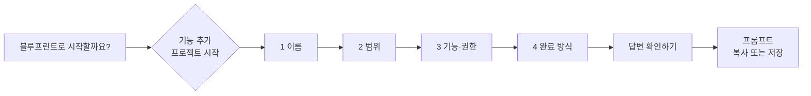

# 프롬프트 만들기

프롬프트 만들기는 서비스 아이디어를 코딩 에이전트가 따를 구현 지시문으로 바꿉니다. 짧은 질문 네 개에 답하면 요구사항, 범위 경계, RBAC 규칙, 검증·완료 단계를 담은 현재 언어의 Markdown을 만듭니다. 모든 처리는 브라우저 안의 템플릿으로 이루어지며 모델 호출, 저장소 분석, 커밋·병합·배포를 하지 않습니다.

|            |                                                                                                     |
| ---------- | --------------------------------------------------------------------------------------------------- |
| **사용**   | 개발·프로덕션 모두 항상 제공                                                                        |
| **경로**   | `/prompt-builder`, 앱 셸 안에서 지연 로딩                                                           |
| **대상**   | 비회원과 로그인 사용자                                                                              |
| **메뉴**   | 모든 [레이아웃](/docs/features/settings-and-profile#layouts)에서 홈 바로 다음의 **프롬프트 만들기** |
| **백엔드** | 없음: 엔드포인트, 설정, 저장소 없음                                                                 |
| **결과**   | 클립보드 복사 또는 `blueprint-<경로>-prompt.md`(UTF-8) 다운로드                                     |

## 흐름

중앙 캡슐을 누르면 **기능 추가**와 **프로젝트 시작** 중 하나를 고릅니다. 두 경로 모두 같은 네 질문을 묻습니다.

| 단계      | 입력                                                                                                                                                 | 필수 여부                        |
| --------- | ---------------------------------------------------------------------------------------------------------------------------------------------------- | -------------------------------- |
| 이름      | 기능 이름, 직접 입력                                                                                                                                 | 필수                             |
| 범위      | 복수 선택 카드 12개: 백엔드, 프론트엔드, UI 디자인, API, 데이터베이스, 인증·권한, 실시간 기능, 백그라운드 작업, 파일 업로드, 결제, 테스트, 배포 구성 | 하나 이상                        |
| 기능·권한 | 복수 선택 기능 카드 6개(추가·수정·삭제, 검색·필터, 알림, 현황·통계, 승인·처리, 파일 첨부), RBAC 표, 선택 입력인 추가 요청                            | 선택, **건너뛰기**로 기본값 유지 |
| 완료 방식 | 에이전트가 어디까지 진행할지: 구현과 로컬 검증, 검토할 PR 생성(추천, 기본값), 검증 후 병합, 배포와 실제 동작 확인                                    | 배포를 고른 경우 배포 대상만     |

- 각 입력에 필수·선택 사항 표시가 붙습니다. 기본적으로 직접 입력할 항목은 이름 하나입니다.
- 확인 화면은 네 항목을 보여 주고 항목마다 **수정**을 제공합니다. 수정으로 새 질문이 생기면 **답변 필요**로 표시합니다. 완료 방식이 더 이상 배포가 아니면 앞서 입력한 배포 대상은 결과에서 빠집니다.
- **프롬프트 완성하기**를 누르면 결과가 나옵니다. **답변 다시 수정**은 이전 화면으로 돌아가고, **새 프롬프트**는 확인을 받은 뒤 두 경로를 모두 초기화합니다.

## RBAC 기본값

표에서 역할별 조회·추가·수정·삭제를 정합니다. 로그인 역할은 데이터 범위도 본인 또는 전체로 고릅니다.

| 역할   | 기본값                                 |
| ------ | -------------------------------------- |
| 비회원 | 접근 불가, 허용해도 공개 데이터에 한정 |
| 회원   | 조회·추가·수정·삭제, 본인 데이터       |
| 매니저 | 조회, 서비스/테넌트 내 전체 데이터     |
| 관리자 | 조회·추가·수정·삭제, 전체 데이터       |

이 값은 프롬프트에 들어갈 수정 가능한 기본값이며 실행 중인 서비스의 [역할](/docs/features/admin-and-roles)을 바꾸지 않습니다.

## 생성되는 프롬프트

결과는 현재 언어로 된 결정적 Markdown입니다.

- **요구사항**: 네 답변과 RBAC 요약, 추가 요청.
- **범위**: 선택한 영역마다 규칙 하나. 선택하지 않은 영역은 범위 밖이며, UI만 고르면 API·업무 규칙·데이터 정책을 바꾸지 않고 백엔드 의존성을 명시합니다.
- **RBAC**: 권한은 서버에서 검증해야 하며, 기존 정책과 충돌하면 약화하지 않고 알립니다.
- **완료 기준**: 기본 확인 항목과 선택한 기능별 동작 확인 항목. 기능을 고르지 않으면 이름과 기존 프로젝트를 바탕으로 최소 동작을 정하고 꼭 필요한 미정 사항만 확인하게 합니다.
- **단계**: 저장소 분석, 설계, 백엔드와 프론트엔드를 모두 고른 경우의 구현 단계, 검증, 통합, 보고.
- **종료점**: 선택한 완료 방식. 범위에서 배포 구성을 골라도 배포를 허용하지 않습니다.

프롬프트는 분석이나 검증이 이미 끝났다고 표현하지 않습니다. 클립보드를 쓸 수 없으면 직접 선택해 복사하거나 Markdown 파일로 저장하도록 안내하며, 저장된 파일은 화면의 텍스트와 동일합니다.

## 상태

- 단계와 답변은 페이지 메모리에 있으며 경로별로 초안을 따로 유지합니다. 페이지를 벗어나거나 새로고침하면 초기화됩니다.
- 영구 저장하거나 API로 전송하지 않습니다. 새 프로바이더, 상태 저장소, 의존성, 백엔드 계약, 실시간·백그라운드 작업을 추가하지 않습니다.
- 페이지가 표시되기 전 기존 설정·서버 연결 확인 경로는 그대로 적용됩니다.

## 프론트엔드

- 페이지는 `MainPageTemplate`의 General 설정 셸, 헤더, 너비, 모바일 여백을 사용합니다. 컨트롤은 공통 `InputField`, `TextareaField`, `FormCheckbox`, `DropdownMenu`, `SelectionCard`, 캡슐형 `Button`, `Modal`입니다.
- 경로·범위 카드는 같은 폭입니다. 배경 효과는 클릭을 가로채지 않으며, 애니메이션 줄이기에서는 단계 전환과 함께 정지합니다.
- 단계를 이동하면 제목으로 포커스를 옮겨 스크린 리더가 읽게 하고, 컨트롤은 공통 포커스 표시를 유지합니다.
- `make test-ui`는 `tests/e2e/prompt-builder.spec.ts`를 실행합니다. 프로덕션의 비회원 두 경로, 확인 화면 수정, 클립보드 성공·실패, 정확한 다운로드, 세 레이아웃, General 화면과의 390·1440px 한국어 라이트·다크 비교를 다룹니다. 프로덕션 라우트 검사는 지연 청크와 직접 새로고침을 확인합니다.

## 코드

- 프론트엔드: `src/frontend`의 `src/pages/prompts/PromptBuilderPage.tsx`(마법사), `src/pages/prompts/promptBuilder.ts`(초안 모델, 검증, 프롬프트 조립), `src/locales/`의 `promptBuilder.*` 문자열
- 백엔드: 없음. B4FastAPI는 B4React 리비전을 고정하고 다른 라우트처럼 제공합니다.
