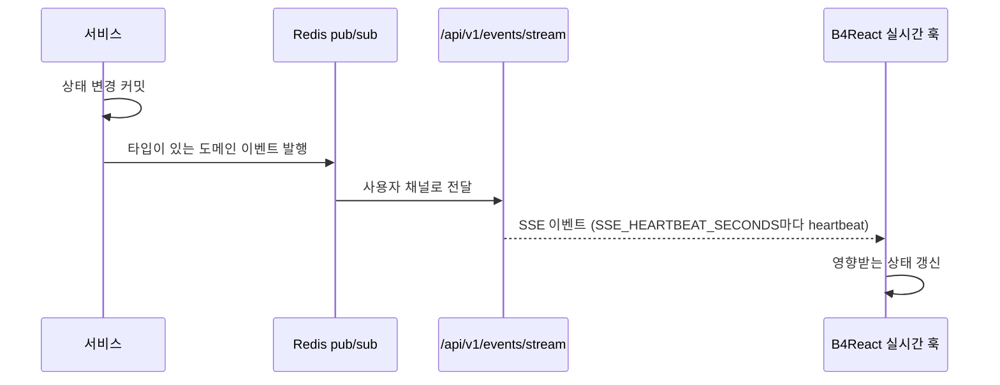

# 실시간 이벤트

사용자별 Server-Sent Events 스트림이 도메인 이벤트를 열린 모든 탭에 전달하므로, 폴링 없이 화면이 갱신됩니다.

|                |                                                                 |
| -------------- | --------------------------------------------------------------- |
| **활성화**     | 로그인한 사용자에게 항상 제공                                   |
| **엔드포인트** | `GET /api/v1/events/stream`(Bearer 토큰 또는 API 키)            |
| **설정**       | `SSE_HEARTBEAT_SECONDS`(기본 20), `SSE_RETRY_MILLIS`(기본 5000) |
| **전송**       | Redis pub/sub, 어느 API 인스턴스에 연결된 사용자에게도 전달     |

## 동작 방식



1. 서비스가 API 키 생성 같은 상태 변경을 완료합니다.
2. 타입이 정의된 도메인 이벤트(`app/core/realtime/domain_events/`)를 Redis 브로커로 발행합니다.
3. 스트림이 사용자 연결로 이벤트를 보내고, `SSE_HEARTBEAT_SECONDS`마다 heartbeat를 보냅니다.
4. B4React의 실시간 훅이 이벤트를 해석하고 영향받는 상태를 한곳에서 갱신합니다.

## 전달 보장

이벤트는 알림이며 메시지 로그가 아닙니다.

- 재전송(replay)은 없습니다. `Last-Event-ID`는 진단용으로만 받습니다.
- 발행은 최선 노력 방식이며 최대 2초로 제한됩니다. 발행이 실패해도 HTTP 결과는 바뀌지 않습니다.
- 재연결, 창 활성화, 데스크톱 복구 후에는 놓친 이벤트를 믿지 않고 다시 조회합니다.

## 이벤트 추가

1. `app/core/realtime/domain_events/<domain>.py`에 이벤트 타입을 정의합니다.
2. 변경이 커밋된 뒤 서비스에서 발행합니다. 라우터는 이벤트를 발행하지 않습니다.
3. `src/frontend/src/hooks/realtime/<domain>/`에서 처리하고 도메인 훅으로 상태를 갱신합니다.

각 저장소 가이드의 백엔드 **도메인 이벤트 루프**와 프론트엔드 **실시간 갱신 루프**에 해당합니다.

예를 들어 `inbox.changed`는 알림함이나 문의가 커밋된 뒤 발행되며 메시지 내용을 담지 않습니다. [알림함](/docs/features/notifications)과 [문의하기](/docs/features/support) 화면은 이 이벤트를 받으면 API에서 다시 읽습니다.

## WebSocket provider(선택) \{#websocket-provider\}

B4React는 양방향 메시지가 필요한 향후 기능을 위해 재사용 가능한 전송 템플릿 `WebSocketProvider`(`src/hooks/realtime/websocket/`)를 제공합니다. 앱에 **마운트되어 있지 않으며** 기본적으로 연결을 열지 않습니다. 백엔드에도 WebSocket 라우트가 없습니다. 알림함과 문의는 계속 SSE를 사용합니다.

```tsx
const connection = useCallback(async (signal: AbortSignal) => {
    // 인가된 { url, protocols? } 정보를 반환하는 도메인 API
    return getAuthorizedSocketConnection(signal);
}, []);

<WebSocketProvider
    enabled={featureEnabled && Boolean(user)}
    sessionKey={user?.id ?? null}
    getConnection={connection}
    onMessage={handleDomainMessage}
>
    <Feature />
</WebSocketProvider>;
```

| 동작   | 규칙                                                                                                                                        |
| ------ | ------------------------------------------------------------------------------------------------------------------------------------------- |
| API    | `useWebSocket()`은 `status`(`idle`, `connecting`, `open`, `reconnecting`, `closed`, `error`), `send(string): boolean`, `reconnect()`를 반환 |
| URL    | 자격 증명이 없는 `ws://` 또는 `wss://`만 허용, 배포에서는 `wss` 사용                                                                        |
| 전송   | 열려 있지 않거나 64 KiB 넘게 버퍼링되면 `false` 반환, 큐에 쌓거나 재전송하지 않음                                                           |
| 재시도 | 1, 2, 4, 8, 16초, 연결당 최대 5회. `reconnect()`는 처음부터 다시 시작. 종료 코드 1000과 1008은 재시도 중단                                  |
| 정리   | 세션 변경, 비활성화, 오프라인 전환, 언마운트 시 대기 중인 생성 함수를 중단하고 소켓을 닫음                                                  |
| 복구   | 브라우저 online 이벤트와 데스크톱 연결 복구 시 다시 연결                                                                                    |

이 템플릿을 쓰는 기능이 연결과 각 메시지의 인증·인가, payload 검증, HTTP 재동기화를 책임집니다. 브라우저는 WebSocket에 `Authorization` 헤더를 설정할 수 없으므로 쿠키와 `Origin` 검증 또는 짧은 수명의 소켓 티켓을 사용하고, 오래 유지되는 bearer 토큰을 URL에 넣지 않습니다. 받은 payload는 `unknown`으로 전달되며 공유 상태에 보관하지 않습니다.
