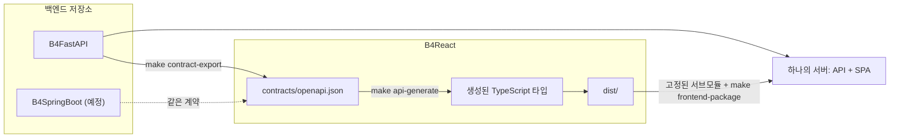

# B4Agent 개요

B4Agent는 에이전틱 코딩을 위한 풀스택 웹 서버 블루프린트입니다. 백엔드 블루프린트, 공유 프론트엔드, 검증 하네스를 함께 제공하므로 팀이나 팀을 대신하는 에이전트가 첫 커밋부터 운영 수준의 구조로 프로젝트를 시작할 수 있습니다.

<CardGrid>
    <Card
        icon="server"
        title="B4FastAPI"
        badge="백엔드"
        href="https://github.com/Blueprint4Agent/B4FastAPI"
    >
        FastAPI, SQLAlchemy, Alembic, Redis, Celery와 Docker 배포를 제공합니다.
    </Card>
    <Card
        icon="frontend"
        title="B4React"
        badge="프론트엔드"
        href="https://github.com/Blueprint4Agent/B4React"
    >
        React, TypeScript, Vite 기반이며 선택형 Tauri 데스크톱 셸을 포함합니다.
    </Card>
    <Card
        icon="leaf"
        title="B4SpringBoot"
        badge="예정"
        badgeTone="planned"
        href="/docs/backends/b4springboot"
    >
        같은 프론트엔드와 API 계약을 사용하는 Spring Boot 백엔드입니다.
    </Card>
</CardGrid>

## 프로젝트 목적

대부분의 템플릿은 실행 가능한 뼈대에서 끝납니다. B4Agent는 에이전트가 프로젝트를 건강하게 유지하는 데 필요한 규칙까지 함께 제공합니다.

- **De facto 우선.** 널리 쓰이는 라이브러리와 관례를 사용하므로 생성된 코드가 팀이 직접 작성한 코드처럼 보입니다.
- **에이전트가 따를 수 있는 가이드.** 모든 저장소에 `AGENTS.md` 읽기 순서, 도메인 가이드, 코드 변경 전에 점검할 런타임 루프가 있습니다.
- **기본 검증.** 변경 범위 기반 검사, 고정된 API 계약, 아키텍처 경계, worklog, Git 거버넌스가 푸시마다 로컬 Git 훅으로 실행됩니다.

## 프로젝트 구성

| 저장소                                                                                    | 역할                                                        | 기술                                            |
| ----------------------------------------------------------------------------------------- | ----------------------------------------------------------- | ----------------------------------------------- |
| [B4FastAPI](https://github.com/Blueprint4Agent/B4FastAPI)                                 | 백엔드 블루프린트, OpenAPI 제공자, 통합 패키징, Docker 배포 | FastAPI, SQLAlchemy, Alembic, Redis, Celery     |
| [B4React](https://github.com/Blueprint4Agent/B4React)                                     | `src/frontend`에 Git 서브모듈로 고정되는 공유 프론트엔드    | React, TypeScript, Vite, Tauri 2, lucide 아이콘 |
| B4SpringBoot                                                                              | 같은 계약을 사용하는 예정된 백엔드 블루프린트               | Spring Boot                                     |
| [Blueprint4Agent.github.io](https://github.com/Blueprint4Agent/Blueprint4Agent.github.io) | 이 매뉴얼                                                   | Docusaurus                                      |

조직은 에이전트 기반 이슈 생성 액션인 [B4Bot](https://github.com/Blueprint4Agent/B4Bot)도 관리합니다. B4Bot은 블루프린트 스택과 독립적이며 이 매뉴얼에서는 다루지 않습니다.

## 구성 요소의 연결 방식

1. 백엔드가 OpenAPI 스키마를 `contracts/openapi.json`으로 내보냅니다.
2. B4React가 그 스냅샷을 채택하고 TypeScript 타입을 생성한 뒤 `dist/`를 빌드합니다.
3. 백엔드는 검토된 B4React 커밋을 고정하고 그 `dist/`를 백엔드 정적 디렉터리에 패키징합니다. 그래서 하나의 서버가 API와 SPA를 함께 제공합니다.
4. B4SpringBoot 같은 두 번째 백엔드도 같은 계약을 구현하면 같은 프론트엔드를 제공할 수 있습니다.

## 다음 단계

<CardGrid columns={2}>
    <Card icon="rocket" title="빠른 시작" href="/docs/getting-started/quick-start">
        클론, 설치 후 백엔드와 프론트엔드를 로컬에서 실행합니다.
    </Card>
    <Card icon="sparkles" title="기능" href="/docs/features">
        바로 동작하는 모든 기능을 기능별 페이지로 정리합니다.
    </Card>
    <Card icon="settings" title="환경 및 옵션" href="/docs/environment">
        환경변수, 데이터 저장소, 옵저버빌리티, Docker, make 타깃을 다룹니다.
    </Card>
    <Card icon="list-checks" title="검증" href="/docs/verification">
        변경 사항을 검사하고 커밋하고 리뷰하는 방법입니다.
    </Card>
</CardGrid>
