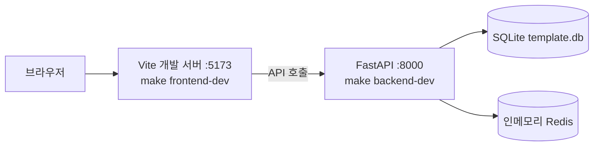

# 빠른 시작

내 컴퓨터에서 B4FastAPI 백엔드와 B4React 프론트엔드를 실행합니다. 기본 로컬 설정은 SQLite와 인메모리 Redis를 사용하므로 Docker 서비스가 필요하지 않습니다.

## 요구 사항

| 도구                                      | 용도                                        |
| ----------------------------------------- | ------------------------------------------- |
| Git                                       | 백엔드와 B4React 서브모듈 클론              |
| [uv](https://docs.astral.sh/uv/)와 Python | 백엔드 의존성, 테스트, env 도구             |
| Node.js 24와 npm                          | B4React 개발, 테스트, 빌드                  |
| Docker와 Compose                          | 선택: PostgreSQL, Redis, 옵저버빌리티, 배포 |
| Rust와 Tauri 플랫폼 의존성                | 선택: 데스크톱 셸                           |

## 1. 프론트엔드 서브모듈과 함께 클론

```bash
git clone --recurse-submodules https://github.com/Blueprint4Agent/B4FastAPI.git
cd B4FastAPI
```

이미 클론한 저장소에서는 `make frontend-init`으로 고정된 B4React 커밋을 체크아웃합니다.

## 2. env 파일 생성과 의존성 설치

```bash
make init       # 예제에서 backend, frontend, docker .env 파일 생성
make install    # 백엔드(uv)와 프론트엔드(npm) 의존성 설치
```

`make init`은 기존 `.env`를 덮어쓰지 않습니다. 새 예제에 추가된 키는 나중에 `make env-sync`로 반영합니다.

## 3. 백엔드와 프론트엔드 실행



터미널 두 개를 사용합니다.

```bash
make backend-dev
```

```bash
make frontend-dev
```

| URL                                  | 내용                                                  |
| ------------------------------------ | ----------------------------------------------------- |
| `http://localhost:5173`              | 컴포넌트 쇼케이스가 포함된 B4React 앱(Vite 개발 서버) |
| `http://localhost:8000/docs`         | FastAPI 백엔드 Swagger UI                             |
| `http://localhost:8000/health/ready` | 데이터베이스와 Redis 준비 상태 확인                   |

:::tip[가입 없이 둘러보기]

루트 경로는 공개 컴포넌트 쇼케이스를 엽니다. 계정 기능은 프로필 메뉴에서 가입한 뒤 사용해 보세요. 기본값인 `EMAIL_ENABLED=false`에서는 이메일 인증을 건너뜁니다.

:::

## 4. 설정 확인

```bash
make verify-plan   # 작업 트리 변경에 필요한 검사를 보여줍니다
make verify        # 그 검사를 실행합니다
```

검사가 선택되는 방식은 [검증](/docs/verification)을 참고하세요.

## 다음 단계

- [프로젝트 초기화](/docs/getting-started/project-initialization)로 복사한 프로젝트의 이름, 브랜드, 기능 스위치를 지정합니다.
- [저장소 구조](/docs/getting-started/repository-layout)에서 어느 저장소가 무엇을 담당하는지 확인합니다.
- [환경 및 옵션](/docs/environment)에서 PostgreSQL, 실제 Redis, Docker로 전환합니다.
