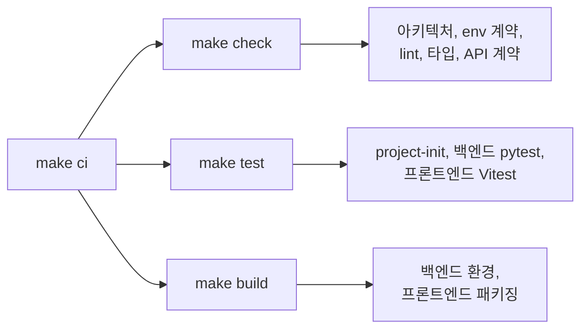

# 검사와 테스트

`make verify`는 직접 실행할 수 있는 같은 타깃 중에서 선택합니다. `make ci`는 전부 로컬에서 실행합니다. 전체 검증은 Git 훅과 영수증 무효화를 테스트하는 `make hooks-test`도 실행하며, `make verification-test`는 변경 분류를 테스트합니다.

## 묶음 타깃



| 타깃         | 실행                                                                                                                                                                     |
| ------------ | ------------------------------------------------------------------------------------------------------------------------------------------------------------------------ |
| `make check` | `project-init-check`, `architecture-check`, `env-contract-check`, `backend-check`, `frontend-format-check`, `frontend-typecheck`, `contract-check`, `frontend-api-check` |
| `make test`  | `project-init-test`, `backend-test`, `frontend-test`                                                                                                                     |
| `make build` | `backend-build`, `frontend-package`                                                                                                                                      |
| `make ci`    | `check`, `test`, `build`                                                                                                                                                 |

## 정적 검사

| 검사                                          | 보장하는 것                                                                                                          |
| --------------------------------------------- | -------------------------------------------------------------------------------------------------------------------- |
| `backend-check`                               | Ruff lint와 포맷                                                                                                     |
| `frontend-format-check`, `frontend-typecheck` | Prettier와 엄격한 TypeScript                                                                                         |
| `backend-architecture-check`                  | 라우터는 DB 계층을 직접 쓰지 않고, 하위 계층은 라우터나 `app.main`을 import하지 않음                                 |
| `frontend-architecture-check`                 | 페이지와 컴포넌트는 API 모듈 대신 도메인 훅을 사용, 공유 스타일은 `app.css`에만, 모든 공유 UI export에 쇼케이스 예제 |
| `frontend-react-performance-check`            | 상태 소유권, 라우트 분할, memo 안전장치                                                                              |
| `env-contract-check`                          | 백엔드와 Docker env 예제가 같은 공유 키를 선언                                                                       |
| `contract-check`                              | 백엔드 OpenAPI 내보내기와 고정된 B4React 스냅샷이 동일                                                               |
| `frontend-api-check`                          | 생성된 TypeScript 타입이 스냅샷과 일치                                                                               |

## 백엔드 테스트

```bash
cd src/backend
uv run pytest                                  # 전체(make backend-test)
uv run pytest -m api_test                      # 라우터 계약 테스트
uv run pytest -m primary_data                  # 통합, 깨끗한 데이터
uv run pytest -m mocked_data                   # 통합, 시드 데이터
uv run pytest -m email_enabled                 # EMAIL_ENABLED=true 동작
uv run pytest -m "mocked_data and scenario_flow"   # 전체 시스템 시나리오
```

## 프론트엔드 테스트

| 타깃                        | 실행                                                                                          |
| --------------------------- | --------------------------------------------------------------------------------------------- |
| `make frontend-test`        | Vitest 단위·컴포넌트 테스트                                                                   |
| `make test-ui`(B4React)     | Chromium: 프롬프트 만들기, 컴포넌트 레이아웃, 툴팁, 대비, 인증 스모크, 관리자 패널, 설정 공유 |
| `make frontend-test-routes` | 프로덕션 빌드: lazy 라우트, 지연·실패한 청크 다운로드                                         |
| `make project-build-test`   | 영어·한국어 커스텀 브랜드 프로덕션 빌드                                                       |

## 런타임 루프

커밋 전에 관련 루프를 따랐는지 확인하고, 해당하지 않으면 이유를 기록합니다.

| 영역       | 루프            | 확인할 점                                                                 |
| ---------- | --------------- | ------------------------------------------------------------------------- |
| 백엔드     | 요청 생명주기   | 라우터 → `deps.py` → 서비스 → 모델·DB → 도메인 결과 또는 예외 → 핸들러    |
| 백엔드     | 도메인 이벤트   | 서비스가 커밋 후 타입이 있는 이벤트를 발행, 라우터는 발행하지 않음        |
| 백엔드     | 백그라운드 작업 | 느리거나 재시도가 필요한 작업은 최소 payload로 큐에 넣고 멱등하게 처리    |
| 프론트엔드 | API 상태        | 페이지 → 도메인 훅 → 생성된 타입을 쓰는 API 래퍼, 컴포넌트는 props로 받음 |
| 프론트엔드 | 실시간 갱신     | 도메인 실시간 훅이 한곳에서 상태 갱신, 재연결 로직은 core에               |
| 프론트엔드 | 데스크톱 연결   | 오프라인 동안 작업 중지, 복구 시 재검증 후 재개                           |
| 프론트엔드 | UI 구성         | 공유 컴포넌트와 `app.css` 재사용, 모바일·데스크톱 폭 확인                 |
