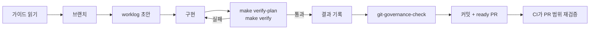
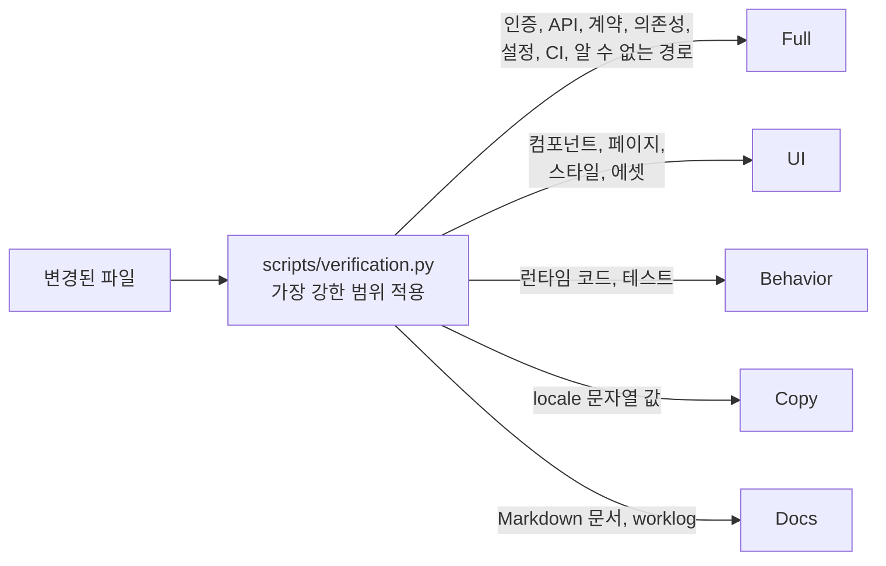

# 검증 프로세스

B4Agent의 모든 작업은 사람이 하든 에이전트가 하든 같은 루프를 따릅니다. 검사는 실제 변경에서 선택되므로 문서 수정에 전체 빌드 비용을 치르지 않고, 위험한 변경은 검사를 건너뛸 수 없습니다.

## 작업 루프



1. **읽기.** `AGENTS.md`, 도메인 가이드(`src/backend/BACKEND.md` 또는 `src/frontend/FRONTEND.md`), 관련 README나 테스트 가이드 순서로 읽습니다.
2. **브랜치.** `<type>/<short-kebab-title>`을 만듭니다.
3. **계획.** `.github/WORKLOG_TEMPLATE.md`로 `worklog/NNNN-title.md`를 작성합니다. 이유, 설계, 검증 계획, 관련 런타임 루프를 적습니다.
4. **구현.** 변경은 하나의 작업 단위로 제한합니다.
5. **검증.** `make verify-plan` 후 `make verify`를 실행합니다.
6. **기록.** 실제 결과와 건너뛴 검사, 그 이유를 worklog에 기록합니다.
7. **메타데이터 검증.** `COMMIT_TITLE=... COMMIT_BODY_FILE=... make git-governance-check`
8. **커밋과 ready PR.** CI가 PR 전체 범위를 다시 검증합니다.

## 변경 범위 기반 검증

```bash
make verify-plan   # 범위와 선택된 명령 표시
make verify        # 실행
```

`scripts/verification.py`가 변경된 파일을 분류합니다. 로컬과 CI는 같은 계획기를 사용합니다.



| 범위     | 변경                                                                 | 검증                                                              |
| -------- | -------------------------------------------------------------------- | ----------------------------------------------------------------- |
| Docs     | Markdown 문서와 worklog(`AGENTS.md` 제외)                            | 텍스트, 공백, UTF-8 검사                                          |
| Copy     | 키, 플레이스홀더, 마크업이 같은 locale JSON 문자열 값                | 중복 키를 포함한 텍스트·JSON 검증                                 |
| Behavior | 보호되지 않은 런타임 유틸리티, 훅, 테스트, 백엔드 애플리케이션 코드  | 영향받는 도메인 검사와 테스트, 프론트엔드 빌드                    |
| UI       | 컴포넌트, 페이지, 스타일, 에셋, 브라우저 테스트                      | 프론트엔드 검사, 테스트, 빌드, 브라우저 UI 스위트                 |
| Full     | 인증, 세션, API, 연결, 계약, 의존성, 설정, CI, 도구, 알 수 없는 경로 | 영향받는 모든 검사, 프로덕션 라우트, 스타일 스튜디오, 통합·패키징 |

- 여러 범위가 섞이면 가장 강한 범위를 따릅니다. 낮추는 플래그나 라벨 우회는 없습니다.
- 백엔드 애플리케이션 변경은 항상 백엔드 전체 테스트를 실행합니다.
- locale 추가·삭제, 키 이름 변경, 보간 변경은 전체 검증이 필요합니다.

### 옵션

| 옵션                                             | 효과                                                   |
| ------------------------------------------------ | ------------------------------------------------------ |
| _(기본값)_                                       | staged·untracked 파일을 포함해 `HEAD`와 작업 트리 비교 |
| `VERIFY_BASE=$(git merge-base origin/main HEAD)` | 브랜치 전체 검증                                       |
| `VERIFY_FULL=1`                                  | 모든 검사 강제 실행                                    |
| `make verify-light`                              | 의존성 설치 없이 텍스트·JSON만 검사                    |
| `python3 scripts/verification.py plan --json`    | 기계가 읽을 수 있는 계획                               |

전체 출력은 `.git/verification-logs/`에 저장되며, 실패하면 마지막 80줄을 출력합니다.

## CI

| 워크플로우       | 필수 검사         | 실행 내용                                        |
| ---------------- | ----------------- | ------------------------------------------------ |
| `build.yml`      | `Backend checks`  | 계획기와 선택된 백엔드·통합 검사                 |
| `build.yml`      | `Frontend checks` | 계획기와 선택된 프론트엔드 검사, 브라우저 테스트 |
| `governance.yml` | `Git governance`  | 브랜치, PR 제목과 섹션, 모든 커밋과 worklog      |

작업은 모든 PR에서 실행되고 선택된 검사가 없어도 결과를 보고하므로 필수 검사가 대기 상태로 남지 않습니다. `main`은 PR, 이 세 가지 검사, 리뷰 스레드 해결을 요구합니다.

## 증거 규칙

- 같은 내용에 대해 이미 통과한 검사는 다시 실행하지 않고 이전 결과를 기록합니다.
- 새 런타임 수정은 이전 런타임 증거를 무효화합니다.
- 관련 수정은 하나의 작업 PR에 모읍니다. 프론트엔드 작업은 B4React를 먼저 병합하고 백엔드 고정 커밋을 한 번만 갱신합니다.
- CI는 감시 프로세스 하나로 확인하고, 모든 로그를 쏟아내지 말고 실패 부분만 읽습니다.
