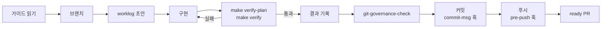
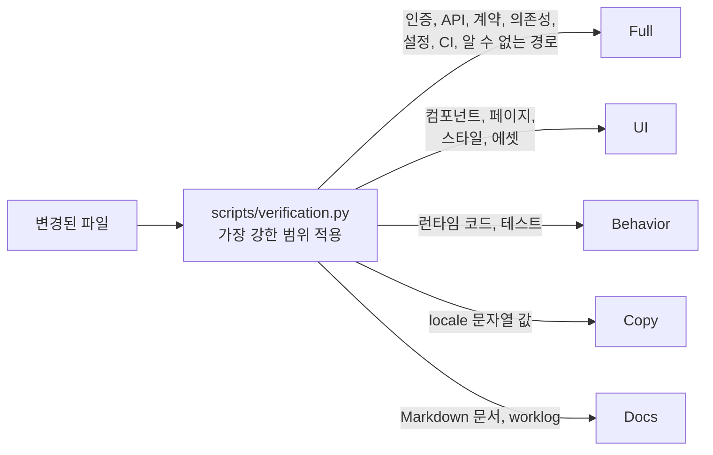
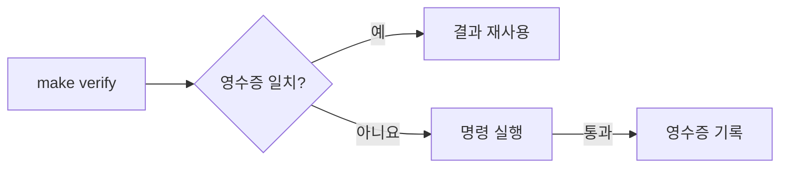

# 검증 프로세스

B4Agent의 모든 작업은 사람이 하든 에이전트가 하든 같은 루프를 따릅니다. 검사는 실제 변경에서 선택되므로 문서 수정에 전체 빌드 비용을 치르지 않고, 위험한 변경은 검사를 건너뛸 수 없습니다.

## 작업 루프



1. **읽기.** `AGENTS.md`, 도메인 가이드(`src/backend/BACKEND.md` 또는 `src/frontend/FRONTEND.md`), 관련 README나 테스트 가이드 순서로 읽습니다.
2. **브랜치.** `<type>/<short-kebab-title>`을 만듭니다.
3. **계획.** `.github/WORKLOG_TEMPLATE.md`로 `worklog/NNNN-title.md`를 작성합니다. 이유, 설계, 검증 계획, 관련 런타임 루프를 적습니다.
4. **구현.** 변경은 하나의 작업 단위로 제한합니다.
5. **검증.** `make verify-plan` 후 `make verify`를 실행합니다.
6. **기록.** 실제 결과와 건너뛴 검사, 그 이유를 worklog에 기록합니다.
7. **메타데이터 검증.** `COMMIT_TITLE=... COMMIT_BODY_FILE=... make git-governance-check`
8. **커밋과 푸시.** `commit-msg` 훅이 메시지와 스테이징된 worklog를 확인하고, `pre-push` 훅이 브랜치 전체를 검증합니다. 이후 ready PR을 열고 `PR_NUMBER=<number> make git-governance-pr-check`로 실제 메타데이터를 확인합니다.

## 변경 범위 기반 검증

```bash
make verify-plan   # 범위와 선택된 명령 표시
make verify        # 실행
```

`scripts/verification.py`가 변경된 파일을 분류합니다. `make verify`, pre-push 훅, 수동 워크플로우가 같은 계획기를 사용합니다.



| 범위     | 변경                                                                 | 검증                                                              |
| -------- | -------------------------------------------------------------------- | ----------------------------------------------------------------- |
| Docs     | Markdown 문서와 worklog(`AGENTS.md` 제외)                            | 텍스트, 공백, UTF-8 검사                                          |
| Copy     | 키, 플레이스홀더, 마크업이 같은 locale JSON 문자열 값                | 중복 키를 포함한 텍스트·JSON 검증                                 |
| Behavior | 보호되지 않은 런타임 유틸리티, 훅, 테스트, 백엔드 애플리케이션 코드  | 영향받는 도메인 검사와 테스트, 프론트엔드 빌드                    |
| UI       | 컴포넌트, 페이지, 스타일, 에셋, 브라우저 테스트                      | 프론트엔드 검사, 테스트, 빌드, 브라우저 UI 스위트                 |
| Full     | 인증, 세션, API, 연결, 계약, 의존성, 설정, CI, 도구, 알 수 없는 경로 | 영향받는 모든 검사, 프로덕션 라우트, 스타일 스튜디오, 통합·패키징 |

- 여러 범위가 섞이면 가장 강한 범위를 따릅니다. 낮추는 플래그나 라벨 우회는 없습니다.
- 백엔드 애플리케이션 변경은 항상 백엔드 전체 테스트를 실행합니다.
- locale 추가·삭제, 키 이름 변경, 보간 변경은 전체 검증이 필요합니다.

### 옵션

| 옵션                                             | 효과                                                   |
| ------------------------------------------------ | ------------------------------------------------------ |
| _(기본값)_                                       | staged·untracked 파일을 포함해 `HEAD`와 작업 트리 비교 |
| `VERIFY_BASE=$(git merge-base origin/main HEAD)` | 브랜치 전체 검증                                       |
| `VERIFY_FULL=1`                                  | 모든 검사 강제 실행                                    |
| `make verify-light`                              | 의존성 설치 없이 텍스트·JSON만 검사                    |
| `python3 scripts/verification.py plan --json`    | 기계가 읽을 수 있는 계획                               |

전체 출력은 `.git/verification-logs/`에 저장되며, 실패하면 마지막 80줄을 출력합니다.

### 영향받는 스위트

같은 범위 안에서도 소유 관계가 등록된 곳만 테스트를 좁힙니다.

- 등록된 결제·관리자 페이지, 기능, 도메인 훅은 각자의 단위·통합·브라우저 스위트를 선택합니다.
- 등록된 컴포넌트의 JSX return 영역만 고친 경우 검토된 렌더 시나리오를 선택합니다. CSS는 바뀐 모든 선택자가 등록된 컴포넌트로 연결될 때만 좁힙니다.
- 정적 검사, 타입, 계약, 빌드, git governance는 항상 실행합니다. 백엔드 애플리케이션 변경은 항상 전체 백엔드 스위트를 실행합니다.
- 공유·미등록·보호 대상(인증, API, 설정)·알 수 없는 변경은 넓은 스위트로 돌아갑니다.

## 검증 영수증

`make verify`는 성공한 명령마다 `.git/verification-receipts/`에 영수증을 저장합니다. 같은 입력으로 같은 명령을 다시 실행하면 영수증을 재사용하므로, pre-push 훅과 상위 통합 단계가 이미 통과한 검사를 반복하지 않습니다.



| 영수증을 무효화하는 것                     | 무효화하지 않는 것 |
| ------------------------------------------ | ------------------ |
| 소스, 설정, 문서, 브랜딩, 빌드 결과물 변경 | worklog만 수정     |
| 도구, 도구 버전, 환경 변경                 | 중복된 `PATH` 항목 |
| 24시간 경과, 손상, 재실행 실패             |                    |

- B4FastAPI는 통합 시 동일한 B4React 영수증을 재사용하되 자체 브랜딩·계약·패키징 검사는 계속 실행합니다.
- 작업마다 하나의 셸과 도구 체인을 사용합니다. 예를 들어 상위 저장소에서 `make -C src/frontend verify`, `git -C src/frontend push`를 실행합니다.
- `VERIFY_FULL=1 make verify`와 수동 워크플로우는 영수증과 범위 축소를 사용하지 않습니다.
- 영수증은 로컬 증거이며 서명된 CI 증명이 아닙니다.

## 로컬 Git 훅 \{#local-git-hooks\}

`make hooks-install`(`make init`이 실행)은 클론과 B4React 서브모듈에 `core.hooksPath=.githooks`를 설정합니다.

| 훅           | 검사 내용                                                                                                                                             |
| ------------ | ----------------------------------------------------------------------------------------------------------------------------------------------------- |
| `commit-msg` | Conventional Commit 제목과 본문, 스테이징된 worklog 일치. 통합 병합은 제외                                                                            |
| `pre-push`   | 서브모듈을 포함한 깨끗한 작업 트리, 푸시 ref와 `HEAD` 일치, 원격 `main`과의 merge base 이후 모든 비병합 커밋, 이어서 `make verify-plan`·`make verify` |

이력·네트워크·의존성이 없거나 검사가 실패하면 푸시가 차단됩니다. `make hooks-test`는 격리된 저장소에서 훅을 테스트합니다.

## GitHub 워크플로우

| 워크플로우          | 실행 내용                                 |
| ------------------- | ----------------------------------------- |
| `build.yml`         | ref나 PR의 전체 검사, 요청 시 이미지 게시 |
| `governance.yml`    | 지정한 PR 번호의 Git governance           |
| `desktop-build.yml` | 선택한 ref의 데스크톱 번들                |

모든 워크플로우는 수동 실행으로만 동작하며, 영수증 없이 전체 검증을 수행합니다. `main`은 PR과 대화 해결을 요구하고 브랜치 삭제와 강제 푸시를 막습니다. 필수 상태 검사는 없고 필수 승인 수는 0입니다. 훅은 건너뛰거나 설치하지 않을 수 있으므로, 기여자와 에이전트는 훅을 설치하고 worklog 증거를 남기며 병합 전에 PR 메타데이터를 확인해야 합니다.

## 증거 규칙

- 같은 내용에 대해 이미 통과한 검사는 다시 실행하지 않고 이전 결과를 기록합니다.
- 새 런타임 수정은 이전 런타임 증거를 무효화합니다.
- 관련 수정은 하나의 작업 PR에 모읍니다. 프론트엔드 작업은 B4React를 먼저 병합하고 백엔드 고정 커밋을 한 번만 갱신합니다.
- 모든 로그를 쏟아내지 말고 실행기의 요약과 실패 부분만 읽습니다.
